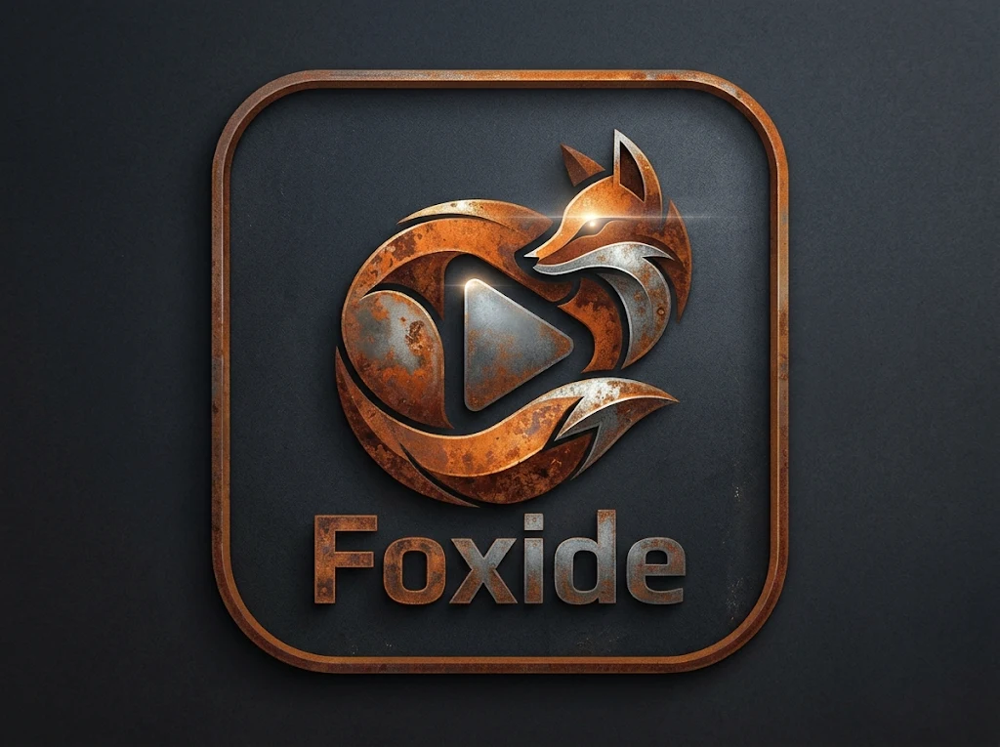
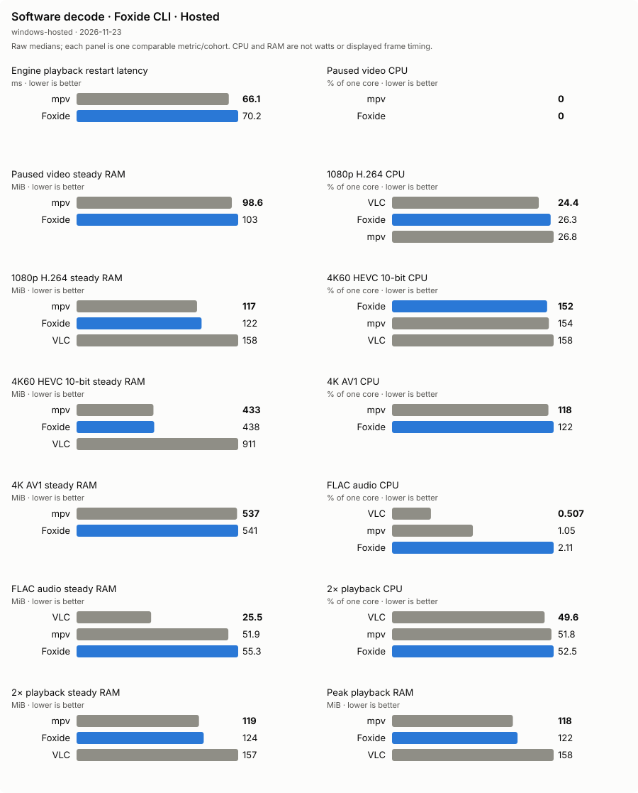
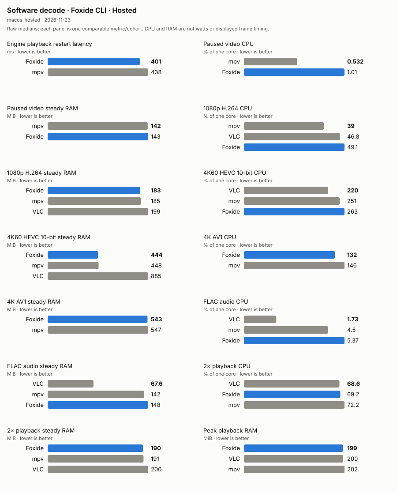
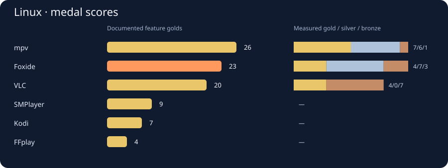
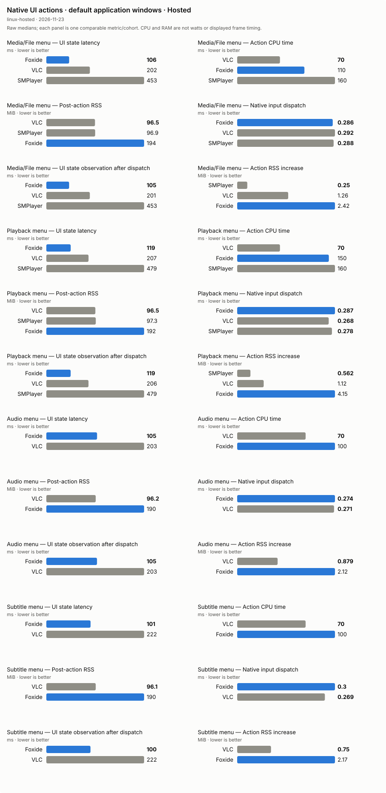
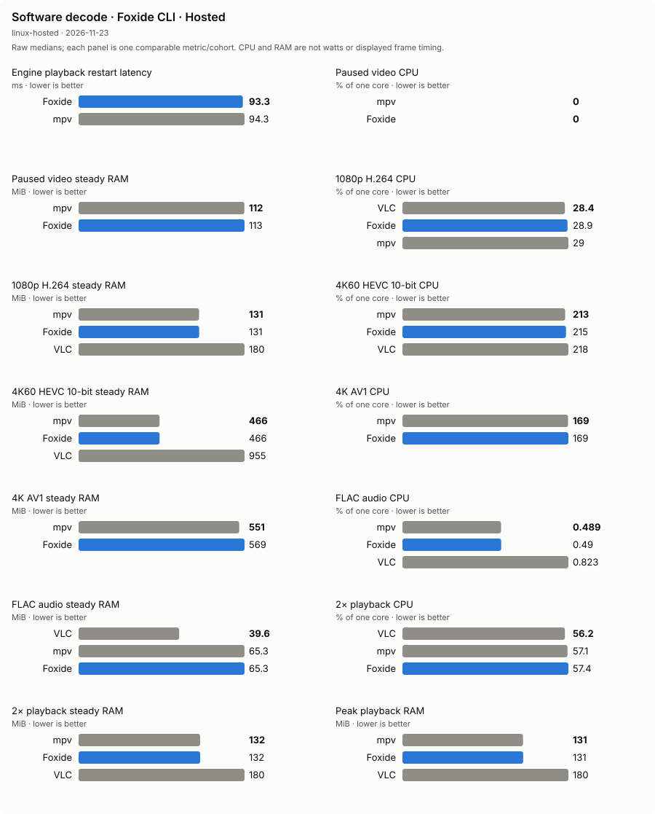

# Foxide

<!-- source-lines:start -->


Physical source lines include comments and blank lines in crates/, scripts/, tests/, .github/, packaging/ and the root Cargo manifest. Vendored code, lockfiles, generated reports and build output are excluded. Refresh with python scripts/source_lines.py.
<!-- source-lines:end -->

<p align="center">
  
</p>

[](https://github.com/marksmayo/foxide/actions/workflows/ci.yml)
[](https://github.com/marksmayo/foxide/actions/workflows/desktop-ui.yml)
[](https://github.com/marksmayo/foxide/actions/workflows/video-render.yml)
[](https://github.com/marksmayo/foxide/actions/workflows/player-games.yml)
[](https://app.codspeed.io/marksmayo/foxide?utm_source=badge)

[](Cargo.toml)
[](docs/desktop.md)
[](docs/architecture.md)
[](docs/security-and-testing.md)
[](docs/security-and-testing.md)
[](LICENSE)

A Rust desktop media player with a Slint desktop preview and a transparent competitor scoreboard. The new desktop embeds libmpv in Foxide's own window; the existing `foxide` CLI still launches external mpv.

```powershell
cargo build -p player-ui --features desktop --bin foxide-desktop --release --locked
.\target\release\foxide-desktop.exe "C:\media\movie.mkv"
```

**Desktop customization:** View → Preferences offers editable keys, light/dark skins and a custom accent. View → Compact music view preserves playback in a smaller dedicated layout. [Settings and the complete feature-parity checklist](docs/feature-parity/README.md).

The desktop needs a libmpv ABI 2 library: Windows `tools/libmpv/libmpv-2.dll` or `FOXIDE_LIBMPV`, macOS `brew install mpv`, Linux your distribution's `libmpv2`. [Desktop setup and current limits](docs/desktop.md) · [UI action benchmarks](docs/ui-benchmarks.md). The UI includes menus, a playlist, file/URL opening, playback/speed/track controls, external subtitles, volume and fullscreen. Native playback, GPU interop and power acceptance remain in progress. Software-OpenGL CI uses a [pinned libmpv scaler-padding fix](third_party/mpv/README.md); downloaded/system libraries require separate runtime acceptance.

```powershell
.\target\release\foxide.exe "C:\media\movie.mkv"
.\target\release\foxide.exe --speed 1.5 --subtitle "C:\media\movie.srt" "C:\media\movie.mkv"
.\target\release\foxide.exe --autoqueue --resume-dir ".\results\local\resume" "C:\series\episode2.mkv"
```

Build with `cargo build --release --locked`. On Windows, `python scripts/install-mpv.py` installs a verified engine under `tools/mpv`; development CLI builds need an explicit `--mpv tools/mpv/mpv.exe` or `FOXIDE_MPV` override. Desktop builds use the separate libmpv setup in [desktop instructions](docs/desktop.md). Playback controls include Space/pause, arrows/seek, Shift+arrows/exact seek, F/fullscreen, J/subtitles, #/audio track, S/screenshot, and Q/quit. Run `foxide --help` for tracks, offsets, tone mapping, picture controls, chapters, URLs, playlists, and window options.

[Performance implementation ledger](docs/performance-review/IMPLEMENTATION.md) · [Capabilities and remaining work](docs/features.md) · [Local players](docs/local-players.md) · [Benchmark protocol](docs/player-games.md) · [Architecture](docs/architecture.md) · [Actions](https://github.com/marksmayo/foxide/actions)

The **Player Games** workflow installs/attempts each platform's native field, records verified playback or labeled frontend diagnostics, produces the GitHub-native graphs, result tables, and expandable feature/metric details below; benchmark branches receive updates for PR review and downloadable HTML remains optional. Feature possession awards shared gold. Performance requires repeated, verified, comparable measurements. Hosted VMs have separate cohorts from physical GPU, battery, and displayed-frame tests.

Development follows red → green tests. CI enforces **90% Rust workspace line coverage** for default features and **90% coverage for medal/report policies and installers**, in separate gates. Feature-gated desktop/native rendering has a separate instrumented GPU CI report; the default-feature threshold does not cover it. [Measured coverage and security follow-up](docs/security-and-testing.md). A separate three-platform desktop workflow builds the GUI and renders a layout preview. Native PiP, thumbnails, drag-and-drop, persistent GUI resume, complete GUI coverage and physical GPU acceptance remain open.

CodSpeed tracks **279 CPU benchmark cases** across playback policy, UI actions, playlists and telemetry processing. [Suite and run commands](docs/codspeed.md) · [Case inventory](benchmarks/codspeed-inventory.json).

[Windows preview release packaging](docs/windows-releases.md) — automated tag builds, checksums and draft releases.

<!-- foxide-scores:start -->
## Benchmark

### Latest results

Every metric is a separate medal event within one platform, host, fixture and settings cohort. Performance requires ≥3 verified repeats and ≥2 comparable entrants. Documented feature support earns shared gold; unknown does not mean unsupported.

Overall feature gold counts each feature once across applicable platforms; performance totals count every eligible field. These totals are not an overall speed ranking.

**Overall**

| Player | 🥇 | 🥈 | 🥉 | Total |
|---|---:|---:|---:|---:|
| mpv | 71 | 29 | 7 | 107 |
| Foxide | 68 | 43 | 22 | 133 |
| VLC | 60 | 14 | 22 | 96 |
| IINA | 33 | 0 | 0 | 33 |
| Infuse | 21 | 0 | 0 | 21 |
| Kodi | 20 | 0 | 0 | 20 |
| SMPlayer | 19 | 2 | 6 | 27 |
| MPC-BE | 19 | 0 | 0 | 19 |
| MPC-HC | 15 | 0 | 0 | 15 |
| PotPlayer | 14 | 0 | 0 | 14 |
| KMPlayer | 13 | 0 | 0 | 13 |
| foobar2000 | 13 | 0 | 0 | 13 |
| GOM Player | 11 | 0 | 0 | 11 |
| Plex | 7 | 0 | 0 | 7 |
| FFplay | 5 | 0 | 0 | 5 |
| QuickTime Player | 5 | 0 | 0 | 5 |
| Windows Media Player | 4 | 0 | 0 | 4 |
| Windows Media Player Legacy | 4 | 0 | 0 | 4 |

**Performance**

| Player | 🥇 | 🥈 | 🥉 | Total |
|---|---:|---:|---:|---:|
| VLC | 35 | 14 | 22 | 71 |
| mpv | 34 | 29 | 7 | 70 |
| Foxide | 29 | 43 | 22 | 94 |
| SMPlayer | 4 | 2 | 6 | 12 |
| FFplay | 0 | 0 | 0 | 0 |
| GOM Player | 0 | 0 | 0 | 0 |
| IINA | 0 | 0 | 0 | 0 |
| Infuse | 0 | 0 | 0 | 0 |
| KMPlayer | 0 | 0 | 0 | 0 |
| Kodi | 0 | 0 | 0 | 0 |
| MPC-BE | 0 | 0 | 0 | 0 |
| MPC-HC | 0 | 0 | 0 | 0 |
| Plex | 0 | 0 | 0 | 0 |
| PotPlayer | 0 | 0 | 0 | 0 |
| QuickTime Player | 0 | 0 | 0 | 0 |
| Windows Media Player | 0 | 0 | 0 | 0 |
| Windows Media Player Legacy | 0 | 0 | 0 | 0 |
| foobar2000 | 0 | 0 | 0 | 0 |

**Features**

| Player | 🥇 | 🥈 | 🥉 | Total |
|---|---:|---:|---:|---:|
| Foxide | 39 | 0 | 0 | 39 |
| mpv | 37 | 0 | 0 | 37 |
| IINA | 33 | 0 | 0 | 33 |
| VLC | 25 | 0 | 0 | 25 |
| Infuse | 21 | 0 | 0 | 21 |
| Kodi | 20 | 0 | 0 | 20 |
| MPC-BE | 19 | 0 | 0 | 19 |
| MPC-HC | 15 | 0 | 0 | 15 |
| SMPlayer | 15 | 0 | 0 | 15 |
| PotPlayer | 14 | 0 | 0 | 14 |
| KMPlayer | 13 | 0 | 0 | 13 |
| foobar2000 | 13 | 0 | 0 | 13 |
| GOM Player | 11 | 0 | 0 | 11 |
| Plex | 7 | 0 | 0 | 7 |
| FFplay | 5 | 0 | 0 | 5 |
| QuickTime Player | 5 | 0 | 0 | 5 |
| Windows Media Player | 4 | 0 | 0 | 4 |
| Windows Media Player Legacy | 4 | 0 | 0 | 4 |

[Raw scores](docs/scoreboards/medals.json) · [Feature sources](docs/scoreboards/features.json) · [Performance protocols](docs/scoreboards/performance-events.json) · [Download optional HTML](docs/scoreboards/report.html)

Windowed fields use **Foxide Desktop**; software-only fields use the **Foxide CLI** launcher. Engine playback evidence is distinct from physical frame presentation. UI-action metrics, displayed TTFF, power and battery results remain pending unless explicitly measured.

### Windows medals

| Player | 🥇 | 🥈 | 🥉 | Total |
|---|---:|---:|---:|---:|
| mpv | 58 | 17 | 4 | 79 |
| Foxide | 47 | 22 | 12 | 81 |
| VLC | 39 | 2 | 13 | 54 |
| Kodi | 20 | 0 | 0 | 20 |
| MPC-BE | 19 | 0 | 0 | 19 |
| MPC-HC | 15 | 0 | 0 | 15 |
| SMPlayer | 15 | 0 | 0 | 15 |
| PotPlayer | 14 | 0 | 0 | 14 |
| KMPlayer | 13 | 0 | 0 | 13 |
| foobar2000 | 13 | 0 | 0 | 13 |
| GOM Player | 11 | 0 | 0 | 11 |
| Plex | 7 | 0 | 0 | 7 |
| FFplay | 5 | 0 | 0 | 5 |
| Windows Media Player | 4 | 0 | 0 | 4 |
| Windows Media Player Legacy | 4 | 0 | 0 | 4 |

**Windows · Software decode · Foxide CLI · Hosted**

| Player | 🥇 | 🥈 | 🥉 | Total |
|---|---:|---:|---:|---:|
| mpv | 9 | 4 | 1 | 14 |
| VLC | 4 | 0 | 5 | 9 |
| Foxide | 2 | 9 | 3 | 14 |


**Windows · Windowed playback · Foxide Desktop · Local**

| Player | 🥇 | 🥈 | 🥉 | Total |
|---|---:|---:|---:|---:|
| mpv | 7 | 6 | 1 | 14 |
| Foxide | 4 | 6 | 4 | 14 |
| VLC | 3 | 2 | 6 | 11 |


**Windows · Software decode · Foxide CLI · Local**

| Player | 🥇 | 🥈 | 🥉 | Total |
|---|---:|---:|---:|---:|
| VLC | 7 | 0 | 2 | 9 |
| mpv | 5 | 7 | 2 | 14 |
| Foxide | 2 | 7 | 5 | 14 |

<details><summary>Windows feature medals — shared gold</summary>

| Feature | Foxide | VLC | mpv | Windows Media Player | Windows Media Player Legacy | MPC-HC | MPC-BE | PotPlayer | SMPlayer | KMPlayer | GOM Player | FFplay | Kodi | Plex | foobar2000 |
|---|---:|---:|---:|---:|---:|---:|---:|---:|---:|---:|---:|---:|---:|---:|---:|
| MP4 and MKV playback | 🥇 | 🥇 | 🥇 | ? | ? | ? | 🥇 | 🥇 | 🥇 | 🥇 | ? | ? | ? | ? | N/A |
| FLAC audio | 🥇 | 🥇 | 🥇 | ? | ? | ? | 🥇 | 🥇 | ? | 🥇 | ? | ? | ? | ? | 🥇 |
| Hardware decoding | 🥇 | 🥇 | 🥇 | ? | ? | ? | 🥇 | 🥇 | ? | 🥇 | ? | ? | 🥇 | ? | N/A |
| Audio track selection | 🥇 | 🥇 | 🥇 | ? | ? | ? | 🥇 | ? | 🥇 | ? | 🥇 | 🥇 | 🥇 | 🥇 | N/A |
| Subtitle track selection | 🥇 | 🥇 | 🥇 | ? | ? | ? | 🥇 | 🥇 | 🥇 | ? | ? | 🥇 | 🥇 | 🥇 | N/A |
| External subtitle files | 🥇 | 🥇 | 🥇 | ? | ? | ? | 🥇 | ? | 🥇 | 🥇 | 🥇 | ? | 🥇 | ? | N/A |
| ASS/SSA subtitle rendering | 🥇 | 🥇 | 🥇 | ? | ? | 🥇 | 🥇 | 🥇 | ? | 🥇 | ? | ? | ? | ? | N/A |
| Variable playback speed | 🥇 | 🥇 | 🥇 | ? | 🥇 | 🥇 | 🥇 | 🥇 | 🥇 | ? | 🥇 | ? | ? | 🥇 | ? |
| Playlists | 🥇 | 🥇 | 🥇 | 🥇 | ? | ? | 🥇 | 🥇 | ? | 🥇 | 🥇 | ? | ? | ? | ? |
| Keyboard controls | 🥇 | 🥇 | 🥇 | 🥇 | ? | 🥇 | ? | ? | ? | ? | 🥇 | 🥇 | ? | 🥇 | 🥇 |
| Frame-accurate seeking | 🥇 | ? | 🥇 | ? | ? | ? | ? | ? | ? | ? | ? | ? | ? | ? | N/A |
| Seekbar thumbnail previews | ? | ? | ? | ? | ? | 🥇 | 🥇 | ? | ? | ? | ? | ? | ? | ? | N/A |
| HDR video playback | 🥇 | ? | 🥇 | ? | ? | 🥇 | 🥇 | 🥇 | ? | ? | ? | ? | ? | ? | N/A |
| HDR to SDR tone mapping | 🥇 | ? | 🥇 | ? | ? | ? | ? | 🥇 | ? | ? | ? | ? | ? | ? | N/A |
| Audio synchronization offset | 🥇 | 🥇 | 🥇 | ? | ? | ? | 🥇 | ? | 🥇 | ? | ? | ? | 🥇 | ? | N/A |
| Subtitle synchronization offset | 🥇 | 🥇 | 🥇 | ? | ? | ? | 🥇 | ? | 🥇 | ? | 🥇 | ? | 🥇 | ? | N/A |
| Video filters and adjustments | 🥇 | 🥇 | 🥇 | ? | ? | 🥇 | 🥇 | 🥇 | 🥇 | 🥇 | 🥇 | 🥇 | ? | ? | N/A |
| Chapter navigation | 🥇 | 🥇 | 🥇 | ? | ? | ? | 🥇 | ? | ? | ? | ? | ? | 🥇 | ? | ? |
| Native picture in picture | ? | ? | ? | ? | ? | ? | ? | ? | ? | ? | ? | ? | ? | ? | N/A |
| Network stream playback | 🥇 | 🥇 | 🥇 | ? | ? | 🥇 | 🥇 | 🥇 | ? | 🥇 | ? | ? | ? | ? | 🥇 |
| Persistent playback resume | 🥇 | ? | 🥇 | ? | ? | 🥇 | ? | ? | 🥇 | ? | ? | ? | ? | ? | ? |
| Automatic folder playback | 🥇 | ? | ? | ? | ? | 🥇 | ? | ? | ? | ? | ? | ? | ? | ? | ? |
| Borderless viewing mode | 🥇 | ? | 🥇 | ? | ? | ? | ? | ? | ? | ? | ? | ? | ? | ? | ? |
| Video screenshots | 🥇 | 🥇 | 🥇 | ? | ? | ? | 🥇 | 🥇 | ? | 🥇 | 🥇 | ? | ? | ? | N/A |
| A–B repeat | 🥇 | 🥇 | 🥇 | ? | ? | 🥇 | 🥇 | ? | ? | ? | 🥇 | ? | ? | ? | ? |
| Audio equalizer / DSP | 🥇 | 🥇 | 🥇 | ? | ? | ? | ? | ? | ? | ? | ? | ? | ? | ? | 🥇 |
| ReplayGain | 🥇 | 🥇 | 🥇 | ? | ? | ? | ? | 🥇 | ? | ? | ? | ? | ? | ? | 🥇 |
| Gapless audio playback | ? | ? | 🥇 | ? | ? | ? | ? | ? | ? | ? | ? | ? | ? | ? | 🥇 |
| DVD / Blu-ray structure playback | ? | 🥇 | 🥇 | ? | ? | ? | 🥇 | ? | ? | ? | 🥇 | ? | ? | ? | N/A |
| Chromecast video output | ? | 🥇 | ? | ? | ? | ? | ? | ? | 🥇 | ? | ? | ? | ? | ? | N/A |
| AirPlay video output | ? | ? | ? | ? | ? | ? | ? | ? | ? | ? | ? | ? | ? | ? | N/A |
| AirPlay audio receiver | ? | ? | ? | ? | ? | ? | ? | ? | ? | ? | ? | ? | 🥇 | ? | ? |
| Search and download subtitles | ? | ? | ? | ? | ? | 🥇 | ? | ? | 🥇 | ? | ? | ? | ? | ? | N/A |
| Video-site URL playback | 🥇 | ? | 🥇 | ? | ? | 🥇 | ? | ? | 🥇 | 🥇 | ? | ? | ? | ? | N/A |
| User extension or scripting system | ? | ? | 🥇 | ? | ? | ? | ? | ? | ? | ? | ? | ? | 🥇 | ? | 🥇 |
| Editable keyboard bindings | 🥇 | ? | 🥇 | ? | ? | 🥇 | ? | ? | ? | ? | ? | ? | ? | ? | 🥇 |
| Customizable UI layout or skins | 🥇 | ? | ? | ? | ? | ? | ? | ? | 🥇 | ? | ? | ? | ? | ? | 🥇 |
| Touch or trackpad playback gestures | ? | ? | ? | ? | ? | ? | ? | ? | 🥇 | ? | ? | ? | ? | ? | ? |
| System media-control integration | ? | ? | ? | ? | ? | ? | ? | ? | ? | ? | ? | ? | ? | ? | ? |
| Compact dedicated music view | 🥇 | ? | ? | 🥇 | ? | ? | ? | ? | ? | ? | ? | ? | ? | ? | ? |
| Dark interface theme | 🥇 | ? | ? | ? | ? | 🥇 | ? | ? | ? | ? | ? | ? | ? | ? | ? |
| Music playback artwork view | 🥇 | ? | ? | 🥇 | ? | ? | ? | ? | ? | ? | ? | ? | ? | ? | ? |
| Automatic movie and TV library metadata | ? | ? | ? | ? | ? | ? | ? | ? | ? | ? | ? | ? | 🥇 | ? | N/A |
| Browse SMB network media | ? | ? | ? | ? | ? | ? | ? | ? | ? | ? | ? | ? | 🥇 | ? | ? |
| Direct cloud-storage playback | ? | ? | ? | ? | ? | ? | ? | ? | ? | ? | ? | ? | ? | ? | N/A |
| Download server media for offline viewing | ? | ? | ? | ? | ? | ? | ? | ? | ? | ? | ? | ? | ? | 🥇 | ? |
| Cross-device playback progress sync | ? | ? | ? | ? | ? | ? | ? | ? | ? | ? | ? | ? | ? | ? | N/A |
| Live TV and guide frontend | ? | ? | ? | ? | ? | ? | ? | ? | ? | ? | ? | ? | 🥇 | ? | N/A |
| Schedule TV recordings from the player | ? | ? | ? | ? | ? | ? | ? | ? | ? | ? | ? | ? | 🥇 | ? | N/A |
| HTTP remote-control interface | ? | ? | ? | ? | ? | ? | ? | ? | ? | ? | ? | ? | 🥇 | ? | ? |
| Documented JSON IPC control | ? | ? | 🥇 | ? | ? | ? | ? | ? | ? | ? | ? | ? | ? | ? | ? |
| HD audio bitstream passthrough | ? | 🥇 | 🥇 | ? | ? | ? | ? | ? | ? | ? | ? | ? | ? | ? | ? |
| 360-degree panoramic video | ? | 🥇 | ? | ? | ? | ? | ? | ? | ? | 🥇 | 🥇 | ? | ? | ? | N/A |
| Stereoscopic 3D video | ? | ? | ? | ? | ? | ? | ? | ? | ? | 🥇 | ? | ? | ? | ? | N/A |
| Capture playing video to a clip | ? | ? | ? | ? | ? | ? | ? | ? | ? | 🥇 | ? | ? | ? | ? | N/A |
| Desktop screen recording | ? | 🥇 | ? | ? | ? | ? | ? | ? | ? | ? | ? | ? | ? | ? | N/A |
| Trim and rearrange video clips | ? | ? | ? | ? | ? | ? | ? | ? | ? | ? | ? | ? | ? | ? | N/A |
| Audio conversion or transcoding | ? | ? | ? | ? | ? | ? | ? | ? | ? | ? | ? | ? | ? | ? | 🥇 |
| Audio CD ripping | ? | ? | ? | ? | 🥇 | ? | ? | ? | ? | ? | ? | ? | ? | ? | 🥇 |
| Audio or data CD burning | ? | ? | ? | ? | 🥇 | ? | ? | ? | ? | ? | ? | ? | ? | ? | ? |
| Edit media tags | ? | ? | ? | ? | ? | ? | ? | ? | ? | ? | ? | ? | ? | ? | 🥇 |
| Built-in internet-radio directory | 🥇 | ? | ? | ? | ? | ? | ? | ? | ? | ? | ? | ? | ? | ? | 🥇 |
| Video rotation and flip controls | 🥇 | ? | 🥇 | ? | ? | 🥇 | ? | ? | ? | ? | ? | ? | ? | ? | N/A |
| ICC display color management | 🥇 | ? | 🥇 | ? | ? | ? | ? | ? | ? | ? | ? | ? | ? | ? | N/A |
| User GPU shader pipeline | 🥇 | ? | 🥇 | ? | ? | ? | ? | ? | ? | ? | ? | ? | ? | ? | N/A |
| Debanding control | 🥇 | ? | 🥇 | ? | ? | ? | ? | ? | ? | ? | ? | ? | ? | ? | N/A |
| Single-frame advance | 🥇 | ? | 🥇 | ? | ? | ? | ? | ? | ? | ? | ? | 🥇 | ? | ? | N/A |
| Playlist search and filtering | 🥇 | ? | ? | ? | ? | ? | ? | 🥇 | ? | ? | ? | ? | ? | ? | ? |
| Two simultaneous subtitle tracks | 🥇 | ? | 🥇 | ? | ? | ? | ? | ? | 🥇 | ? | ? | ? | ? | ? | N/A |
| Browse UPnP / DLNA media servers | ? | ? | ? | ? | ? | ? | ? | ? | ? | ? | ? | ? | 🥇 | ? | ? |
| Share a library as a UPnP server | ? | ? | ? | ? | ? | ? | ? | ? | ? | ? | ? | ? | 🥇 | ? | ? |
| Game controller UI navigation | ? | ? | ? | ? | ? | ? | ? | ? | ? | ? | ? | ? | 🥇 | ? | ? |
| Browse WebDAV media shares | ? | ? | ? | ? | ? | ? | ? | ? | ? | ? | ? | ? | 🥇 | ? | ? |
| Browse NFS media shares | ? | ? | ? | ? | ? | ? | ? | ? | ? | ? | ? | ? | 🥇 | ? | ? |
| Trakt watched-history scrobbling | ? | ? | ? | ? | ? | ? | ? | ? | ? | ? | ? | ? | ? | ? | N/A |
| Native Plex server library integration | ? | ? | ? | ? | ? | ? | ? | ? | ? | ? | ? | ? | ? | 🥇 | N/A |
| Native Emby server library integration | ? | ? | ? | ? | ? | ? | ? | ? | ? | ? | ? | ? | ? | ? | N/A |
| Native Jellyfin server library integration | ? | ? | ? | ? | ? | ? | ? | ? | ? | ? | ? | ? | ? | ? | N/A |
| Skip detected episode intros | ? | ? | ? | ? | ? | ? | ? | ? | ? | ? | ? | ? | ? | 🥇 | N/A |
| Music visualization display | ? | 🥇 | ? | ? | 🥇 | ? | ? | ? | ? | ? | ? | ? | 🥇 | ? | ? |

? = undocumented/unverified. N/A = inapplicable media type.

</details>

### macOS medals

| Player | 🥇 | 🥈 | 🥉 | Total |
|---|---:|---:|---:|---:|
| Foxide | 45 | 3 | 4 | 52 |
| mpv | 39 | 9 | 2 | 50 |
| IINA | 33 | 0 | 0 | 33 |
| VLC | 28 | 2 | 3 | 33 |
| Infuse | 21 | 0 | 0 | 21 |
| Kodi | 19 | 0 | 0 | 19 |
| SMPlayer | 13 | 0 | 0 | 13 |
| foobar2000 | 12 | 0 | 0 | 12 |
| Plex | 6 | 0 | 0 | 6 |
| QuickTime Player | 5 | 0 | 0 | 5 |
| FFplay | 4 | 0 | 0 | 4 |

**macOS · Software decode · Foxide CLI · Hosted**

| Player | 🥇 | 🥈 | 🥉 | Total |
|---|---:|---:|---:|---:|
| Foxide | 7 | 3 | 4 | 14 |
| VLC | 4 | 2 | 3 | 9 |
| mpv | 3 | 9 | 2 | 14 |

<details><summary>macOS feature medals — shared gold</summary>

1 universal feature events omitted: every eligible player has documented gold. Evidence remains in the raw scores and feature sources.

| Feature | Foxide | VLC | mpv | SMPlayer | FFplay | Kodi | Plex | foobar2000 | Infuse | IINA | QuickTime Player |
|---|---:|---:|---:|---:|---:|---:|---:|---:|---:|---:|---:|
| MP4 and MKV playback | 🥇 | 🥇 | 🥇 | 🥇 | ? | ? | ? | N/A | 🥇 | 🥇 | ? |
| FLAC audio | 🥇 | 🥇 | 🥇 | ? | ? | ? | ? | 🥇 | ? | 🥇 | ? |
| Hardware decoding | 🥇 | 🥇 | 🥇 | ? | ? | 🥇 | ? | N/A | 🥇 | 🥇 | ? |
| Audio track selection | 🥇 | 🥇 | 🥇 | 🥇 | 🥇 | 🥇 | 🥇 | N/A | 🥇 | 🥇 | ? |
| External subtitle files | 🥇 | 🥇 | 🥇 | 🥇 | ? | 🥇 | ? | N/A | 🥇 | 🥇 | ? |
| ASS/SSA subtitle rendering | 🥇 | 🥇 | 🥇 | ? | ? | ? | ? | N/A | 🥇 | 🥇 | ? |
| Variable playback speed | 🥇 | 🥇 | 🥇 | 🥇 | ? | ? | 🥇 | ? | 🥇 | 🥇 | 🥇 |
| Playlists | 🥇 | 🥇 | 🥇 | ? | ? | ? | ? | ? | ? | 🥇 | ? |
| Keyboard controls | 🥇 | 🥇 | 🥇 | ? | 🥇 | ? | 🥇 | 🥇 | ? | 🥇 | ? |
| Frame-accurate seeking | 🥇 | ? | 🥇 | ? | ? | ? | ? | N/A | ? | 🥇 | ? |
| Seekbar thumbnail previews | ? | ? | ? | ? | ? | ? | ? | N/A | ? | 🥇 | ? |
| HDR video playback | 🥇 | ? | 🥇 | ? | ? | ? | ? | N/A | 🥇 | 🥇 | ? |
| HDR to SDR tone mapping | 🥇 | ? | 🥇 | ? | ? | ? | ? | N/A | ? | 🥇 | ? |
| Audio synchronization offset | 🥇 | 🥇 | 🥇 | 🥇 | ? | 🥇 | ? | N/A | ? | 🥇 | ? |
| Subtitle synchronization offset | 🥇 | 🥇 | 🥇 | 🥇 | ? | 🥇 | ? | N/A | ? | 🥇 | ? |
| Video filters and adjustments | 🥇 | 🥇 | 🥇 | 🥇 | 🥇 | ? | ? | N/A | ? | 🥇 | ? |
| Chapter navigation | 🥇 | 🥇 | 🥇 | ? | ? | 🥇 | ? | ? | 🥇 | 🥇 | ? |
| Native picture in picture | ? | ? | ? | ? | ? | ? | ? | N/A | 🥇 | 🥇 | 🥇 |
| Network stream playback | 🥇 | 🥇 | 🥇 | ? | ? | ? | ? | 🥇 | ? | 🥇 | ? |
| Persistent playback resume | 🥇 | ? | 🥇 | 🥇 | ? | ? | ? | ? | ? | 🥇 | ? |
| Automatic folder playback | 🥇 | ? | ? | ? | ? | ? | ? | ? | 🥇 | 🥇 | ? |
| Borderless viewing mode | 🥇 | ? | 🥇 | ? | ? | ? | ? | ? | ? | ? | ? |
| Video screenshots | 🥇 | 🥇 | 🥇 | ? | ? | ? | ? | N/A | ? | 🥇 | ? |
| A–B repeat | 🥇 | 🥇 | 🥇 | ? | ? | ? | ? | ? | ? | 🥇 | ? |
| Audio equalizer / DSP | 🥇 | 🥇 | 🥇 | ? | ? | ? | ? | 🥇 | ? | 🥇 | ? |
| ReplayGain | 🥇 | 🥇 | 🥇 | ? | ? | ? | ? | 🥇 | ? | 🥇 | ? |
| Gapless audio playback | ? | ? | 🥇 | ? | ? | ? | ? | 🥇 | ? | 🥇 | ? |
| DVD / Blu-ray structure playback | ? | 🥇 | 🥇 | ? | ? | ? | ? | N/A | ? | ? | ? |
| Chromecast video output | ? | 🥇 | ? | 🥇 | ? | ? | ? | N/A | ? | ? | ? |
| AirPlay video output | ? | ? | ? | ? | ? | ? | ? | N/A | ? | ? | 🥇 |
| AirPlay audio receiver | ? | ? | ? | ? | ? | 🥇 | ? | ? | ? | ? | ? |
| Search and download subtitles | ? | ? | ? | 🥇 | ? | ? | ? | N/A | ? | 🥇 | ? |
| Video-site URL playback | 🥇 | ? | 🥇 | 🥇 | ? | ? | ? | N/A | ? | ? | ? |
| User extension or scripting system | ? | ? | 🥇 | ? | ? | 🥇 | ? | 🥇 | ? | 🥇 | ? |
| Editable keyboard bindings | 🥇 | ? | 🥇 | ? | ? | ? | ? | 🥇 | ? | ? | ? |
| Customizable UI layout or skins | 🥇 | ? | ? | 🥇 | ? | ? | ? | 🥇 | ? | 🥇 | ? |
| Touch or trackpad playback gestures | ? | ? | ? | ? | ? | ? | ? | ? | ? | 🥇 | ? |
| System media-control integration | ? | ? | ? | ? | ? | ? | ? | ? | ? | 🥇 | ? |
| Compact dedicated music view | 🥇 | ? | ? | ? | ? | ? | ? | ? | ? | 🥇 | ? |
| Dark interface theme | 🥇 | ? | ? | ? | ? | ? | ? | ? | ? | 🥇 | ? |
| Music playback artwork view | 🥇 | ? | ? | ? | ? | ? | ? | ? | ? | ? | ? |
| Automatic movie and TV library metadata | ? | ? | ? | ? | ? | 🥇 | ? | N/A | 🥇 | ? | ? |
| Browse SMB network media | ? | ? | ? | ? | ? | 🥇 | ? | ? | ? | ? | ? |
| Direct cloud-storage playback | ? | ? | ? | ? | ? | ? | ? | N/A | 🥇 | ? | ? |
| Download server media for offline viewing | ? | ? | ? | ? | ? | ? | 🥇 | ? | ? | ? | ? |
| Cross-device playback progress sync | ? | ? | ? | ? | ? | ? | ? | N/A | 🥇 | ? | ? |
| Live TV and guide frontend | ? | ? | ? | ? | ? | 🥇 | ? | N/A | ? | ? | ? |
| Schedule TV recordings from the player | ? | ? | ? | ? | ? | 🥇 | ? | N/A | ? | ? | ? |
| HTTP remote-control interface | ? | ? | ? | ? | ? | 🥇 | ? | ? | ? | ? | ? |
| Documented JSON IPC control | ? | ? | 🥇 | ? | ? | ? | ? | ? | ? | ? | ? |
| HD audio bitstream passthrough | ? | 🥇 | 🥇 | ? | ? | ? | ? | ? | ? | ? | ? |
| 360-degree panoramic video | ? | 🥇 | ? | ? | ? | ? | ? | N/A | ? | ? | ? |
| Stereoscopic 3D video | ? | ? | ? | ? | ? | ? | ? | N/A | ? | ? | ? |
| Capture playing video to a clip | ? | ? | ? | ? | ? | ? | ? | N/A | ? | ? | ? |
| Desktop screen recording | ? | 🥇 | ? | ? | ? | ? | ? | N/A | ? | ? | ? |
| Trim and rearrange video clips | ? | ? | ? | ? | ? | ? | ? | N/A | ? | ? | 🥇 |
| Audio conversion or transcoding | ? | ? | ? | ? | ? | ? | ? | 🥇 | ? | ? | ? |
| Audio CD ripping | ? | ? | ? | ? | ? | ? | ? | ? | ? | ? | ? |
| Audio or data CD burning | ? | ? | ? | ? | ? | ? | ? | ? | ? | ? | ? |
| Edit media tags | ? | ? | ? | ? | ? | ? | ? | 🥇 | ? | ? | ? |
| Built-in internet-radio directory | 🥇 | ? | ? | ? | ? | ? | ? | 🥇 | ? | ? | ? |
| Video rotation and flip controls | 🥇 | ? | 🥇 | ? | ? | ? | ? | N/A | ? | ? | 🥇 |
| ICC display color management | 🥇 | ? | 🥇 | ? | ? | ? | ? | N/A | ? | ? | ? |
| User GPU shader pipeline | 🥇 | ? | 🥇 | ? | ? | ? | ? | N/A | ? | ? | ? |
| Debanding control | 🥇 | ? | 🥇 | ? | ? | ? | ? | N/A | ? | ? | ? |
| Single-frame advance | 🥇 | ? | 🥇 | ? | 🥇 | ? | ? | N/A | ? | ? | ? |
| Playlist search and filtering | 🥇 | ? | ? | ? | ? | ? | ? | ? | ? | ? | ? |
| Two simultaneous subtitle tracks | 🥇 | ? | 🥇 | 🥇 | ? | ? | ? | N/A | ? | ? | ? |
| Browse UPnP / DLNA media servers | ? | ? | ? | ? | ? | 🥇 | ? | ? | 🥇 | ? | ? |
| Share a library as a UPnP server | ? | ? | ? | ? | ? | 🥇 | ? | ? | ? | ? | ? |
| Game controller UI navigation | ? | ? | ? | ? | ? | 🥇 | ? | ? | ? | ? | ? |
| Browse WebDAV media shares | ? | ? | ? | ? | ? | 🥇 | ? | ? | 🥇 | ? | ? |
| Browse NFS media shares | ? | ? | ? | ? | ? | 🥇 | ? | ? | 🥇 | ? | ? |
| Trakt watched-history scrobbling | ? | ? | ? | ? | ? | ? | ? | N/A | 🥇 | ? | ? |
| Native Plex server library integration | ? | ? | ? | ? | ? | ? | 🥇 | N/A | 🥇 | ? | ? |
| Native Emby server library integration | ? | ? | ? | ? | ? | ? | ? | N/A | 🥇 | ? | ? |
| Native Jellyfin server library integration | ? | ? | ? | ? | ? | ? | ? | N/A | 🥇 | ? | ? |
| Skip detected episode intros | ? | ? | ? | ? | ? | ? | 🥇 | N/A | 🥇 | ? | ? |
| Music visualization display | ? | 🥇 | ? | ? | ? | 🥇 | ? | ? | ? | ? | ? |

? = undocumented/unverified. N/A = inapplicable media type.

</details>

### Linux medals

| Player | 🥇 | 🥈 | 🥉 | Total |
|---|---:|---:|---:|---:|
| Foxide | 51 | 18 | 6 | 75 |
| mpv | 45 | 3 | 1 | 49 |
| VLC | 40 | 10 | 6 | 56 |
| Kodi | 18 | 0 | 0 | 18 |
| SMPlayer | 16 | 2 | 6 | 24 |
| Plex | 5 | 0 | 0 | 5 |
| FFplay | 3 | 0 | 0 | 3 |

**Linux · Native UI actions · default application windows · Hosted**

| Player | 🥇 | 🥈 | 🥉 | Total |
|---|---:|---:|---:|---:|
| VLC | 14 | 10 | 0 | 24 |
| Foxide | 12 | 8 | 4 | 24 |
| SMPlayer | 4 | 2 | 6 | 12 |


**Linux · Software decode · Foxide CLI · Hosted**

| Player | 🥇 | 🥈 | 🥉 | Total |
|---|---:|---:|---:|---:|
| mpv | 10 | 3 | 1 | 14 |
| VLC | 3 | 0 | 6 | 9 |
| Foxide | 2 | 10 | 2 | 14 |

<details><summary>Linux feature medals — shared gold</summary>

2 universal feature events omitted: every eligible player has documented gold. Evidence remains in the raw scores and feature sources.

| Feature | Foxide | VLC | mpv | SMPlayer | FFplay | Kodi | Plex |
|---|---:|---:|---:|---:|---:|---:|---:|
| MP4 and MKV playback | 🥇 | 🥇 | 🥇 | 🥇 | ? | ? | ? |
| FLAC audio | 🥇 | 🥇 | 🥇 | ? | ? | ? | ? |
| Hardware decoding | 🥇 | 🥇 | 🥇 | ? | ? | 🥇 | ? |
| External subtitle files | 🥇 | 🥇 | 🥇 | 🥇 | ? | 🥇 | ? |
| ASS/SSA subtitle rendering | 🥇 | 🥇 | 🥇 | ? | ? | ? | ? |
| Variable playback speed | 🥇 | 🥇 | 🥇 | 🥇 | ? | ? | 🥇 |
| Playlists | 🥇 | 🥇 | 🥇 | ? | ? | ? | ? |
| Keyboard controls | 🥇 | 🥇 | 🥇 | ? | 🥇 | ? | 🥇 |
| Frame-accurate seeking | 🥇 | ? | 🥇 | ? | ? | ? | ? |
| Seekbar thumbnail previews | ? | ? | ? | ? | ? | ? | ? |
| HDR video playback | 🥇 | ? | 🥇 | ? | ? | ? | ? |
| HDR to SDR tone mapping | 🥇 | ? | 🥇 | ? | ? | ? | ? |
| Audio synchronization offset | 🥇 | 🥇 | 🥇 | 🥇 | ? | 🥇 | ? |
| Subtitle synchronization offset | 🥇 | 🥇 | 🥇 | 🥇 | ? | 🥇 | ? |
| Video filters and adjustments | 🥇 | 🥇 | 🥇 | 🥇 | 🥇 | ? | ? |
| Chapter navigation | 🥇 | 🥇 | 🥇 | ? | ? | 🥇 | ? |
| Native picture in picture | ? | ? | ? | ? | ? | ? | ? |
| Network stream playback | 🥇 | 🥇 | 🥇 | ? | ? | ? | ? |
| Persistent playback resume | 🥇 | ? | 🥇 | 🥇 | ? | ? | ? |
| Automatic folder playback | 🥇 | ? | ? | ? | ? | ? | ? |
| Borderless viewing mode | 🥇 | ? | 🥇 | ? | ? | ? | ? |
| Video screenshots | 🥇 | 🥇 | 🥇 | ? | ? | ? | ? |
| A–B repeat | 🥇 | 🥇 | 🥇 | ? | ? | ? | ? |
| Audio equalizer / DSP | 🥇 | 🥇 | 🥇 | ? | ? | ? | ? |
| ReplayGain | 🥇 | 🥇 | 🥇 | ? | ? | ? | ? |
| Gapless audio playback | ? | ? | 🥇 | ? | ? | ? | ? |
| DVD / Blu-ray structure playback | ? | 🥇 | 🥇 | ? | ? | ? | ? |
| Chromecast video output | ? | 🥇 | ? | 🥇 | ? | ? | ? |
| AirPlay video output | ? | ? | ? | ? | ? | ? | ? |
| AirPlay audio receiver | ? | ? | ? | ? | ? | 🥇 | ? |
| Search and download subtitles | ? | ? | ? | 🥇 | ? | ? | ? |
| Video-site URL playback | 🥇 | ? | 🥇 | 🥇 | ? | ? | ? |
| User extension or scripting system | ? | ? | 🥇 | ? | ? | 🥇 | ? |
| Editable keyboard bindings | 🥇 | ? | 🥇 | ? | ? | ? | ? |
| Customizable UI layout or skins | 🥇 | ? | ? | 🥇 | ? | ? | ? |
| Touch or trackpad playback gestures | ? | ? | ? | ? | ? | ? | ? |
| System media-control integration | ? | ? | ? | ? | ? | ? | ? |
| Compact dedicated music view | 🥇 | ? | ? | ? | ? | ? | ? |
| Dark interface theme | 🥇 | ? | ? | ? | ? | ? | ? |
| Music playback artwork view | 🥇 | ? | ? | ? | ? | ? | ? |
| Automatic movie and TV library metadata | ? | ? | ? | ? | ? | 🥇 | ? |
| Browse SMB network media | ? | ? | ? | ? | ? | 🥇 | ? |
| Direct cloud-storage playback | ? | ? | ? | ? | ? | ? | ? |
| Download server media for offline viewing | ? | ? | ? | ? | ? | ? | 🥇 |
| Cross-device playback progress sync | ? | ? | ? | ? | ? | ? | ? |
| Live TV and guide frontend | ? | ? | ? | ? | ? | 🥇 | ? |
| Schedule TV recordings from the player | ? | ? | ? | ? | ? | 🥇 | ? |
| HTTP remote-control interface | ? | ? | ? | ? | ? | 🥇 | ? |
| Documented JSON IPC control | ? | ? | 🥇 | ? | ? | ? | ? |
| HD audio bitstream passthrough | ? | 🥇 | 🥇 | ? | ? | ? | ? |
| 360-degree panoramic video | ? | 🥇 | ? | ? | ? | ? | ? |
| Stereoscopic 3D video | ? | ? | ? | ? | ? | ? | ? |
| Capture playing video to a clip | ? | ? | ? | ? | ? | ? | ? |
| Desktop screen recording | ? | 🥇 | ? | ? | ? | ? | ? |
| Trim and rearrange video clips | ? | ? | ? | ? | ? | ? | ? |
| Audio conversion or transcoding | ? | ? | ? | ? | ? | ? | ? |
| Audio CD ripping | ? | ? | ? | ? | ? | ? | ? |
| Audio or data CD burning | ? | ? | ? | ? | ? | ? | ? |
| Edit media tags | ? | ? | ? | ? | ? | ? | ? |
| Built-in internet-radio directory | 🥇 | ? | ? | ? | ? | ? | ? |
| Video rotation and flip controls | 🥇 | ? | 🥇 | ? | ? | ? | ? |
| ICC display color management | 🥇 | ? | 🥇 | ? | ? | ? | ? |
| User GPU shader pipeline | 🥇 | ? | 🥇 | ? | ? | ? | ? |
| Debanding control | 🥇 | ? | 🥇 | ? | ? | ? | ? |
| Single-frame advance | 🥇 | ? | 🥇 | ? | 🥇 | ? | ? |
| Playlist search and filtering | 🥇 | ? | ? | ? | ? | ? | ? |
| Two simultaneous subtitle tracks | 🥇 | ? | 🥇 | 🥇 | ? | ? | ? |
| Browse UPnP / DLNA media servers | ? | ? | ? | ? | ? | 🥇 | ? |
| Share a library as a UPnP server | ? | ? | ? | ? | ? | 🥇 | ? |
| Game controller UI navigation | ? | ? | ? | ? | ? | 🥇 | ? |
| Browse WebDAV media shares | ? | ? | ? | ? | ? | 🥇 | ? |
| Browse NFS media shares | ? | ? | ? | ? | ? | 🥇 | ? |
| Trakt watched-history scrobbling | ? | ? | ? | ? | ? | ? | ? |
| Native Plex server library integration | ? | ? | ? | ? | ? | ? | 🥇 |
| Native Emby server library integration | ? | ? | ? | ? | ? | ? | ? |
| Native Jellyfin server library integration | ? | ? | ? | ? | ? | ? | ? |
| Skip detected episode intros | ? | ? | ? | ? | ? | ? | 🥇 |
| Music visualization display | ? | 🥇 | ? | ? | ? | 🥇 | ? |

? = undocumented/unverified. N/A = inapplicable media type.

</details>

### Charts

#### Windows


**Windows · Software decode · Foxide CLI · Hosted**



**Windows · Windowed playback · Foxide Desktop · Local**


**Windows · Software decode · Foxide CLI · Local**


#### macOS


**macOS · Software decode · Foxide CLI · Hosted**



#### Linux



**Linux · Native UI actions · default application windows · Hosted**



**Linux · Software decode · Foxide CLI · Hosted**



### Measurement details

linux-hostedLinux-7.0.0-1014-aws-x86_64-with-glibc2.39x86_644 logical CPUs2026-11-23T03:00:03.225899+00:00linux-hosted · Linux-7.0.0-1014-aws-x86_64-with-glibc2.39 · x86_64 · 4 logical CPUs · 2026-11-23T03:00:03.225899+00:00.

[Actions run](https://github.com/marksmayo/foxide/actions/runs/45103097124) · Source: `63ca33301f62c5d09cb82f4b161304ac3c900105`. Freshness is per field; older platform results are retained with their original collection dates.

Sampling: 8s after engine readiness, 2s warmup excluded; randomized order (seed 20261115); cache state uncontrolled.

<details><summary>Every measured metric — median values and podiums</summary>

| Metric | Foxide | VLC | mpv |
|---|---:|---:|---:|
| Engine playback restart latency | **93.3** ms | — | 94.3 ms |
| Paused video CPU | **0** % of one core | — | **0** % of one core |
| Paused video steady RAM | 113 MiB | — | **112** MiB |
| 1080p H.264 CPU | 28.9 % of one core | **28.4** % of one core | 29 % of one core |
| 1080p H.264 steady RAM | 131 MiB | 180 MiB | **131** MiB |
| 4K60 HEVC 10-bit CPU | 215 % of one core | 218 % of one core | **213** % of one core |
| 4K60 HEVC 10-bit steady RAM | 466 MiB | 955 MiB | **466** MiB |
| 4K AV1 CPU | 169 % of one core | — | **169** % of one core |
| 4K AV1 steady RAM | 569 MiB | — | **551** MiB |
| FLAC audio CPU | 0.49 % of one core | 0.823 % of one core | **0.489** % of one core |
| FLAC audio steady RAM | 65.3 MiB | **39.6** MiB | 65.3 MiB |
| 2× playback CPU | 57.4 % of one core | **56.2** % of one core | 57.1 % of one core |
| 2× playback steady RAM | 132 MiB | 180 MiB | **132** MiB |
| Peak playback RAM | 131 MiB | 180 MiB | **131** MiB |

Bold values are gold medians. — means no eligible comparable result. Trial evidence and exact cohort IDs:

| Metric | Cohort | Trials per eligible entrant |
|---|---|---:|
| Engine playback restart latency | `software-null-output/avc1080/62ea38307cc93c19` | 3, 3 |
| Paused video CPU | `software-null-output/paused/b26879d96365fb0d` | 3, 3 |
| Paused video steady RAM | `software-null-output/paused/b26879d96365fb0d` | 3, 3 |
| 1080p H.264 CPU | `software-null-output/avc1080/62ea38307cc93c19` | 3, 3, 3 |
| 1080p H.264 steady RAM | `software-null-output/avc1080/62ea38307cc93c19` | 3, 3, 3 |
| 4K60 HEVC 10-bit CPU | `software-null-output/hevc4k/c6e394fcbca3ab30` | 3, 3, 3 |
| 4K60 HEVC 10-bit steady RAM | `software-null-output/hevc4k/c6e394fcbca3ab30` | 3, 3, 3 |
| 4K AV1 CPU | `software-null-output/av14k/d334fe57864f5e46` | 3, 3 |
| 4K AV1 steady RAM | `software-null-output/av14k/d334fe57864f5e46` | 3, 3 |
| FLAC audio CPU | `software-null-output/flac/3007385f4662267f` | 3, 3, 3 |
| FLAC audio steady RAM | `software-null-output/flac/3007385f4662267f` | 3, 3, 3 |
| 2× playback CPU | `software-null-output/speed2x/260df8c52188e16e` | 3, 3, 3 |
| 2× playback steady RAM | `software-null-output/speed2x/260df8c52188e16e` | 3, 3, 3 |
| Peak playback RAM | `software-null-output/avc1080/62ea38307cc93c19` | 3, 3, 3 |

</details>

<details><summary>Linux runtime outcomes</summary>

| Player | Runtime outcome | Evidence / limitation |
|---|---|---|
| Foxide | Verified playback 18/21; Verified UI actions 40/41 | adapter-required, sampled-playback-unverified, verified, verified-playback |
| VLC | Verified playback 12/21; Verified UI actions 40/41 | adapter-required, playback-readiness-timeout, sampled-playback-unverified, verified, verified-playback |
| mpv | Verified playback 18/21 | sampled-playback-unverified, verified-playback |
| SMPlayer | Unverified / diagnostic (3 cases); Verified UI actions 20/23 | adapter-required, sampled-playback-unverified, verified |
| FFplay | Unverified / diagnostic (3 cases) | sampled-playback-unverified |
| Kodi | Unverified / diagnostic (3 cases) | early-exit |
| Plex | not-detected | No native executable found; packaged-app/account/Store activation may need a dedicated adapter. |

</details>

<!-- foxide-scores:end -->
