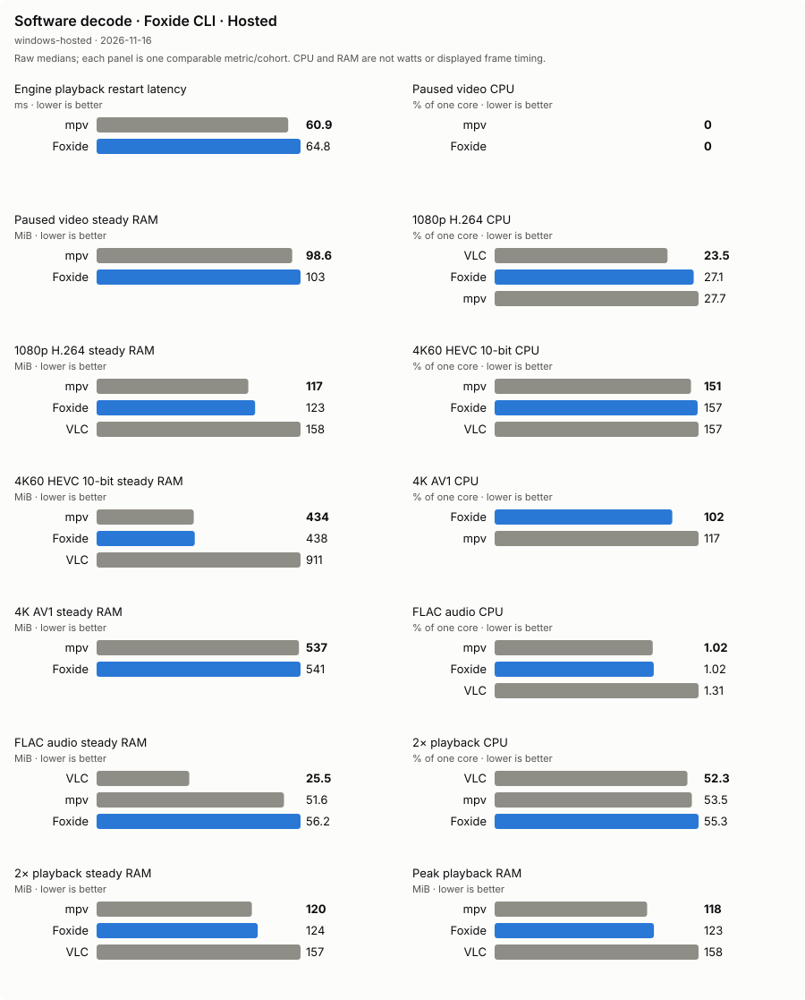
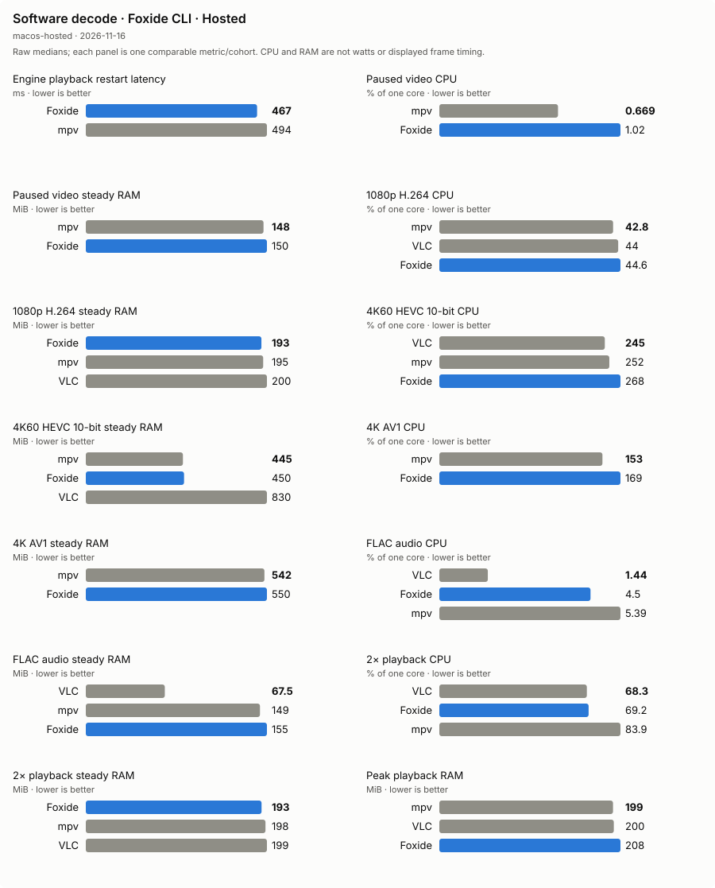
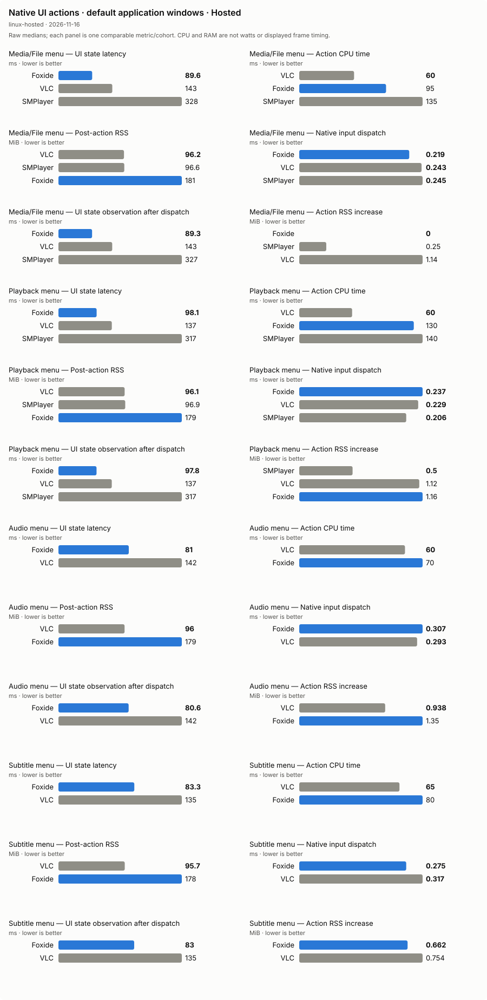
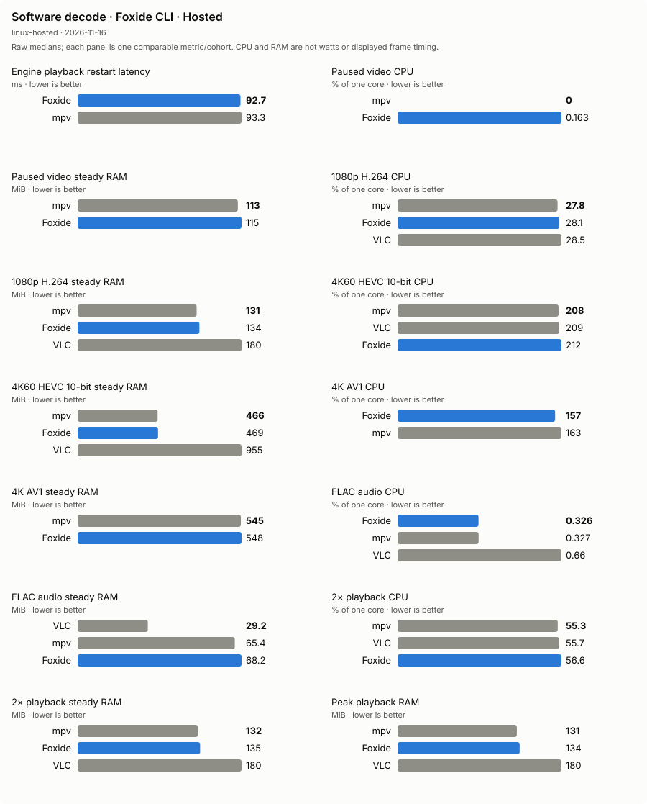

# Foxide

<!-- source-lines:start -->


Physical source lines include comments and blank lines in crates/, scripts/, tests/, .github/ and the root Cargo manifest. Vendored code, lockfiles, generated reports and build output are excluded. Refresh with python scripts/source_lines.py.
<!-- source-lines:end -->

<p align="center">
  
</p>

[](https://github.com/marksmayo/foxide/actions/workflows/ci.yml)
[](https://github.com/marksmayo/foxide/actions/workflows/desktop-ui.yml)
[](https://github.com/marksmayo/foxide/actions/workflows/video-render.yml)
[](https://github.com/marksmayo/foxide/actions/workflows/player-games.yml)
[](https://app.codspeed.io/marksmayo/foxide?utm_source=badge)

[](Cargo.toml)
[](docs/desktop.md)
[](docs/architecture.md)
[](docs/security-and-testing.md)
[](docs/security-and-testing.md)
[](LICENSE)

A Rust desktop media player with a Slint desktop preview and a transparent competitor scoreboard. The new desktop embeds libmpv in Foxide's own window; the existing `foxide` CLI still launches external mpv.

```powershell
cargo build -p player-ui --features desktop --bin foxide-desktop --release --locked
.\target\release\foxide-desktop.exe "C:\media\movie.mkv"
```

The desktop needs a libmpv ABI 2 library: Windows `tools/libmpv/libmpv-2.dll` or `FOXIDE_LIBMPV`, macOS `brew install mpv`, Linux your distribution's `libmpv2`. [Desktop setup and current limits](docs/desktop.md) · [UI action benchmarks](docs/ui-benchmarks.md). The UI includes menus, a playlist, file/URL opening, playback/speed/track controls, external subtitles, volume and fullscreen. Native playback, GPU interop and power acceptance remain in progress. Software-OpenGL CI uses a [pinned libmpv scaler-padding fix](third_party/mpv/README.md); downloaded/system libraries require separate runtime acceptance.

```powershell
.\target\release\foxide.exe "C:\media\movie.mkv"
.\target\release\foxide.exe --speed 1.5 --subtitle "C:\media\movie.srt" "C:\media\movie.mkv"
.\target\release\foxide.exe --autoqueue --resume-dir ".\results\local\resume" "C:\series\episode2.mkv"
```

Build with `cargo build --release --locked`. On Windows, `python scripts/install-mpv.py` installs a verified engine under `tools/mpv`. Playback controls include Space/pause, arrows/seek, Shift+arrows/exact seek, F/fullscreen, J/subtitles, #/audio track, S/screenshot, and Q/quit. Run `foxide --help` for tracks, offsets, tone mapping, picture controls, chapters, URLs, playlists, and window options.

[Performance implementation ledger](docs/performance-review/IMPLEMENTATION.md) · [Capabilities and remaining work](docs/features.md) · [Local players](docs/local-players.md) · [Benchmark protocol](docs/player-games.md) · [Architecture](docs/architecture.md) · [Actions](https://github.com/marksmayo/foxide/actions)

The **Player Games** workflow installs/attempts each platform's native field, records verified playback or labeled frontend diagnostics, produces the GitHub-native graphs, result tables, and expandable feature/metric details below; benchmark branches receive updates for PR review and downloadable HTML remains optional. Feature possession awards shared gold. Performance requires repeated, verified, comparable measurements. Hosted VMs have separate cohorts from physical GPU, battery, and displayed-frame tests.

Development follows red → green tests. CI enforces **90% Rust workspace line coverage** for default features and **90% coverage for medal/report policies and installers**, in separate gates. Feature-gated desktop/native rendering has a separate instrumented GPU CI report; the default-feature threshold does not cover it. [Measured coverage and security follow-up](docs/security-and-testing.md). A separate three-platform desktop workflow builds the GUI and renders a layout preview. Native PiP, thumbnails, drag-and-drop, persistent GUI resume, complete GUI coverage and physical GPU acceptance remain open.

CodSpeed tracks **233 CPU benchmark cases** across playback policy, UI actions, playlists and telemetry processing. [Suite and run commands](docs/codspeed.md) · [Case inventory](benchmarks/codspeed-inventory.json).

<!-- foxide-scores:start -->
## Benchmark

### Latest results

Every metric is a separate medal event within one platform, host, fixture and settings cohort. Performance requires ≥3 verified repeats and ≥2 comparable entrants. Documented feature support earns shared gold; unknown does not mean unsupported.

Overall feature gold counts each feature once across applicable platforms; performance totals count every eligible field. These totals are not an overall speed ranking.

**Overall**

| Player | 🥇 | 🥈 | 🥉 | Total |
|---|---:|---:|---:|---:|
| mpv | 75 | 25 | 6 | 106 |
| VLC | 55 | 16 | 24 | 95 |
| Foxide | 51 | 45 | 21 | 117 |
| IINA | 34 | 0 | 0 | 34 |
| MPC-BE | 19 | 0 | 0 | 19 |
| SMPlayer | 17 | 3 | 6 | 26 |
| MPC-HC | 15 | 0 | 0 | 15 |
| Infuse | 14 | 0 | 0 | 14 |
| Kodi | 14 | 0 | 0 | 14 |
| PotPlayer | 14 | 0 | 0 | 14 |
| KMPlayer | 13 | 0 | 0 | 13 |
| foobar2000 | 13 | 0 | 0 | 13 |
| GOM Player | 11 | 0 | 0 | 11 |
| QuickTime Player | 6 | 0 | 0 | 6 |
| FFplay | 5 | 0 | 0 | 5 |
| Plex | 5 | 0 | 0 | 5 |
| Windows Media Player | 4 | 0 | 0 | 4 |
| Windows Media Player Legacy | 3 | 0 | 0 | 3 |

**Performance**

| Player | 🥇 | 🥈 | 🥉 | Total |
|---|---:|---:|---:|---:|
| mpv | 39 | 25 | 6 | 70 |
| VLC | 31 | 16 | 24 | 71 |
| Foxide | 28 | 45 | 21 | 94 |
| SMPlayer | 3 | 3 | 6 | 12 |
| FFplay | 0 | 0 | 0 | 0 |
| GOM Player | 0 | 0 | 0 | 0 |
| IINA | 0 | 0 | 0 | 0 |
| Infuse | 0 | 0 | 0 | 0 |
| KMPlayer | 0 | 0 | 0 | 0 |
| Kodi | 0 | 0 | 0 | 0 |
| MPC-BE | 0 | 0 | 0 | 0 |
| MPC-HC | 0 | 0 | 0 | 0 |
| Plex | 0 | 0 | 0 | 0 |
| PotPlayer | 0 | 0 | 0 | 0 |
| QuickTime Player | 0 | 0 | 0 | 0 |
| Windows Media Player | 0 | 0 | 0 | 0 |
| Windows Media Player Legacy | 0 | 0 | 0 | 0 |
| foobar2000 | 0 | 0 | 0 | 0 |

**Features**

| Player | 🥇 | 🥈 | 🥉 | Total |
|---|---:|---:|---:|---:|
| mpv | 36 | 0 | 0 | 36 |
| IINA | 34 | 0 | 0 | 34 |
| VLC | 24 | 0 | 0 | 24 |
| Foxide | 23 | 0 | 0 | 23 |
| MPC-BE | 19 | 0 | 0 | 19 |
| MPC-HC | 15 | 0 | 0 | 15 |
| Infuse | 14 | 0 | 0 | 14 |
| Kodi | 14 | 0 | 0 | 14 |
| PotPlayer | 14 | 0 | 0 | 14 |
| SMPlayer | 14 | 0 | 0 | 14 |
| KMPlayer | 13 | 0 | 0 | 13 |
| foobar2000 | 13 | 0 | 0 | 13 |
| GOM Player | 11 | 0 | 0 | 11 |
| QuickTime Player | 6 | 0 | 0 | 6 |
| FFplay | 5 | 0 | 0 | 5 |
| Plex | 5 | 0 | 0 | 5 |
| Windows Media Player | 4 | 0 | 0 | 4 |
| Windows Media Player Legacy | 3 | 0 | 0 | 3 |

[Raw scores](docs/scoreboards/medals.json) · [Feature sources](docs/scoreboards/features.json) · [Performance protocols](docs/scoreboards/performance-events.json) · [Download optional HTML](docs/scoreboards/report.html)

Windowed fields use **Foxide Desktop**; software-only fields use the **Foxide CLI** launcher. Engine playback evidence is distinct from physical frame presentation. UI-action metrics, displayed TTFF, power and battery results remain pending unless explicitly measured.

### Windows


| Player | 🥇 | 🥈 | 🥉 | Total |
|---|---:|---:|---:|---:|
| mpv | 58 | 16 | 4 | 78 |
| VLC | 37 | 2 | 14 | 53 |
| Foxide | 31 | 23 | 11 | 65 |
| MPC-BE | 19 | 0 | 0 | 19 |
| MPC-HC | 15 | 0 | 0 | 15 |
| Kodi | 14 | 0 | 0 | 14 |
| PotPlayer | 14 | 0 | 0 | 14 |
| SMPlayer | 14 | 0 | 0 | 14 |
| KMPlayer | 13 | 0 | 0 | 13 |
| foobar2000 | 13 | 0 | 0 | 13 |
| GOM Player | 11 | 0 | 0 | 11 |
| FFplay | 5 | 0 | 0 | 5 |
| Plex | 5 | 0 | 0 | 5 |
| Windows Media Player | 4 | 0 | 0 | 4 |
| Windows Media Player Legacy | 3 | 0 | 0 | 3 |

**Software decode · Foxide CLI · Hosted**

windows-hosted · Windows-2025Server-10.0.26100-SP0 · AMD64 · 4 logical CPUs · 2026-11-16T01:47:02.586593+00:00.

[Actions run](https://github.com/marksmayo/foxide/actions/runs/43787689931) · Source: `cbdbf6b4ea6e5ce1e07733bfe52b9613bece5dba`. Freshness is per field; older platform results are retained with their original collection dates.

Sampling: 8s after engine readiness, 2s warmup excluded; randomized order (seed 20261115); cache state uncontrolled.

| Player | 🥇 | 🥈 | 🥉 | Total |
|---|---:|---:|---:|---:|
| mpv | 10 | 3 | 1 | 14 |
| VLC | 3 | 0 | 6 | 9 |
| Foxide | 2 | 10 | 2 | 14 |



<details><summary>Every measured metric — median values and podiums</summary>

| Metric | Foxide | VLC | mpv |
|---|---:|---:|---:|
| Engine playback restart latency | 64.8 ms | — | **60.9** ms |
| Paused video CPU | **0** % of one core | — | **0** % of one core |
| Paused video steady RAM | 103 MiB | — | **98.6** MiB |
| 1080p H.264 CPU | 27.1 % of one core | **23.5** % of one core | 27.7 % of one core |
| 1080p H.264 steady RAM | 123 MiB | 158 MiB | **117** MiB |
| 4K60 HEVC 10-bit CPU | 157 % of one core | 157 % of one core | **151** % of one core |
| 4K60 HEVC 10-bit steady RAM | 438 MiB | 911 MiB | **434** MiB |
| 4K AV1 CPU | **102** % of one core | — | 117 % of one core |
| 4K AV1 steady RAM | 541 MiB | — | **537** MiB |
| FLAC audio CPU | 1.02 % of one core | 1.31 % of one core | **1.02** % of one core |
| FLAC audio steady RAM | 56.2 MiB | **25.5** MiB | 51.6 MiB |
| 2× playback CPU | 55.3 % of one core | **52.3** % of one core | 53.5 % of one core |
| 2× playback steady RAM | 124 MiB | 157 MiB | **120** MiB |
| Peak playback RAM | 123 MiB | 158 MiB | **118** MiB |

Bold values are gold medians. — means no eligible comparable result. Trial evidence and exact cohort IDs:

| Metric | Cohort | Trials per eligible entrant |
|---|---|---:|
| Engine playback restart latency | `software-null-output/avc1080/720757a5419bbfc3` | 3, 3 |
| Paused video CPU | `software-null-output/paused/9cae31d974b1be5f` | 3, 3 |
| Paused video steady RAM | `software-null-output/paused/9cae31d974b1be5f` | 3, 3 |
| 1080p H.264 CPU | `software-null-output/avc1080/720757a5419bbfc3` | 3, 3, 3 |
| 1080p H.264 steady RAM | `software-null-output/avc1080/720757a5419bbfc3` | 3, 3, 3 |
| 4K60 HEVC 10-bit CPU | `software-null-output/hevc4k/598d1c7d82a16f5e` | 3, 3, 3 |
| 4K60 HEVC 10-bit steady RAM | `software-null-output/hevc4k/598d1c7d82a16f5e` | 3, 3, 3 |
| 4K AV1 CPU | `software-null-output/av14k/a3603cef3df72f31` | 3, 3 |
| 4K AV1 steady RAM | `software-null-output/av14k/a3603cef3df72f31` | 3, 3 |
| FLAC audio CPU | `software-null-output/flac/beb5ca88ec0867c8` | 3, 3, 3 |
| FLAC audio steady RAM | `software-null-output/flac/beb5ca88ec0867c8` | 3, 3, 3 |
| 2× playback CPU | `software-null-output/speed2x/e34a97ebb497dfbb` | 3, 3, 3 |
| 2× playback steady RAM | `software-null-output/speed2x/e34a97ebb497dfbb` | 3, 3, 3 |
| Peak playback RAM | `software-null-output/avc1080/720757a5419bbfc3` | 3, 3, 3 |

</details>


**Windowed playback · Foxide Desktop · Local**

windows-local · Windows-11-10.0.26300-SP0 · 20 logical CPUs · 2026-11-15T04:01:52.019159+00:00.

Source: `372de990b8f2810a32e091b01a553a1ec5d3a76f`. Freshness is per field; older platform results are retained with their original collection dates.

Sampling: 8s after engine readiness, 2s warmup excluded; randomized order (seed 20261115); cache state uncontrolled.

Exploratory native playback at each player’s default window size and audio route; dimensions are not normalized. Hardware fallback and observer overhead differ. This field does not establish displayed FPS or battery efficiency.

| Observed decoder | Foxide | VLC | mpv |
|---|---|---|---|
| 1080p H.264 | d3d11va-copy | Not reported | d3d11va |
| 4K60 HEVC | d3d11va-copy | Not reported | d3d11va |
| 4K60 AV1 | d3d11va-copy | Not reported | d3d11va |

Engine observations, not scanout proof. The [mpv manual](https://mpv.io/manual/stable/#options-hwdec) identifies <code>d3d11va-copy</code> as copying decoded video into system RAM; this is not zero-copy.

| Player | 🥇 | 🥈 | 🥉 | Total |
|---|---:|---:|---:|---:|
| mpv | 7 | 6 | 1 | 14 |
| Foxide | 4 | 6 | 4 | 14 |
| VLC | 3 | 2 | 6 | 11 |


<details><summary>Every measured metric — median values and podiums</summary>

| Metric | Foxide | VLC | mpv |
|---|---:|---:|---:|
| Engine playback restart latency | 4.36e+03 ms | — | **3.16e+03** ms |
| Paused video CPU | 0.256 % of one core | — | **0** % of one core |
| Paused video steady RAM | 242 MiB | — | **229** MiB |
| 1080p H.264 CPU | **9.39** % of one core | 9.75 % of one core | 9.49 % of one core |
| 1080p H.264 steady RAM | 259 MiB | 379 MiB | **239** MiB |
| 4K60 HEVC 10-bit CPU | 101 % of one core | **11.9** % of one core | 21.4 % of one core |
| 4K60 HEVC 10-bit steady RAM | **1.17e+03** MiB | 1.56e+03 MiB | 1.2e+03 MiB |
| 4K AV1 CPU | 87.5 % of one core | **15.1** % of one core | 24.3 % of one core |
| 4K AV1 steady RAM | **801** MiB | 820 MiB | 803 MiB |
| FLAC audio CPU | 4.14 % of one core | 2.31 % of one core | **1.31** % of one core |
| FLAC audio steady RAM | 156 MiB | **65.9** MiB | 150 MiB |
| 2× playback CPU | **10.5** % of one core | 10.5 % of one core | 21.9 % of one core |
| 2× playback steady RAM | 264 MiB | 365 MiB | **242** MiB |
| Peak playback RAM | 260 MiB | 379 MiB | **245** MiB |

Bold values are gold medians. — means no eligible comparable result. Trial evidence and exact cohort IDs:

| Metric | Cohort | Trials per eligible entrant |
|---|---|---:|
| Engine playback restart latency | `native-default-window/avc1080/e5a3127a89486db7` | 3, 3 |
| Paused video CPU | `native-default-window/paused/4fe317a2a7ce449c` | 3, 3 |
| Paused video steady RAM | `native-default-window/paused/4fe317a2a7ce449c` | 3, 3 |
| 1080p H.264 CPU | `native-default-window/avc1080/e5a3127a89486db7` | 3, 3, 3 |
| 1080p H.264 steady RAM | `native-default-window/avc1080/e5a3127a89486db7` | 3, 3, 3 |
| 4K60 HEVC 10-bit CPU | `native-default-window/hevc4k/2e513aff25627cca` | 3, 3, 3 |
| 4K60 HEVC 10-bit steady RAM | `native-default-window/hevc4k/2e513aff25627cca` | 3, 3, 3 |
| 4K AV1 CPU | `native-default-window/av14k/50e9d1024fa3f2f7` | 3, 3, 3 |
| 4K AV1 steady RAM | `native-default-window/av14k/50e9d1024fa3f2f7` | 3, 3, 3 |
| FLAC audio CPU | `native-default-window/flac/3a05bf63a227e2b5` | 3, 3, 3 |
| FLAC audio steady RAM | `native-default-window/flac/3a05bf63a227e2b5` | 3, 3, 3 |
| 2× playback CPU | `native-default-window/speed2x/4c72021d4bdad5b6` | 3, 3, 3 |
| 2× playback steady RAM | `native-default-window/speed2x/4c72021d4bdad5b6` | 3, 3, 3 |
| Peak playback RAM | `native-default-window/avc1080/e5a3127a89486db7` | 3, 3, 3 |

</details>


**Software decode · Foxide CLI · Local**

windows-local · Windows-11-10.0.26300-SP0 · 20 logical CPUs · 2026-11-15T04:29:30.454755+00:00.

Source: `188f2e6b49b5d638b7f641b47d13ae0ee6906740`. Freshness is per field; older platform results are retained with their original collection dates.

Sampling: 8s after engine readiness, 2s warmup excluded; randomized order (seed 20261115); cache state uncontrolled.

| Player | 🥇 | 🥈 | 🥉 | Total |
|---|---:|---:|---:|---:|
| VLC | 7 | 0 | 2 | 9 |
| mpv | 5 | 7 | 2 | 14 |
| Foxide | 2 | 7 | 5 | 14 |


<details><summary>Every measured metric — median values and podiums</summary>

| Metric | Foxide | VLC | mpv |
|---|---:|---:|---:|
| Engine playback restart latency | **2.35e+03** ms | — | 2.42e+03 ms |
| Paused video CPU | 0.325 % of one core | — | **0.27** % of one core |
| Paused video steady RAM | 175 MiB | — | **170** MiB |
| 1080p H.264 CPU | 70.9 % of one core | **62.5** % of one core | 64.5 % of one core |
| 1080p H.264 steady RAM | 200 MiB | **166** MiB | 196 MiB |
| 4K60 HEVC 10-bit CPU | 216 % of one core | — | **207** % of one core |
| 4K60 HEVC 10-bit steady RAM | **835** MiB | — | 848 MiB |
| 4K AV1 CPU | 72.3 % of one core | **51** % of one core | 74.9 % of one core |
| 4K AV1 steady RAM | 643 MiB | 698 MiB | **640** MiB |
| FLAC audio CPU | 1.18 % of one core | 2.68 % of one core | **1.15** % of one core |
| FLAC audio steady RAM | 58.7 MiB | **26.2** MiB | 53.7 MiB |
| 2× playback CPU | 127 % of one core | **47** % of one core | 138 % of one core |
| 2× playback steady RAM | 205 MiB | **174** MiB | 201 MiB |
| Peak playback RAM | 201 MiB | **176** MiB | 198 MiB |

Bold values are gold medians. — means no eligible comparable result. Trial evidence and exact cohort IDs:

| Metric | Cohort | Trials per eligible entrant |
|---|---|---:|
| Engine playback restart latency | `software-null-output/avc1080/627de1d25dff605b` | 3, 3 |
| Paused video CPU | `software-null-output/paused/daf715b1bd930d72` | 3, 3 |
| Paused video steady RAM | `software-null-output/paused/daf715b1bd930d72` | 3, 3 |
| 1080p H.264 CPU | `software-null-output/avc1080/627de1d25dff605b` | 3, 3, 3 |
| 1080p H.264 steady RAM | `software-null-output/avc1080/627de1d25dff605b` | 3, 3, 3 |
| 4K60 HEVC 10-bit CPU | `software-null-output/hevc4k/bef5bd64c814bebc` | 3, 3 |
| 4K60 HEVC 10-bit steady RAM | `software-null-output/hevc4k/bef5bd64c814bebc` | 3, 3 |
| 4K AV1 CPU | `software-null-output/av14k/4c0374fd24a77a8b` | 3, 3, 3 |
| 4K AV1 steady RAM | `software-null-output/av14k/4c0374fd24a77a8b` | 3, 3, 3 |
| FLAC audio CPU | `software-null-output/flac/243ea89a8ffb1188` | 3, 3, 3 |
| FLAC audio steady RAM | `software-null-output/flac/243ea89a8ffb1188` | 3, 3, 3 |
| 2× playback CPU | `software-null-output/speed2x/f035ebb00f869495` | 3, 3, 3 |
| 2× playback steady RAM | `software-null-output/speed2x/f035ebb00f869495` | 3, 3, 3 |
| Peak playback RAM | `software-null-output/avc1080/627de1d25dff605b` | 3, 3, 3 |

</details>

<details><summary>Runtime outcomes and feature events</summary>

| Player | Runtime outcome | Evidence / limitation |
|---|---|---|
| Foxide | Verified playback 54/57 | sampled-playback-unverified, verified-playback |
| VLC | Verified playback 41/57 | playback-readiness-timeout, sampled-playback-unverified, verified-playback |
| mpv | Verified playback 54/57 | sampled-playback-unverified, verified-playback |
| Windows Media Player | install-blocked | Local Store package was not registered; WinGet list/install both returned 0x8A150001. Store desktop control is unavailable. Interactive Store installation is pending. |
| Windows Media Player Legacy | Unverified / diagnostic (6 cases) | early-exit, sampled-playback-unverified |
| MPC-HC | Unverified / diagnostic (6 cases) | sampled-playback-unverified |
| MPC-BE | Unverified / diagnostic (6 cases) | sampled-playback-unverified |
| PotPlayer | Unverified / diagnostic (6 cases) | sampled-playback-unverified |
| SMPlayer | Unverified / diagnostic (6 cases) | sampled-playback-unverified |
| KMPlayer | Unverified / diagnostic (3 cases) | early-exit, sampled-playback-unverified |
| GOM Player | Unverified / diagnostic (3 cases) | sampled-playback-unverified |
| FFplay | Unverified / diagnostic (6 cases) | sampled-playback-unverified |
| Kodi | Unverified / diagnostic (6 cases) | sampled-playback-unverified |
| Plex | Unverified / diagnostic (6 cases) | early-exit, sampled-playback-unverified |
| foobar2000 | Unverified / diagnostic (6 cases) | sampled-playback-unverified |

| Feature | Foxide | VLC | mpv | Windows Media Player | Windows Media Player Legacy | MPC-HC | MPC-BE | PotPlayer | SMPlayer | KMPlayer | GOM Player | FFplay | Kodi | Plex | foobar2000 |
|---|---:|---:|---:|---:|---:|---:|---:|---:|---:|---:|---:|---:|---:|---:|---:|
| MP4 and MKV playback | 🥇 | 🥇 | 🥇 | ? | ? | ? | 🥇 | 🥇 | 🥇 | 🥇 | ? | ? | ? | ? | N/A |
| FLAC audio | 🥇 | 🥇 | 🥇 | ? | ? | ? | 🥇 | 🥇 | ? | 🥇 | ? | ? | ? | ? | 🥇 |
| Hardware decoding | 🥇 | 🥇 | 🥇 | ? | ? | ? | 🥇 | 🥇 | ? | 🥇 | ? | ? | 🥇 | ? | N/A |
| Audio track selection | 🥇 | 🥇 | 🥇 | ? | ? | ? | 🥇 | ? | 🥇 | ? | 🥇 | 🥇 | 🥇 | 🥇 | N/A |
| Subtitle track selection | 🥇 | 🥇 | 🥇 | ? | ? | ? | 🥇 | 🥇 | 🥇 | ? | ? | 🥇 | 🥇 | 🥇 | N/A |
| External subtitle files | 🥇 | 🥇 | 🥇 | ? | ? | ? | 🥇 | ? | 🥇 | 🥇 | 🥇 | ? | 🥇 | ? | N/A |
| ASS/SSA subtitle rendering | 🥇 | 🥇 | 🥇 | ? | ? | 🥇 | 🥇 | 🥇 | ? | 🥇 | ? | ? | ? | ? | N/A |
| Variable playback speed | 🥇 | 🥇 | 🥇 | ? | 🥇 | 🥇 | 🥇 | 🥇 | 🥇 | ? | 🥇 | ? | ? | 🥇 | ? |
| Playlists | 🥇 | 🥇 | 🥇 | 🥇 | ? | ? | 🥇 | 🥇 | ? | 🥇 | 🥇 | ? | ? | ? | ? |
| Keyboard controls | 🥇 | 🥇 | 🥇 | 🥇 | ? | 🥇 | ? | ? | ? | ? | 🥇 | 🥇 | ? | 🥇 | 🥇 |
| Frame-accurate seeking | 🥇 | ? | 🥇 | ? | ? | ? | ? | ? | ? | ? | ? | ? | ? | ? | N/A |
| Seekbar thumbnail previews | ? | ? | ? | ? | ? | 🥇 | 🥇 | ? | ? | ? | ? | ? | ? | ? | N/A |
| HDR video playback | 🥇 | ? | 🥇 | ? | ? | 🥇 | 🥇 | 🥇 | ? | ? | ? | ? | ? | ? | N/A |
| HDR to SDR tone mapping | 🥇 | ? | 🥇 | ? | ? | ? | ? | 🥇 | ? | ? | ? | ? | ? | ? | N/A |
| Audio synchronization offset | 🥇 | 🥇 | 🥇 | ? | ? | ? | 🥇 | ? | 🥇 | ? | ? | ? | 🥇 | ? | N/A |
| Subtitle synchronization offset | 🥇 | 🥇 | 🥇 | ? | ? | ? | 🥇 | ? | 🥇 | ? | 🥇 | ? | 🥇 | ? | N/A |
| Video filters and adjustments | 🥇 | 🥇 | 🥇 | ? | ? | 🥇 | 🥇 | 🥇 | 🥇 | 🥇 | 🥇 | 🥇 | ? | ? | N/A |
| Chapter navigation | 🥇 | 🥇 | 🥇 | ? | ? | ? | 🥇 | ? | ? | ? | ? | ? | 🥇 | ? | ? |
| Native picture in picture | ? | ? | ? | ? | ? | ? | ? | ? | ? | ? | ? | ? | ? | ? | N/A |
| Network stream playback | 🥇 | 🥇 | 🥇 | ? | ? | 🥇 | 🥇 | 🥇 | ? | 🥇 | ? | ? | ? | ? | 🥇 |
| Persistent playback resume | 🥇 | ? | 🥇 | ? | ? | 🥇 | ? | ? | 🥇 | ? | ? | ? | ? | ? | ? |
| Automatic folder playback | 🥇 | ? | ? | ? | ? | 🥇 | ? | ? | ? | ? | ? | ? | ? | ? | ? |
| Borderless viewing mode | 🥇 | ? | 🥇 | ? | ? | ? | ? | ? | ? | ? | ? | ? | ? | ? | ? |
| Video screenshots | 🥇 | 🥇 | 🥇 | ? | ? | ? | 🥇 | 🥇 | ? | 🥇 | 🥇 | ? | ? | ? | N/A |
| A–B repeat | 🥇 | 🥇 | 🥇 | ? | ? | 🥇 | 🥇 | ? | ? | ? | 🥇 | ? | ? | ? | ? |
| Audio equalizer / DSP | ? | 🥇 | 🥇 | ? | ? | ? | ? | ? | ? | ? | ? | ? | ? | ? | 🥇 |
| ReplayGain | ? | 🥇 | 🥇 | ? | ? | ? | ? | 🥇 | ? | ? | ? | ? | ? | ? | 🥇 |
| Gapless audio playback | ? | ? | 🥇 | ? | ? | ? | ? | ? | ? | ? | ? | ? | ? | ? | 🥇 |
| DVD / Blu-ray structure playback | ? | 🥇 | 🥇 | ? | ? | ? | 🥇 | ? | ? | ? | 🥇 | ? | ? | ? | N/A |
| Chromecast video output | ? | 🥇 | ? | ? | ? | ? | ? | ? | 🥇 | ? | ? | ? | ? | ? | N/A |
| AirPlay video output | ? | ? | ? | ? | ? | ? | ? | ? | ? | ? | ? | ? | ? | ? | N/A |
| AirPlay audio receiver | ? | ? | ? | ? | ? | ? | ? | ? | ? | ? | ? | ? | 🥇 | ? | ? |
| Search and download subtitles | ? | ? | ? | ? | ? | 🥇 | ? | ? | 🥇 | ? | ? | ? | ? | ? | N/A |
| Video-site URL playback | ? | ? | 🥇 | ? | ? | 🥇 | ? | ? | 🥇 | 🥇 | ? | ? | ? | ? | N/A |
| User extension or scripting system | ? | ? | 🥇 | ? | ? | ? | ? | ? | ? | ? | ? | ? | 🥇 | ? | 🥇 |
| Editable keyboard bindings | ? | ? | 🥇 | ? | ? | 🥇 | ? | ? | ? | ? | ? | ? | ? | ? | 🥇 |
| Customizable UI layout or skins | ? | ? | ? | ? | ? | ? | ? | ? | 🥇 | ? | ? | ? | ? | ? | 🥇 |
| Touch or trackpad playback gestures | ? | ? | ? | ? | ? | ? | ? | ? | 🥇 | ? | ? | ? | ? | ? | ? |
| System media-control integration | ? | ? | ? | ? | ? | ? | ? | ? | ? | ? | ? | ? | ? | ? | ? |
| Compact dedicated music view | ? | ? | ? | 🥇 | ? | ? | ? | ? | ? | ? | ? | ? | ? | ? | ? |
| Dark interface theme | ? | ? | ? | ? | ? | 🥇 | ? | ? | ? | ? | ? | ? | ? | ? | ? |
| Music playback artwork view | ? | ? | ? | 🥇 | ? | ? | ? | ? | ? | ? | ? | ? | ? | ? | ? |
| Automatic movie and TV library metadata | ? | ? | ? | ? | ? | ? | ? | ? | ? | ? | ? | ? | 🥇 | ? | N/A |
| Browse SMB network media | ? | ? | ? | ? | ? | ? | ? | ? | ? | ? | ? | ? | 🥇 | ? | ? |
| Direct cloud-storage playback | ? | ? | ? | ? | ? | ? | ? | ? | ? | ? | ? | ? | ? | ? | N/A |
| Download server media for offline viewing | ? | ? | ? | ? | ? | ? | ? | ? | ? | ? | ? | ? | ? | 🥇 | ? |
| Cross-device playback progress sync | ? | ? | ? | ? | ? | ? | ? | ? | ? | ? | ? | ? | ? | ? | N/A |
| Live TV and guide frontend | ? | ? | ? | ? | ? | ? | ? | ? | ? | ? | ? | ? | 🥇 | ? | N/A |
| Schedule TV recordings from the player | ? | ? | ? | ? | ? | ? | ? | ? | ? | ? | ? | ? | 🥇 | ? | N/A |
| HTTP remote-control interface | ? | ? | ? | ? | ? | ? | ? | ? | ? | ? | ? | ? | 🥇 | ? | ? |
| Documented JSON IPC control | ? | ? | 🥇 | ? | ? | ? | ? | ? | ? | ? | ? | ? | ? | ? | ? |
| HD audio bitstream passthrough | ? | 🥇 | 🥇 | ? | ? | ? | ? | ? | ? | ? | ? | ? | ? | ? | ? |
| 360-degree panoramic video | ? | 🥇 | ? | ? | ? | ? | ? | ? | ? | 🥇 | 🥇 | ? | ? | ? | N/A |
| Stereoscopic 3D video | ? | ? | ? | ? | ? | ? | ? | ? | ? | 🥇 | ? | ? | ? | ? | N/A |
| Capture playing video to a clip | ? | ? | ? | ? | ? | ? | ? | ? | ? | 🥇 | ? | ? | ? | ? | N/A |
| Desktop screen recording | ? | 🥇 | ? | ? | ? | ? | ? | ? | ? | ? | ? | ? | ? | ? | N/A |
| Trim and rearrange video clips | ? | ? | ? | ? | ? | ? | ? | ? | ? | ? | ? | ? | ? | ? | N/A |
| Audio conversion or transcoding | ? | ? | ? | ? | ? | ? | ? | ? | ? | ? | ? | ? | ? | ? | 🥇 |
| Audio CD ripping | ? | ? | ? | ? | 🥇 | ? | ? | ? | ? | ? | ? | ? | ? | ? | 🥇 |
| Audio or data CD burning | ? | ? | ? | ? | 🥇 | ? | ? | ? | ? | ? | ? | ? | ? | ? | ? |
| Edit media tags | ? | ? | ? | ? | ? | ? | ? | ? | ? | ? | ? | ? | ? | ? | 🥇 |
| Built-in internet-radio directory | ? | ? | ? | ? | ? | ? | ? | ? | ? | ? | ? | ? | ? | ? | 🥇 |
| Video rotation and flip controls | ? | ? | 🥇 | ? | ? | 🥇 | ? | ? | ? | ? | ? | ? | ? | ? | N/A |
| ICC display color management | ? | ? | 🥇 | ? | ? | ? | ? | ? | ? | ? | ? | ? | ? | ? | N/A |
| User GPU shader pipeline | ? | ? | 🥇 | ? | ? | ? | ? | ? | ? | ? | ? | ? | ? | ? | N/A |
| Debanding control | ? | ? | 🥇 | ? | ? | ? | ? | ? | ? | ? | ? | ? | ? | ? | N/A |
| Single-frame advance | ? | ? | 🥇 | ? | ? | ? | ? | ? | ? | ? | ? | 🥇 | ? | ? | N/A |
| Playlist search and filtering | ? | ? | ? | ? | ? | ? | ? | 🥇 | ? | ? | ? | ? | ? | ? | ? |

? = undocumented/unverified. N/A = inapplicable media type.

</details>

### macOS


| Player | 🥇 | 🥈 | 🥉 | Total |
|---|---:|---:|---:|---:|
| mpv | 43 | 5 | 2 | 50 |
| IINA | 34 | 0 | 0 | 34 |
| VLC | 28 | 2 | 3 | 33 |
| Foxide | 26 | 7 | 4 | 37 |
| Infuse | 14 | 0 | 0 | 14 |
| Kodi | 14 | 0 | 0 | 14 |
| SMPlayer | 13 | 0 | 0 | 13 |
| foobar2000 | 12 | 0 | 0 | 12 |
| QuickTime Player | 6 | 0 | 0 | 6 |
| FFplay | 5 | 0 | 0 | 5 |
| Plex | 5 | 0 | 0 | 5 |

**Software decode · Foxide CLI · Hosted**

macos-hosted · macOS-15.8.2-arm64-arm-64bit · arm64 · 3 logical CPUs · 2026-11-16T01:46:38.886625+00:00.

[Actions run](https://github.com/marksmayo/foxide/actions/runs/43787689931) · Source: `cbdbf6b4ea6e5ce1e07733bfe52b9613bece5dba`. Freshness is per field; older platform results are retained with their original collection dates.

Sampling: 8s after engine readiness, 2s warmup excluded; randomized order (seed 20261115); cache state uncontrolled.

| Player | 🥇 | 🥈 | 🥉 | Total |
|---|---:|---:|---:|---:|
| mpv | 7 | 5 | 2 | 14 |
| VLC | 4 | 2 | 3 | 9 |
| Foxide | 3 | 7 | 4 | 14 |



<details><summary>Every measured metric — median values and podiums</summary>

| Metric | Foxide | VLC | mpv |
|---|---:|---:|---:|
| Engine playback restart latency | **467** ms | — | 494 ms |
| Paused video CPU | 1.02 % of one core | — | **0.669** % of one core |
| Paused video steady RAM | 150 MiB | — | **148** MiB |
| 1080p H.264 CPU | 44.6 % of one core | 44 % of one core | **42.8** % of one core |
| 1080p H.264 steady RAM | **193** MiB | 200 MiB | 195 MiB |
| 4K60 HEVC 10-bit CPU | 268 % of one core | **245** % of one core | 252 % of one core |
| 4K60 HEVC 10-bit steady RAM | 450 MiB | 830 MiB | **445** MiB |
| 4K AV1 CPU | 169 % of one core | — | **153** % of one core |
| 4K AV1 steady RAM | 550 MiB | — | **542** MiB |
| FLAC audio CPU | 4.5 % of one core | **1.44** % of one core | 5.39 % of one core |
| FLAC audio steady RAM | 155 MiB | **67.5** MiB | 149 MiB |
| 2× playback CPU | 69.2 % of one core | **68.3** % of one core | 83.9 % of one core |
| 2× playback steady RAM | **193** MiB | 199 MiB | 198 MiB |
| Peak playback RAM | 208 MiB | 200 MiB | **199** MiB |

Bold values are gold medians. — means no eligible comparable result. Trial evidence and exact cohort IDs:

| Metric | Cohort | Trials per eligible entrant |
|---|---|---:|
| Engine playback restart latency | `software-null-output/avc1080/414e2151fff3ef34` | 3, 3 |
| Paused video CPU | `software-null-output/paused/f44f4b3a6faf3bbc` | 3, 3 |
| Paused video steady RAM | `software-null-output/paused/f44f4b3a6faf3bbc` | 3, 3 |
| 1080p H.264 CPU | `software-null-output/avc1080/414e2151fff3ef34` | 3, 3, 3 |
| 1080p H.264 steady RAM | `software-null-output/avc1080/414e2151fff3ef34` | 3, 3, 3 |
| 4K60 HEVC 10-bit CPU | `software-null-output/hevc4k/7d30fbde773c152e` | 3, 3, 3 |
| 4K60 HEVC 10-bit steady RAM | `software-null-output/hevc4k/7d30fbde773c152e` | 3, 3, 3 |
| 4K AV1 CPU | `software-null-output/av14k/21e1acc101644f7d` | 3, 3 |
| 4K AV1 steady RAM | `software-null-output/av14k/21e1acc101644f7d` | 3, 3 |
| FLAC audio CPU | `software-null-output/flac/ec481a0fe14c1d71` | 3, 3, 3 |
| FLAC audio steady RAM | `software-null-output/flac/ec481a0fe14c1d71` | 3, 3, 3 |
| 2× playback CPU | `software-null-output/speed2x/42ec63e2facfe37f` | 3, 3, 3 |
| 2× playback steady RAM | `software-null-output/speed2x/42ec63e2facfe37f` | 3, 3, 3 |
| Peak playback RAM | `software-null-output/avc1080/414e2151fff3ef34` | 3, 3, 3 |

</details>

<details><summary>Runtime outcomes and feature events</summary>

| Player | Runtime outcome | Evidence / limitation |
|---|---|---|
| Foxide | Verified playback 18/21 | sampled-playback-unverified, verified-playback |
| VLC | Verified playback 12/21 | playback-readiness-timeout, sampled-playback-unverified, verified-playback |
| mpv | Verified playback 18/21 | sampled-playback-unverified, verified-playback |
| SMPlayer | not-detected | No native executable found; packaged-app/account/Store activation may need a dedicated adapter. |
| FFplay | Unverified / diagnostic (3 cases) | sampled-playback-unverified |
| Kodi | Unverified / diagnostic (3 cases) | early-exit |
| Plex | Unverified / diagnostic (3 cases) | sampled-playback-unverified |
| foobar2000 | Unverified / diagnostic (3 cases) | sampled-playback-unverified |
| Infuse | not-detected | No native executable found; packaged-app/account/Store activation may need a dedicated adapter. |
| IINA | Unverified / diagnostic (3 cases) | sampled-playback-unverified |
| QuickTime Player | Unverified / diagnostic (3 cases) | sampled-playback-unverified |

| Feature | Foxide | VLC | mpv | SMPlayer | FFplay | Kodi | Plex | foobar2000 | Infuse | IINA | QuickTime Player |
|---|---:|---:|---:|---:|---:|---:|---:|---:|---:|---:|---:|
| MP4 and MKV playback | 🥇 | 🥇 | 🥇 | 🥇 | ? | ? | ? | N/A | 🥇 | 🥇 | ? |
| FLAC audio | 🥇 | 🥇 | 🥇 | ? | ? | ? | ? | 🥇 | ? | 🥇 | ? |
| Hardware decoding | 🥇 | 🥇 | 🥇 | ? | ? | 🥇 | ? | N/A | 🥇 | 🥇 | ? |
| Audio track selection | 🥇 | 🥇 | 🥇 | 🥇 | 🥇 | 🥇 | 🥇 | N/A | 🥇 | 🥇 | ? |
| Subtitle track selection | 🥇 | 🥇 | 🥇 | 🥇 | 🥇 | 🥇 | 🥇 | N/A | 🥇 | 🥇 | 🥇 |
| External subtitle files | 🥇 | 🥇 | 🥇 | 🥇 | ? | 🥇 | ? | N/A | 🥇 | 🥇 | ? |
| ASS/SSA subtitle rendering | 🥇 | 🥇 | 🥇 | ? | ? | ? | ? | N/A | 🥇 | 🥇 | ? |
| Variable playback speed | 🥇 | 🥇 | 🥇 | 🥇 | ? | ? | 🥇 | ? | 🥇 | 🥇 | 🥇 |
| Playlists | 🥇 | 🥇 | 🥇 | ? | ? | ? | ? | ? | ? | 🥇 | ? |
| Keyboard controls | 🥇 | 🥇 | 🥇 | ? | 🥇 | ? | 🥇 | 🥇 | ? | 🥇 | ? |
| Frame-accurate seeking | 🥇 | ? | 🥇 | ? | ? | ? | ? | N/A | ? | 🥇 | ? |
| Seekbar thumbnail previews | ? | ? | ? | ? | ? | ? | ? | N/A | ? | 🥇 | ? |
| HDR video playback | 🥇 | ? | 🥇 | ? | ? | ? | ? | N/A | 🥇 | 🥇 | ? |
| HDR to SDR tone mapping | 🥇 | ? | 🥇 | ? | ? | ? | ? | N/A | ? | 🥇 | ? |
| Audio synchronization offset | 🥇 | 🥇 | 🥇 | 🥇 | ? | 🥇 | ? | N/A | ? | 🥇 | ? |
| Subtitle synchronization offset | 🥇 | 🥇 | 🥇 | 🥇 | ? | 🥇 | ? | N/A | ? | 🥇 | ? |
| Video filters and adjustments | 🥇 | 🥇 | 🥇 | 🥇 | 🥇 | ? | ? | N/A | ? | 🥇 | ? |
| Chapter navigation | 🥇 | 🥇 | 🥇 | ? | ? | 🥇 | ? | ? | 🥇 | 🥇 | ? |
| Native picture in picture | ? | ? | ? | ? | ? | ? | ? | N/A | 🥇 | 🥇 | 🥇 |
| Network stream playback | 🥇 | 🥇 | 🥇 | ? | ? | ? | ? | 🥇 | ? | 🥇 | ? |
| Persistent playback resume | 🥇 | ? | 🥇 | 🥇 | ? | ? | ? | ? | ? | 🥇 | ? |
| Automatic folder playback | 🥇 | ? | ? | ? | ? | ? | ? | ? | 🥇 | 🥇 | ? |
| Borderless viewing mode | 🥇 | ? | 🥇 | ? | ? | ? | ? | ? | ? | ? | ? |
| Video screenshots | 🥇 | 🥇 | 🥇 | ? | ? | ? | ? | N/A | ? | 🥇 | ? |
| A–B repeat | 🥇 | 🥇 | 🥇 | ? | ? | ? | ? | ? | ? | 🥇 | ? |
| Audio equalizer / DSP | ? | 🥇 | 🥇 | ? | ? | ? | ? | 🥇 | ? | 🥇 | ? |
| ReplayGain | ? | 🥇 | 🥇 | ? | ? | ? | ? | 🥇 | ? | 🥇 | ? |
| Gapless audio playback | ? | ? | 🥇 | ? | ? | ? | ? | 🥇 | ? | 🥇 | ? |
| DVD / Blu-ray structure playback | ? | 🥇 | 🥇 | ? | ? | ? | ? | N/A | ? | ? | ? |
| Chromecast video output | ? | 🥇 | ? | 🥇 | ? | ? | ? | N/A | ? | ? | ? |
| AirPlay video output | ? | ? | ? | ? | ? | ? | ? | N/A | ? | ? | 🥇 |
| AirPlay audio receiver | ? | ? | ? | ? | ? | 🥇 | ? | ? | ? | ? | ? |
| Search and download subtitles | ? | ? | ? | 🥇 | ? | ? | ? | N/A | ? | 🥇 | ? |
| Video-site URL playback | ? | ? | 🥇 | 🥇 | ? | ? | ? | N/A | ? | ? | ? |
| User extension or scripting system | ? | ? | 🥇 | ? | ? | 🥇 | ? | 🥇 | ? | 🥇 | ? |
| Editable keyboard bindings | ? | ? | 🥇 | ? | ? | ? | ? | 🥇 | ? | ? | ? |
| Customizable UI layout or skins | ? | ? | ? | 🥇 | ? | ? | ? | 🥇 | ? | 🥇 | ? |
| Touch or trackpad playback gestures | ? | ? | ? | ? | ? | ? | ? | ? | ? | 🥇 | ? |
| System media-control integration | ? | ? | ? | ? | ? | ? | ? | ? | ? | 🥇 | ? |
| Compact dedicated music view | ? | ? | ? | ? | ? | ? | ? | ? | ? | 🥇 | ? |
| Dark interface theme | ? | ? | ? | ? | ? | ? | ? | ? | ? | 🥇 | ? |
| Music playback artwork view | ? | ? | ? | ? | ? | ? | ? | ? | ? | ? | ? |
| Automatic movie and TV library metadata | ? | ? | ? | ? | ? | 🥇 | ? | N/A | 🥇 | ? | ? |
| Browse SMB network media | ? | ? | ? | ? | ? | 🥇 | ? | ? | ? | ? | ? |
| Direct cloud-storage playback | ? | ? | ? | ? | ? | ? | ? | N/A | 🥇 | ? | ? |
| Download server media for offline viewing | ? | ? | ? | ? | ? | ? | 🥇 | ? | ? | ? | ? |
| Cross-device playback progress sync | ? | ? | ? | ? | ? | ? | ? | N/A | 🥇 | ? | ? |
| Live TV and guide frontend | ? | ? | ? | ? | ? | 🥇 | ? | N/A | ? | ? | ? |
| Schedule TV recordings from the player | ? | ? | ? | ? | ? | 🥇 | ? | N/A | ? | ? | ? |
| HTTP remote-control interface | ? | ? | ? | ? | ? | 🥇 | ? | ? | ? | ? | ? |
| Documented JSON IPC control | ? | ? | 🥇 | ? | ? | ? | ? | ? | ? | ? | ? |
| HD audio bitstream passthrough | ? | 🥇 | 🥇 | ? | ? | ? | ? | ? | ? | ? | ? |
| 360-degree panoramic video | ? | 🥇 | ? | ? | ? | ? | ? | N/A | ? | ? | ? |
| Stereoscopic 3D video | ? | ? | ? | ? | ? | ? | ? | N/A | ? | ? | ? |
| Capture playing video to a clip | ? | ? | ? | ? | ? | ? | ? | N/A | ? | ? | ? |
| Desktop screen recording | ? | 🥇 | ? | ? | ? | ? | ? | N/A | ? | ? | ? |
| Trim and rearrange video clips | ? | ? | ? | ? | ? | ? | ? | N/A | ? | ? | 🥇 |
| Audio conversion or transcoding | ? | ? | ? | ? | ? | ? | ? | 🥇 | ? | ? | ? |
| Audio CD ripping | ? | ? | ? | ? | ? | ? | ? | ? | ? | ? | ? |
| Audio or data CD burning | ? | ? | ? | ? | ? | ? | ? | ? | ? | ? | ? |
| Edit media tags | ? | ? | ? | ? | ? | ? | ? | 🥇 | ? | ? | ? |
| Built-in internet-radio directory | ? | ? | ? | ? | ? | ? | ? | 🥇 | ? | ? | ? |
| Video rotation and flip controls | ? | ? | 🥇 | ? | ? | ? | ? | N/A | ? | ? | 🥇 |
| ICC display color management | ? | ? | 🥇 | ? | ? | ? | ? | N/A | ? | ? | ? |
| User GPU shader pipeline | ? | ? | 🥇 | ? | ? | ? | ? | N/A | ? | ? | ? |
| Debanding control | ? | ? | 🥇 | ? | ? | ? | ? | N/A | ? | ? | ? |
| Single-frame advance | ? | ? | 🥇 | ? | 🥇 | ? | ? | N/A | ? | ? | ? |
| Playlist search and filtering | ? | ? | ? | ? | ? | ? | ? | ? | ? | ? | ? |

? = undocumented/unverified. N/A = inapplicable media type.

</details>

### Linux


| Player | 🥇 | 🥈 | 🥉 | Total |
|---|---:|---:|---:|---:|
| mpv | 46 | 4 | 0 | 50 |
| Foxide | 40 | 15 | 6 | 61 |
| VLC | 38 | 12 | 7 | 57 |
| SMPlayer | 16 | 3 | 6 | 25 |
| Kodi | 14 | 0 | 0 | 14 |
| FFplay | 5 | 0 | 0 | 5 |
| Plex | 5 | 0 | 0 | 5 |

**Native UI actions · default application windows · Hosted**

linux-hosted · 2026-11-16T01:47:01.290860+00:00.

[Actions run](https://github.com/marksmayo/foxide/actions/runs/43787689931) · Source: `cbdbf6b4ea6e5ce1e07733bfe52b9613bece5dba`. Freshness is per field; older platform results are retained with their original collection dates.

| Player | 🥇 | 🥈 | 🥉 | Total |
|---|---:|---:|---:|---:|
| Foxide | 14 | 7 | 3 | 24 |
| VLC | 13 | 10 | 1 | 24 |
| SMPlayer | 3 | 3 | 6 | 12 |



<details><summary>Every measured metric — median values and podiums</summary>

| Metric | Foxide | VLC | SMPlayer |
|---|---:|---:|---:|
| Media/File menu — UI state latency | **89.6** ms | 143 ms | 328 ms |
| Media/File menu — Action CPU time | 95 ms | **60** ms | 135 ms |
| Media/File menu — Post-action RSS | 181 MiB | **96.2** MiB | 96.6 MiB |
| Media/File menu — Native input dispatch | **0.219** ms | **0.243** ms | **0.245** ms |
| Media/File menu — UI state observation after dispatch | **89.3** ms | 143 ms | 327 ms |
| Media/File menu — Action RSS increase | **0** MiB | 1.14 MiB | 0.25 MiB |
| Playback menu — UI state latency | **98.1** ms | 137 ms | 317 ms |
| Playback menu — Action CPU time | 130 ms | **60** ms | 140 ms |
| Playback menu — Post-action RSS | 179 MiB | **96.1** MiB | 96.9 MiB |
| Playback menu — Native input dispatch | **0.237** ms | **0.229** ms | **0.206** ms |
| Playback menu — UI state observation after dispatch | **97.8** ms | 137 ms | 317 ms |
| Playback menu — Action RSS increase | 1.16 MiB | 1.12 MiB | **0.5** MiB |
| Audio menu — UI state latency | **81** ms | 142 ms | — |
| Audio menu — Action CPU time | 70 ms | **60** ms | — |
| Audio menu — Post-action RSS | 179 MiB | **96** MiB | — |
| Audio menu — Native input dispatch | **0.307** ms | **0.293** ms | — |
| Audio menu — UI state observation after dispatch | **80.6** ms | 142 ms | — |
| Audio menu — Action RSS increase | 1.35 MiB | **0.938** MiB | — |
| Subtitle menu — UI state latency | **83.3** ms | 135 ms | — |
| Subtitle menu — Action CPU time | 80 ms | **65** ms | — |
| Subtitle menu — Post-action RSS | 178 MiB | **95.7** MiB | — |
| Subtitle menu — Native input dispatch | **0.275** ms | **0.317** ms | — |
| Subtitle menu — UI state observation after dispatch | **83** ms | 135 ms | — |
| Subtitle menu — Action RSS increase | **0.662** MiB | 0.754 MiB | — |

Bold values are gold medians. — means no eligible comparable result. Trial evidence and exact cohort IDs:

| Metric | Cohort | Trials per eligible entrant |
|---|---|---:|
| Media/File menu — UI state latency | `native-ui/menu_media/08509d70f889af38` | 10, 10, 10 |
| Media/File menu — Action CPU time | `native-ui/menu_media/08509d70f889af38` | 10, 10, 10 |
| Media/File menu — Post-action RSS | `native-ui/menu_media/08509d70f889af38` | 10, 10, 10 |
| Media/File menu — Native input dispatch | `native-ui/menu_media/08509d70f889af38` | 10, 10, 10 |
| Media/File menu — UI state observation after dispatch | `native-ui/menu_media/08509d70f889af38` | 10, 10, 10 |
| Media/File menu — Action RSS increase | `native-ui/menu_media/08509d70f889af38` | 10, 10, 10 |
| Playback menu — UI state latency | `native-ui/menu_playback/25729964eea4f45f` | 10, 10, 10 |
| Playback menu — Action CPU time | `native-ui/menu_playback/25729964eea4f45f` | 10, 10, 10 |
| Playback menu — Post-action RSS | `native-ui/menu_playback/25729964eea4f45f` | 10, 10, 10 |
| Playback menu — Native input dispatch | `native-ui/menu_playback/25729964eea4f45f` | 10, 10, 10 |
| Playback menu — UI state observation after dispatch | `native-ui/menu_playback/25729964eea4f45f` | 10, 10, 10 |
| Playback menu — Action RSS increase | `native-ui/menu_playback/25729964eea4f45f` | 10, 10, 10 |
| Audio menu — UI state latency | `native-ui/menu_audio/da62dd47366534cf` | 10, 10 |
| Audio menu — Action CPU time | `native-ui/menu_audio/da62dd47366534cf` | 10, 10 |
| Audio menu — Post-action RSS | `native-ui/menu_audio/da62dd47366534cf` | 10, 10 |
| Audio menu — Native input dispatch | `native-ui/menu_audio/da62dd47366534cf` | 10, 10 |
| Audio menu — UI state observation after dispatch | `native-ui/menu_audio/da62dd47366534cf` | 10, 10 |
| Audio menu — Action RSS increase | `native-ui/menu_audio/da62dd47366534cf` | 10, 10 |
| Subtitle menu — UI state latency | `native-ui/menu_subtitles/1287d50fceb70c74` | 10, 10 |
| Subtitle menu — Action CPU time | `native-ui/menu_subtitles/1287d50fceb70c74` | 10, 10 |
| Subtitle menu — Post-action RSS | `native-ui/menu_subtitles/1287d50fceb70c74` | 10, 10 |
| Subtitle menu — Native input dispatch | `native-ui/menu_subtitles/1287d50fceb70c74` | 10, 10 |
| Subtitle menu — UI state observation after dispatch | `native-ui/menu_subtitles/1287d50fceb70c74` | 10, 10 |
| Subtitle menu — Action RSS increase | `native-ui/menu_subtitles/1287d50fceb70c74` | 10, 10 |

</details>


**Software decode · Foxide CLI · Hosted**

linux-hosted · Linux-7.0.0-1014-aws-x86_64-with-glibc2.39 · x86_64 · 4 logical CPUs · 2026-11-16T01:43:19.068175+00:00.

[Actions run](https://github.com/marksmayo/foxide/actions/runs/43787689931) · Source: `cbdbf6b4ea6e5ce1e07733bfe52b9613bece5dba`. Freshness is per field; older platform results are retained with their original collection dates.

Sampling: 8s after engine readiness, 2s warmup excluded; randomized order (seed 20261115); cache state uncontrolled.

| Player | 🥇 | 🥈 | 🥉 | Total |
|---|---:|---:|---:|---:|
| mpv | 10 | 4 | 0 | 14 |
| Foxide | 3 | 8 | 3 | 14 |
| VLC | 1 | 2 | 6 | 9 |



<details><summary>Every measured metric — median values and podiums</summary>

| Metric | Foxide | VLC | mpv |
|---|---:|---:|---:|
| Engine playback restart latency | **92.7** ms | — | 93.3 ms |
| Paused video CPU | 0.163 % of one core | — | **0** % of one core |
| Paused video steady RAM | 115 MiB | — | **113** MiB |
| 1080p H.264 CPU | 28.1 % of one core | 28.5 % of one core | **27.8** % of one core |
| 1080p H.264 steady RAM | 134 MiB | 180 MiB | **131** MiB |
| 4K60 HEVC 10-bit CPU | 212 % of one core | 209 % of one core | **208** % of one core |
| 4K60 HEVC 10-bit steady RAM | 469 MiB | 955 MiB | **466** MiB |
| 4K AV1 CPU | **157** % of one core | — | 163 % of one core |
| 4K AV1 steady RAM | 548 MiB | — | **545** MiB |
| FLAC audio CPU | **0.326** % of one core | 0.66 % of one core | 0.327 % of one core |
| FLAC audio steady RAM | 68.2 MiB | **29.2** MiB | 65.4 MiB |
| 2× playback CPU | 56.6 % of one core | 55.7 % of one core | **55.3** % of one core |
| 2× playback steady RAM | 135 MiB | 180 MiB | **132** MiB |
| Peak playback RAM | 134 MiB | 180 MiB | **131** MiB |

Bold values are gold medians. — means no eligible comparable result. Trial evidence and exact cohort IDs:

| Metric | Cohort | Trials per eligible entrant |
|---|---|---:|
| Engine playback restart latency | `software-null-output/avc1080/868823ead0474786` | 3, 3 |
| Paused video CPU | `software-null-output/paused/62a4fa15dcc18b07` | 3, 3 |
| Paused video steady RAM | `software-null-output/paused/62a4fa15dcc18b07` | 3, 3 |
| 1080p H.264 CPU | `software-null-output/avc1080/868823ead0474786` | 3, 3, 3 |
| 1080p H.264 steady RAM | `software-null-output/avc1080/868823ead0474786` | 3, 3, 3 |
| 4K60 HEVC 10-bit CPU | `software-null-output/hevc4k/0ce76b57118a3f2b` | 3, 3, 3 |
| 4K60 HEVC 10-bit steady RAM | `software-null-output/hevc4k/0ce76b57118a3f2b` | 3, 3, 3 |
| 4K AV1 CPU | `software-null-output/av14k/3e65aae717b828b4` | 3, 3 |
| 4K AV1 steady RAM | `software-null-output/av14k/3e65aae717b828b4` | 3, 3 |
| FLAC audio CPU | `software-null-output/flac/8410bdb0bc5d973a` | 3, 3, 3 |
| FLAC audio steady RAM | `software-null-output/flac/8410bdb0bc5d973a` | 3, 3, 3 |
| 2× playback CPU | `software-null-output/speed2x/3bcd4db7c6013d52` | 3, 3, 3 |
| 2× playback steady RAM | `software-null-output/speed2x/3bcd4db7c6013d52` | 3, 3, 3 |
| Peak playback RAM | `software-null-output/avc1080/868823ead0474786` | 3, 3, 3 |

</details>

<details><summary>Runtime outcomes and feature events</summary>

| Player | Runtime outcome | Evidence / limitation |
|---|---|---|
| Foxide | Verified playback 18/21; Verified UI actions 40/41 | adapter-required, sampled-playback-unverified, verified, verified-playback |
| VLC | Verified playback 12/21; Verified UI actions 40/41 | adapter-required, playback-readiness-timeout, sampled-playback-unverified, verified, verified-playback |
| mpv | Verified playback 18/21 | sampled-playback-unverified, verified-playback |
| SMPlayer | Unverified / diagnostic (3 cases); Verified UI actions 20/23 | adapter-required, sampled-playback-unverified, verified |
| FFplay | Unverified / diagnostic (3 cases) | sampled-playback-unverified |
| Kodi | Unverified / diagnostic (3 cases) | early-exit |
| Plex | not-detected | No native executable found; packaged-app/account/Store activation may need a dedicated adapter. |

| Feature | Foxide | VLC | mpv | SMPlayer | FFplay | Kodi | Plex |
|---|---:|---:|---:|---:|---:|---:|---:|
| MP4 and MKV playback | 🥇 | 🥇 | 🥇 | 🥇 | ? | ? | ? |
| FLAC audio | 🥇 | 🥇 | 🥇 | ? | ? | ? | ? |
| Hardware decoding | 🥇 | 🥇 | 🥇 | ? | ? | 🥇 | ? |
| Audio track selection | 🥇 | 🥇 | 🥇 | 🥇 | 🥇 | 🥇 | 🥇 |
| Subtitle track selection | 🥇 | 🥇 | 🥇 | 🥇 | 🥇 | 🥇 | 🥇 |
| External subtitle files | 🥇 | 🥇 | 🥇 | 🥇 | ? | 🥇 | ? |
| ASS/SSA subtitle rendering | 🥇 | 🥇 | 🥇 | ? | ? | ? | ? |
| Variable playback speed | 🥇 | 🥇 | 🥇 | 🥇 | ? | ? | 🥇 |
| Playlists | 🥇 | 🥇 | 🥇 | ? | ? | ? | ? |
| Keyboard controls | 🥇 | 🥇 | 🥇 | ? | 🥇 | ? | 🥇 |
| Frame-accurate seeking | 🥇 | ? | 🥇 | ? | ? | ? | ? |
| Seekbar thumbnail previews | ? | ? | ? | ? | ? | ? | ? |
| HDR video playback | 🥇 | ? | 🥇 | ? | ? | ? | ? |
| HDR to SDR tone mapping | 🥇 | ? | 🥇 | ? | ? | ? | ? |
| Audio synchronization offset | 🥇 | 🥇 | 🥇 | 🥇 | ? | 🥇 | ? |
| Subtitle synchronization offset | 🥇 | 🥇 | 🥇 | 🥇 | ? | 🥇 | ? |
| Video filters and adjustments | 🥇 | 🥇 | 🥇 | 🥇 | 🥇 | ? | ? |
| Chapter navigation | 🥇 | 🥇 | 🥇 | ? | ? | 🥇 | ? |
| Native picture in picture | ? | ? | ? | ? | ? | ? | ? |
| Network stream playback | 🥇 | 🥇 | 🥇 | ? | ? | ? | ? |
| Persistent playback resume | 🥇 | ? | 🥇 | 🥇 | ? | ? | ? |
| Automatic folder playback | 🥇 | ? | ? | ? | ? | ? | ? |
| Borderless viewing mode | 🥇 | ? | 🥇 | ? | ? | ? | ? |
| Video screenshots | 🥇 | 🥇 | 🥇 | ? | ? | ? | ? |
| A–B repeat | 🥇 | 🥇 | 🥇 | ? | ? | ? | ? |
| Audio equalizer / DSP | ? | 🥇 | 🥇 | ? | ? | ? | ? |
| ReplayGain | ? | 🥇 | 🥇 | ? | ? | ? | ? |
| Gapless audio playback | ? | ? | 🥇 | ? | ? | ? | ? |
| DVD / Blu-ray structure playback | ? | 🥇 | 🥇 | ? | ? | ? | ? |
| Chromecast video output | ? | 🥇 | ? | 🥇 | ? | ? | ? |
| AirPlay video output | ? | ? | ? | ? | ? | ? | ? |
| AirPlay audio receiver | ? | ? | ? | ? | ? | 🥇 | ? |
| Search and download subtitles | ? | ? | ? | 🥇 | ? | ? | ? |
| Video-site URL playback | ? | ? | 🥇 | 🥇 | ? | ? | ? |
| User extension or scripting system | ? | ? | 🥇 | ? | ? | 🥇 | ? |
| Editable keyboard bindings | ? | ? | 🥇 | ? | ? | ? | ? |
| Customizable UI layout or skins | ? | ? | ? | 🥇 | ? | ? | ? |
| Touch or trackpad playback gestures | ? | ? | ? | ? | ? | ? | ? |
| System media-control integration | ? | ? | ? | ? | ? | ? | ? |
| Compact dedicated music view | ? | ? | ? | ? | ? | ? | ? |
| Dark interface theme | ? | ? | ? | ? | ? | ? | ? |
| Music playback artwork view | ? | ? | ? | ? | ? | ? | ? |
| Automatic movie and TV library metadata | ? | ? | ? | ? | ? | 🥇 | ? |
| Browse SMB network media | ? | ? | ? | ? | ? | 🥇 | ? |
| Direct cloud-storage playback | ? | ? | ? | ? | ? | ? | ? |
| Download server media for offline viewing | ? | ? | ? | ? | ? | ? | 🥇 |
| Cross-device playback progress sync | ? | ? | ? | ? | ? | ? | ? |
| Live TV and guide frontend | ? | ? | ? | ? | ? | 🥇 | ? |
| Schedule TV recordings from the player | ? | ? | ? | ? | ? | 🥇 | ? |
| HTTP remote-control interface | ? | ? | ? | ? | ? | 🥇 | ? |
| Documented JSON IPC control | ? | ? | 🥇 | ? | ? | ? | ? |
| HD audio bitstream passthrough | ? | 🥇 | 🥇 | ? | ? | ? | ? |
| 360-degree panoramic video | ? | 🥇 | ? | ? | ? | ? | ? |
| Stereoscopic 3D video | ? | ? | ? | ? | ? | ? | ? |
| Capture playing video to a clip | ? | ? | ? | ? | ? | ? | ? |
| Desktop screen recording | ? | 🥇 | ? | ? | ? | ? | ? |
| Trim and rearrange video clips | ? | ? | ? | ? | ? | ? | ? |
| Audio conversion or transcoding | ? | ? | ? | ? | ? | ? | ? |
| Audio CD ripping | ? | ? | ? | ? | ? | ? | ? |
| Audio or data CD burning | ? | ? | ? | ? | ? | ? | ? |
| Edit media tags | ? | ? | ? | ? | ? | ? | ? |
| Built-in internet-radio directory | ? | ? | ? | ? | ? | ? | ? |
| Video rotation and flip controls | ? | ? | 🥇 | ? | ? | ? | ? |
| ICC display color management | ? | ? | 🥇 | ? | ? | ? | ? |
| User GPU shader pipeline | ? | ? | 🥇 | ? | ? | ? | ? |
| Debanding control | ? | ? | 🥇 | ? | ? | ? | ? |
| Single-frame advance | ? | ? | 🥇 | ? | 🥇 | ? | ? |
| Playlist search and filtering | ? | ? | ? | ? | ? | ? | ? |

? = undocumented/unverified. N/A = inapplicable media type.

</details>

<!-- foxide-scores:end -->
