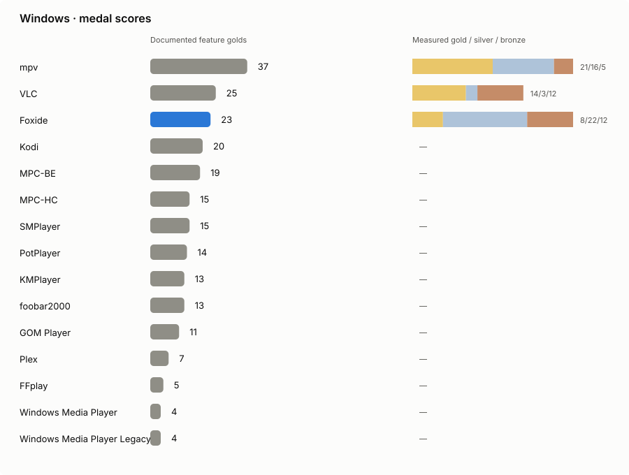
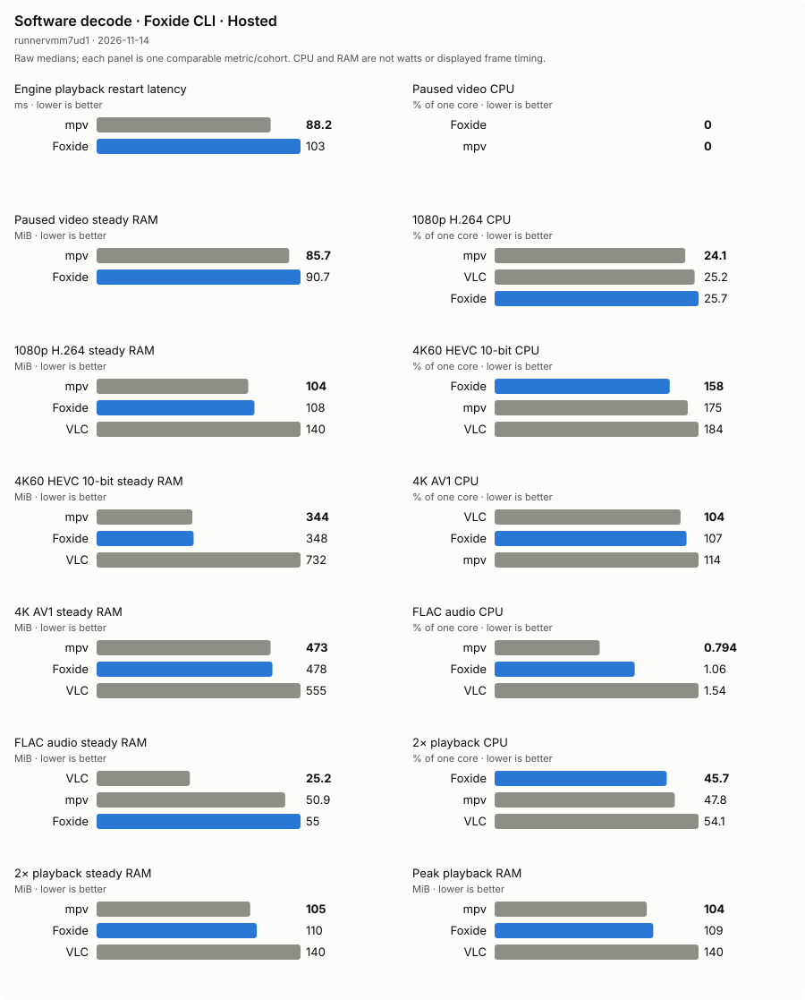
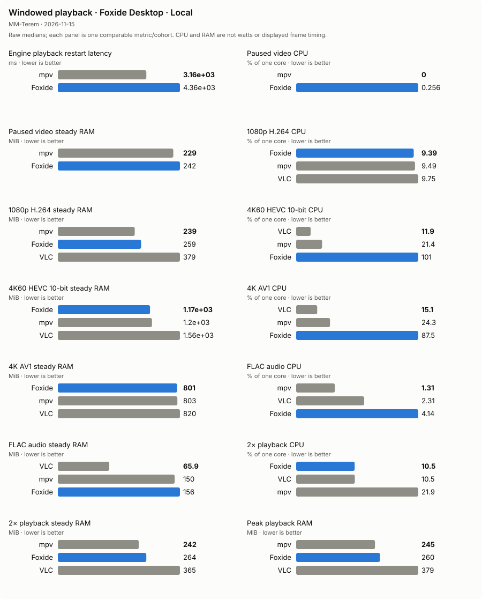
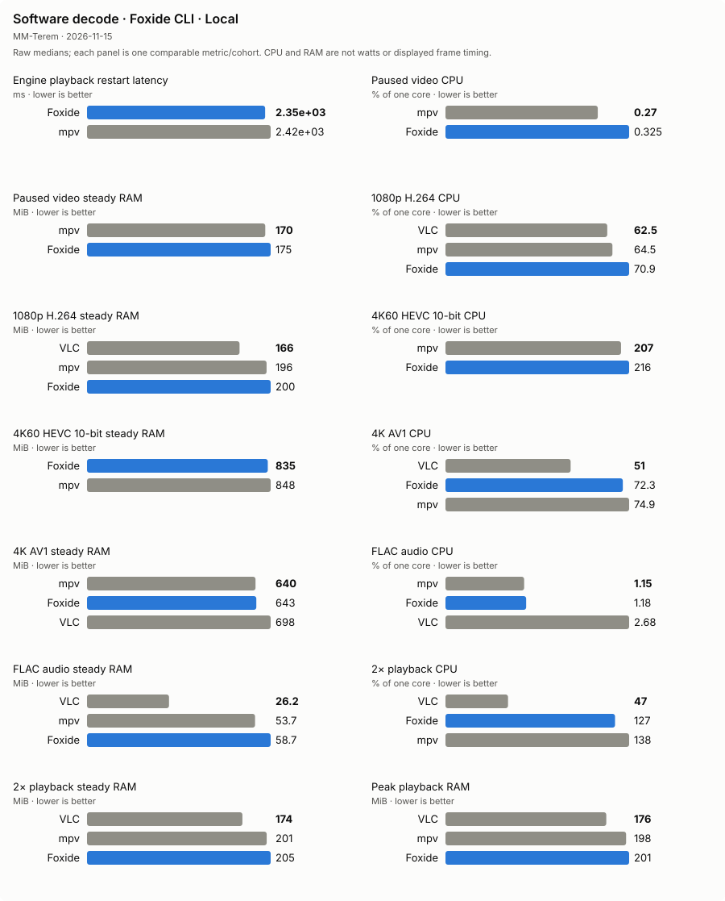
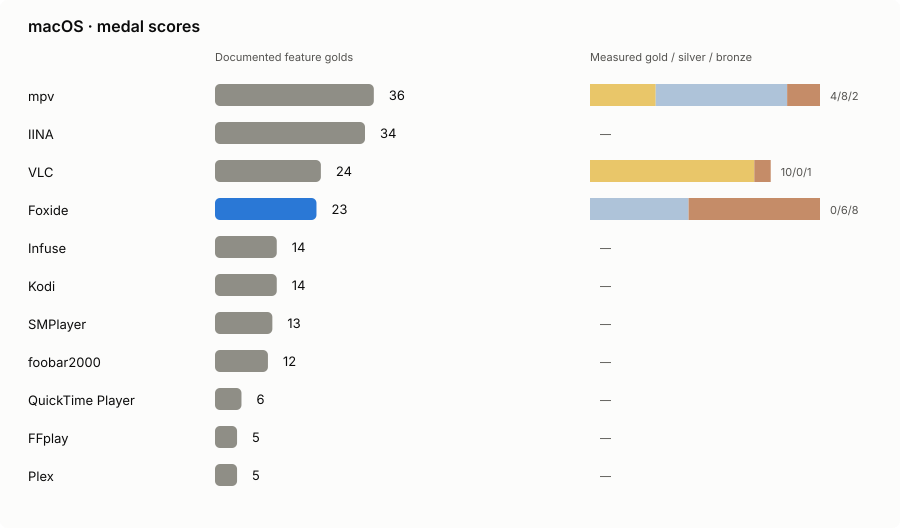
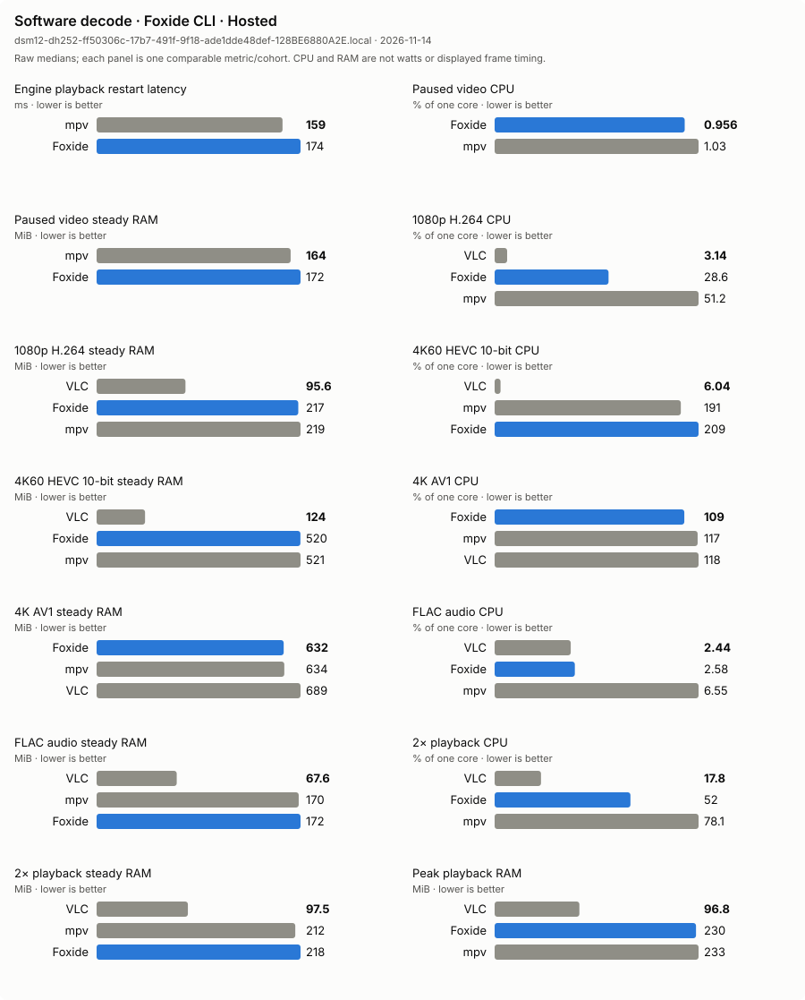
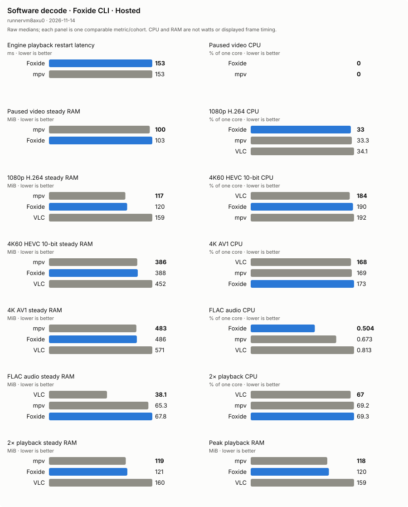

# Foxide

[](https://app.codspeed.io/marksmayo/foxide?utm_source=badge)

A Rust desktop media player with a Slint desktop preview and a transparent competitor scoreboard. The new desktop embeds libmpv in Foxide's own window; the existing `foxide` CLI still launches external mpv.

```powershell
cargo build -p player-ui --features desktop --bin foxide-desktop --release --locked
.\target\release\foxide-desktop.exe "C:\media\movie.mkv"
```

The desktop needs a libmpv ABI 2 library: Windows `tools/libmpv/libmpv-2.dll` or `FOXIDE_LIBMPV`, macOS `brew install mpv`, Linux your distribution's `libmpv2`. [Desktop setup and current limits](docs/desktop.md) · [UI action benchmarks](docs/ui-benchmarks.md). The UI includes menus, a playlist, file/URL opening, playback/speed/track controls, external subtitles, volume and fullscreen. Native playback, GPU interop and power acceptance remain in progress.

```powershell
.\target\release\foxide.exe "C:\media\movie.mkv"
.\target\release\foxide.exe --speed 1.5 --subtitle "C:\media\movie.srt" "C:\media\movie.mkv"
.\target\release\foxide.exe --autoqueue --resume-dir ".\results\local\resume" "C:\series\episode2.mkv"
```

Build with `cargo build --release --locked`. On Windows, `python scripts/install-mpv.py` installs a verified engine under `tools/mpv`. Playback controls include Space/pause, arrows/seek, Shift+arrows/exact seek, F/fullscreen, J/subtitles, #/audio track, S/screenshot, and Q/quit. Run `foxide --help` for tracks, offsets, tone mapping, picture controls, chapters, URLs, playlists, and window options.

[Performance implementation ledger](docs/performance-review/IMPLEMENTATION.md) · [Capabilities and remaining work](docs/features.md) · [Local players](docs/local-players.md) · [Benchmark protocol](docs/player-games.md) · [Architecture](docs/architecture.md) · [Actions](https://github.com/marksmayo/foxide/actions)

The **Player Games** workflow installs/attempts each platform's native field, records verified playback or labeled frontend diagnostics, produces the GitHub-native graphs, result tables, and expandable feature/metric details below; benchmark branches receive updates for PR review and downloadable HTML remains optional. Feature possession awards shared gold. Performance requires repeated, verified, comparable measurements. Hosted VMs have separate cohorts from physical GPU, battery, and displayed-frame tests.

Development follows red → green tests. CI enforces **90% Rust workspace line coverage** for default features and **90% coverage for medal/report policies**. Feature-gated desktop/native rendering is not yet covered by that threshold. A separate three-platform desktop workflow builds the GUI and renders a layout preview. Native PiP, thumbnails, drag-and-drop, persistent GUI resume, complete GUI coverage and physical GPU acceptance remain open.

<!-- foxide-scores:start -->
## Benchmark

### Latest results

Every metric is a separate medal event within one platform, host, fixture and settings cohort. Performance requires ≥3 verified repeats and ≥2 comparable entrants. Documented feature support earns shared gold; unknown does not mean unsupported.

Overall feature gold counts each feature once across applicable platforms; performance totals count every eligible field. These totals are not an overall speed ranking.

**Overall**

| Player | 🥇 | 🥈 | 🥉 | Total |
|---|---:|---:|---:|---:|
| mpv | 57 | 28 | 11 | 96 |
| VLC | 45 | 3 | 25 | 73 |
| Foxide | 39 | 37 | 17 | 93 |
| IINA | 27 | 0 | 0 | 27 |
| MPC-BE | 19 | 0 | 0 | 19 |
| PotPlayer | 13 | 0 | 0 | 13 |
| Infuse | 12 | 0 | 0 | 12 |
| GOM Player | 10 | 0 | 0 | 10 |
| MPC-HC | 10 | 0 | 0 | 10 |
| KMPlayer | 9 | 0 | 0 | 9 |
| SMPlayer | 9 | 0 | 0 | 9 |
| Kodi | 7 | 0 | 0 | 7 |
| foobar2000 | 6 | 0 | 0 | 6 |
| FFplay | 4 | 0 | 0 | 4 |
| Plex | 4 | 0 | 0 | 4 |
| QuickTime Player | 4 | 0 | 0 | 4 |
| Windows Media Player | 2 | 0 | 0 | 2 |
| Windows Media Player Legacy | 1 | 0 | 0 | 1 |

**Performance**

| Player | 🥇 | 🥈 | 🥉 | Total |
|---|---:|---:|---:|---:|
| mpv | 31 | 28 | 11 | 70 |
| VLC | 25 | 3 | 25 | 53 |
| Foxide | 16 | 37 | 17 | 70 |
| FFplay | 0 | 0 | 0 | 0 |
| GOM Player | 0 | 0 | 0 | 0 |
| IINA | 0 | 0 | 0 | 0 |
| Infuse | 0 | 0 | 0 | 0 |
| KMPlayer | 0 | 0 | 0 | 0 |
| Kodi | 0 | 0 | 0 | 0 |
| MPC-BE | 0 | 0 | 0 | 0 |
| MPC-HC | 0 | 0 | 0 | 0 |
| Plex | 0 | 0 | 0 | 0 |
| PotPlayer | 0 | 0 | 0 | 0 |
| QuickTime Player | 0 | 0 | 0 | 0 |
| SMPlayer | 0 | 0 | 0 | 0 |
| Windows Media Player | 0 | 0 | 0 | 0 |
| Windows Media Player Legacy | 0 | 0 | 0 | 0 |
| foobar2000 | 0 | 0 | 0 | 0 |

**Features**

| Player | 🥇 | 🥈 | 🥉 | Total |
|---|---:|---:|---:|---:|
| IINA | 27 | 0 | 0 | 27 |
| mpv | 26 | 0 | 0 | 26 |
| Foxide | 23 | 0 | 0 | 23 |
| VLC | 20 | 0 | 0 | 20 |
| MPC-BE | 19 | 0 | 0 | 19 |
| PotPlayer | 13 | 0 | 0 | 13 |
| Infuse | 12 | 0 | 0 | 12 |
| GOM Player | 10 | 0 | 0 | 10 |
| MPC-HC | 10 | 0 | 0 | 10 |
| KMPlayer | 9 | 0 | 0 | 9 |
| SMPlayer | 9 | 0 | 0 | 9 |
| Kodi | 7 | 0 | 0 | 7 |
| foobar2000 | 6 | 0 | 0 | 6 |
| FFplay | 4 | 0 | 0 | 4 |
| Plex | 4 | 0 | 0 | 4 |
| QuickTime Player | 4 | 0 | 0 | 4 |
| Windows Media Player | 2 | 0 | 0 | 2 |
| Windows Media Player Legacy | 1 | 0 | 0 | 1 |

[Raw scores](docs/scoreboards/medals.json) · [Feature sources](docs/scoreboards/features.json) · [Performance protocols](docs/scoreboards/performance-events.json) · [Download optional HTML](docs/scoreboards/report.html)

Windowed fields use **Foxide Desktop**; software-only fields use the **Foxide CLI** launcher. Engine playback evidence is distinct from physical frame presentation. UI-action metrics, displayed TTFF, power and battery results remain pending unless explicitly measured.

### Windows



| Player | 🥇 | 🥈 | 🥉 | Total |
|---|---:|---:|---:|---:|
| mpv | 48 | 16 | 4 | 68 |
| Foxide | 32 | 22 | 11 | 65 |
| VLC | 32 | 3 | 16 | 51 |
| MPC-BE | 19 | 0 | 0 | 19 |
| PotPlayer | 13 | 0 | 0 | 13 |
| GOM Player | 10 | 0 | 0 | 10 |
| MPC-HC | 10 | 0 | 0 | 10 |
| KMPlayer | 9 | 0 | 0 | 9 |
| SMPlayer | 9 | 0 | 0 | 9 |
| Kodi | 7 | 0 | 0 | 7 |
| foobar2000 | 6 | 0 | 0 | 6 |
| FFplay | 4 | 0 | 0 | 4 |
| Plex | 4 | 0 | 0 | 4 |
| Windows Media Player | 2 | 0 | 0 | 2 |
| Windows Media Player Legacy | 1 | 0 | 0 | 1 |

**Software decode · Foxide CLI · Hosted**

runnervmm7ud1 · Windows-2025Server-10.0.26100-SP0 · AMD64 · 2 logical CPUs · 2026-11-14T12:18:38.147125+00:00.

[Actions run](https://github.com/marksmayo/foxide/actions/runs/43593686026) · Source: `2875cbeef9ed7243e73b44335eedb810cc60b540`. Freshness is per field; older platform results are retained with their original collection dates.

Sampling: 8s after engine readiness, 2s warmup excluded; original collection order; cache state uncontrolled.

| Player | 🥇 | 🥈 | 🥉 | Total |
|---|---:|---:|---:|---:|
| mpv | 10 | 3 | 1 | 14 |
| Foxide | 3 | 9 | 2 | 14 |
| VLC | 2 | 1 | 8 | 11 |



<details><summary>Every measured metric — median values and podiums</summary>

| Metric | Foxide | VLC | mpv |
|---|---:|---:|---:|
| Engine playback restart latency | 103 ms | — | **88.2** ms |
| Paused video CPU | **0** % of one core | — | **0** % of one core |
| Paused video steady RAM | 90.7 MiB | — | **85.7** MiB |
| 1080p H.264 CPU | 25.7 % of one core | 25.2 % of one core | **24.1** % of one core |
| 1080p H.264 steady RAM | 108 MiB | 140 MiB | **104** MiB |
| 4K60 HEVC 10-bit CPU | **158** % of one core | 184 % of one core | 175 % of one core |
| 4K60 HEVC 10-bit steady RAM | 348 MiB | 732 MiB | **344** MiB |
| 4K AV1 CPU | 107 % of one core | **104** % of one core | 114 % of one core |
| 4K AV1 steady RAM | 478 MiB | 555 MiB | **473** MiB |
| FLAC audio CPU | 1.06 % of one core | 1.54 % of one core | **0.794** % of one core |
| FLAC audio steady RAM | 55 MiB | **25.2** MiB | 50.9 MiB |
| 2× playback CPU | **45.7** % of one core | 54.1 % of one core | 47.8 % of one core |
| 2× playback steady RAM | 110 MiB | 140 MiB | **105** MiB |
| Peak playback RAM | 109 MiB | 140 MiB | **104** MiB |

Bold values are gold medians. — means no eligible comparable result. Trial evidence and exact cohort IDs:

| Metric | Cohort | Trials per eligible entrant |
|---|---|---:|
| Engine playback restart latency | `vm-software-null-output/avc1080/e04828eb27f83752` | 3, 3 |
| Paused video CPU | `vm-software-null-output/paused/94639af1b8ea8a22` | 3, 3 |
| Paused video steady RAM | `vm-software-null-output/paused/94639af1b8ea8a22` | 3, 3 |
| 1080p H.264 CPU | `vm-software-null-output/avc1080/e04828eb27f83752` | 3, 3, 3 |
| 1080p H.264 steady RAM | `vm-software-null-output/avc1080/e04828eb27f83752` | 3, 3, 3 |
| 4K60 HEVC 10-bit CPU | `vm-software-null-output/hevc4k/26dbe62c8f570fef` | 3, 3, 3 |
| 4K60 HEVC 10-bit steady RAM | `vm-software-null-output/hevc4k/26dbe62c8f570fef` | 3, 3, 3 |
| 4K AV1 CPU | `vm-software-null-output/av14k/7ad23dc74fb1aa19` | 3, 3, 3 |
| 4K AV1 steady RAM | `vm-software-null-output/av14k/7ad23dc74fb1aa19` | 3, 3, 3 |
| FLAC audio CPU | `vm-software-null-output/flac/af777a91cf88831c` | 3, 3, 3 |
| FLAC audio steady RAM | `vm-software-null-output/flac/af777a91cf88831c` | 3, 3, 3 |
| 2× playback CPU | `vm-software-null-output/speed2x/1b113898b09c7c40` | 3, 3, 3 |
| 2× playback steady RAM | `vm-software-null-output/speed2x/1b113898b09c7c40` | 3, 3, 3 |
| Peak playback RAM | `vm-software-null-output/avc1080/e04828eb27f83752` | 3, 3, 3 |

</details>


**Windowed playback · Foxide Desktop · Local**

MM-Terem · Windows-11-10.0.26300-SP0 · 20 logical CPUs · 2026-11-15T04:01:52.019159+00:00.

Source: `372de990b8f2810a32e091b01a553a1ec5d3a76f`. Freshness is per field; older platform results are retained with their original collection dates.

Sampling: 8s after engine readiness, 2s warmup excluded; randomized order (seed 20261115); cache state uncontrolled.

Exploratory native playback at each player’s default window size and audio route; dimensions are not normalized. Hardware fallback and observer overhead differ. This field does not establish displayed FPS or battery efficiency.

| Observed decoder | Foxide | VLC | mpv |
|---|---|---|---|
| 1080p H.264 | d3d11va-copy | Not reported | d3d11va |
| 4K60 HEVC | d3d11va-copy | Not reported | d3d11va |
| 4K60 AV1 | d3d11va-copy | Not reported | d3d11va |

Engine observations, not scanout proof. The [mpv manual](https://mpv.io/manual/stable/#options-hwdec) identifies <code>d3d11va-copy</code> as copying decoded video into system RAM; this is not zero-copy.

| Player | 🥇 | 🥈 | 🥉 | Total |
|---|---:|---:|---:|---:|
| mpv | 7 | 6 | 1 | 14 |
| Foxide | 4 | 6 | 4 | 14 |
| VLC | 3 | 2 | 6 | 11 |



<details><summary>Every measured metric — median values and podiums</summary>

| Metric | Foxide | VLC | mpv |
|---|---:|---:|---:|
| Engine playback restart latency | 4.36e+03 ms | — | **3.16e+03** ms |
| Paused video CPU | 0.256 % of one core | — | **0** % of one core |
| Paused video steady RAM | 242 MiB | — | **229** MiB |
| 1080p H.264 CPU | **9.39** % of one core | 9.75 % of one core | 9.49 % of one core |
| 1080p H.264 steady RAM | 259 MiB | 379 MiB | **239** MiB |
| 4K60 HEVC 10-bit CPU | 101 % of one core | **11.9** % of one core | 21.4 % of one core |
| 4K60 HEVC 10-bit steady RAM | **1.17e+03** MiB | 1.56e+03 MiB | 1.2e+03 MiB |
| 4K AV1 CPU | 87.5 % of one core | **15.1** % of one core | 24.3 % of one core |
| 4K AV1 steady RAM | **801** MiB | 820 MiB | 803 MiB |
| FLAC audio CPU | 4.14 % of one core | 2.31 % of one core | **1.31** % of one core |
| FLAC audio steady RAM | 156 MiB | **65.9** MiB | 150 MiB |
| 2× playback CPU | **10.5** % of one core | 10.5 % of one core | 21.9 % of one core |
| 2× playback steady RAM | 264 MiB | 365 MiB | **242** MiB |
| Peak playback RAM | 260 MiB | 379 MiB | **245** MiB |

Bold values are gold medians. — means no eligible comparable result. Trial evidence and exact cohort IDs:

| Metric | Cohort | Trials per eligible entrant |
|---|---|---:|
| Engine playback restart latency | `native-default-window/avc1080/e5a3127a89486db7` | 3, 3 |
| Paused video CPU | `native-default-window/paused/4fe317a2a7ce449c` | 3, 3 |
| Paused video steady RAM | `native-default-window/paused/4fe317a2a7ce449c` | 3, 3 |
| 1080p H.264 CPU | `native-default-window/avc1080/e5a3127a89486db7` | 3, 3, 3 |
| 1080p H.264 steady RAM | `native-default-window/avc1080/e5a3127a89486db7` | 3, 3, 3 |
| 4K60 HEVC 10-bit CPU | `native-default-window/hevc4k/2e513aff25627cca` | 3, 3, 3 |
| 4K60 HEVC 10-bit steady RAM | `native-default-window/hevc4k/2e513aff25627cca` | 3, 3, 3 |
| 4K AV1 CPU | `native-default-window/av14k/50e9d1024fa3f2f7` | 3, 3, 3 |
| 4K AV1 steady RAM | `native-default-window/av14k/50e9d1024fa3f2f7` | 3, 3, 3 |
| FLAC audio CPU | `native-default-window/flac/3a05bf63a227e2b5` | 3, 3, 3 |
| FLAC audio steady RAM | `native-default-window/flac/3a05bf63a227e2b5` | 3, 3, 3 |
| 2× playback CPU | `native-default-window/speed2x/4c72021d4bdad5b6` | 3, 3, 3 |
| 2× playback steady RAM | `native-default-window/speed2x/4c72021d4bdad5b6` | 3, 3, 3 |
| Peak playback RAM | `native-default-window/avc1080/e5a3127a89486db7` | 3, 3, 3 |

</details>


**Software decode · Foxide CLI · Local**

MM-Terem · Windows-11-10.0.26300-SP0 · 20 logical CPUs · 2026-11-15T04:29:30.454755+00:00.

Source: `188f2e6b49b5d638b7f641b47d13ae0ee6906740`. Freshness is per field; older platform results are retained with their original collection dates.

Sampling: 8s after engine readiness, 2s warmup excluded; randomized order (seed 20261115); cache state uncontrolled.

| Player | 🥇 | 🥈 | 🥉 | Total |
|---|---:|---:|---:|---:|
| VLC | 7 | 0 | 2 | 9 |
| mpv | 5 | 7 | 2 | 14 |
| Foxide | 2 | 7 | 5 | 14 |



<details><summary>Every measured metric — median values and podiums</summary>

| Metric | Foxide | VLC | mpv |
|---|---:|---:|---:|
| Engine playback restart latency | **2.35e+03** ms | — | 2.42e+03 ms |
| Paused video CPU | 0.325 % of one core | — | **0.27** % of one core |
| Paused video steady RAM | 175 MiB | — | **170** MiB |
| 1080p H.264 CPU | 70.9 % of one core | **62.5** % of one core | 64.5 % of one core |
| 1080p H.264 steady RAM | 200 MiB | **166** MiB | 196 MiB |
| 4K60 HEVC 10-bit CPU | 216 % of one core | — | **207** % of one core |
| 4K60 HEVC 10-bit steady RAM | **835** MiB | — | 848 MiB |
| 4K AV1 CPU | 72.3 % of one core | **51** % of one core | 74.9 % of one core |
| 4K AV1 steady RAM | 643 MiB | 698 MiB | **640** MiB |
| FLAC audio CPU | 1.18 % of one core | 2.68 % of one core | **1.15** % of one core |
| FLAC audio steady RAM | 58.7 MiB | **26.2** MiB | 53.7 MiB |
| 2× playback CPU | 127 % of one core | **47** % of one core | 138 % of one core |
| 2× playback steady RAM | 205 MiB | **174** MiB | 201 MiB |
| Peak playback RAM | 201 MiB | **176** MiB | 198 MiB |

Bold values are gold medians. — means no eligible comparable result. Trial evidence and exact cohort IDs:

| Metric | Cohort | Trials per eligible entrant |
|---|---|---:|
| Engine playback restart latency | `software-null-output/avc1080/627de1d25dff605b` | 3, 3 |
| Paused video CPU | `software-null-output/paused/daf715b1bd930d72` | 3, 3 |
| Paused video steady RAM | `software-null-output/paused/daf715b1bd930d72` | 3, 3 |
| 1080p H.264 CPU | `software-null-output/avc1080/627de1d25dff605b` | 3, 3, 3 |
| 1080p H.264 steady RAM | `software-null-output/avc1080/627de1d25dff605b` | 3, 3, 3 |
| 4K60 HEVC 10-bit CPU | `software-null-output/hevc4k/bef5bd64c814bebc` | 3, 3 |
| 4K60 HEVC 10-bit steady RAM | `software-null-output/hevc4k/bef5bd64c814bebc` | 3, 3 |
| 4K AV1 CPU | `software-null-output/av14k/4c0374fd24a77a8b` | 3, 3, 3 |
| 4K AV1 steady RAM | `software-null-output/av14k/4c0374fd24a77a8b` | 3, 3, 3 |
| FLAC audio CPU | `software-null-output/flac/243ea89a8ffb1188` | 3, 3, 3 |
| FLAC audio steady RAM | `software-null-output/flac/243ea89a8ffb1188` | 3, 3, 3 |
| 2× playback CPU | `software-null-output/speed2x/f035ebb00f869495` | 3, 3, 3 |
| 2× playback steady RAM | `software-null-output/speed2x/f035ebb00f869495` | 3, 3, 3 |
| Peak playback RAM | `software-null-output/avc1080/627de1d25dff605b` | 3, 3, 3 |

</details>

<details><summary>Runtime outcomes and feature events</summary>

| Player | Runtime outcome | Evidence / limitation |
|---|---|---|
| Foxide | Verified playback 54/57 | sampled-playback-unverified, verified-playback |
| VLC | Verified playback 44/57 | playback-readiness-timeout, sampled-playback-unverified, verified-playback |
| mpv | Verified playback 54/57 | sampled-playback-unverified, verified-playback |
| Windows Media Player | install-blocked | Local Store package was not registered; WinGet list/install both returned 0x8A150001. Store desktop control is unavailable. Interactive Store installation is pending. |
| Windows Media Player Legacy | Unverified / diagnostic (6 cases) | early-exit, sampled-playback-unverified |
| MPC-HC | Unverified / diagnostic (6 cases) | sampled-playback-unverified |
| MPC-BE | Unverified / diagnostic (6 cases) | sampled-playback-unverified |
| PotPlayer | Unverified / diagnostic (6 cases) | sampled-playback-unverified |
| SMPlayer | Unverified / diagnostic (6 cases) | sampled-playback-unverified |
| KMPlayer | Unverified / diagnostic (3 cases) | early-exit, sampled-playback-unverified |
| GOM Player | Unverified / diagnostic (3 cases) | sampled-playback-unverified |
| FFplay | Unverified / diagnostic (6 cases) | sampled-playback-unverified |
| Kodi | Unverified / diagnostic (6 cases) | sampled-playback-unverified |
| Plex | Unverified / diagnostic (6 cases) | early-exit, sampled-playback-unverified |
| foobar2000 | Unverified / diagnostic (6 cases) | sampled-playback-unverified |

| Feature | Foxide | VLC | mpv | Windows Media Player | Windows Media Player Legacy | MPC-HC | MPC-BE | PotPlayer | SMPlayer | KMPlayer | GOM Player | FFplay | Kodi | Plex | foobar2000 |
|---|---:|---:|---:|---:|---:|---:|---:|---:|---:|---:|---:|---:|---:|---:|---:|
| MP4 and MKV playback | 🥇 | 🥇 | 🥇 | ? | ? | ? | 🥇 | 🥇 | 🥇 | 🥇 | ? | ? | ? | ? | N/A |
| FLAC audio | 🥇 | 🥇 | 🥇 | ? | ? | ? | 🥇 | 🥇 | ? | 🥇 | ? | ? | ? | ? | 🥇 |
| Hardware decoding | 🥇 | 🥇 | 🥇 | ? | ? | ? | 🥇 | 🥇 | ? | 🥇 | ? | ? | 🥇 | ? | N/A |
| Audio track selection | 🥇 | 🥇 | 🥇 | ? | ? | ? | 🥇 | ? | 🥇 | ? | 🥇 | 🥇 | 🥇 | 🥇 | N/A |
| Subtitle track selection | 🥇 | 🥇 | 🥇 | ? | ? | ? | 🥇 | 🥇 | 🥇 | ? | ? | 🥇 | 🥇 | 🥇 | N/A |
| External subtitle files | 🥇 | 🥇 | 🥇 | ? | ? | ? | 🥇 | ? | 🥇 | 🥇 | 🥇 | ? | 🥇 | ? | N/A |
| ASS/SSA subtitle rendering | 🥇 | 🥇 | 🥇 | ? | ? | 🥇 | 🥇 | 🥇 | ? | 🥇 | ? | ? | ? | ? | N/A |
| Variable playback speed | 🥇 | 🥇 | 🥇 | ? | 🥇 | 🥇 | 🥇 | 🥇 | 🥇 | ? | 🥇 | ? | ? | 🥇 | ? |
| Playlists | 🥇 | 🥇 | 🥇 | 🥇 | ? | ? | 🥇 | 🥇 | ? | 🥇 | 🥇 | ? | ? | ? | ? |
| Keyboard controls | 🥇 | 🥇 | 🥇 | 🥇 | ? | 🥇 | ? | ? | ? | ? | 🥇 | 🥇 | ? | 🥇 | 🥇 |
| Frame-accurate seeking | 🥇 | ? | 🥇 | ? | ? | ? | ? | ? | ? | ? | ? | ? | ? | ? | N/A |
| Seekbar thumbnail previews | ? | ? | ? | ? | ? | 🥇 | 🥇 | ? | ? | ? | ? | ? | ? | ? | N/A |
| HDR video playback | 🥇 | ? | 🥇 | ? | ? | 🥇 | 🥇 | 🥇 | ? | ? | ? | ? | ? | ? | N/A |
| HDR to SDR tone mapping | 🥇 | ? | 🥇 | ? | ? | ? | ? | 🥇 | ? | ? | ? | ? | ? | ? | N/A |
| Audio synchronization offset | 🥇 | 🥇 | 🥇 | ? | ? | ? | 🥇 | ? | 🥇 | ? | ? | ? | 🥇 | ? | N/A |
| Subtitle synchronization offset | 🥇 | 🥇 | 🥇 | ? | ? | ? | 🥇 | ? | 🥇 | ? | 🥇 | ? | 🥇 | ? | N/A |
| Video filters and adjustments | 🥇 | 🥇 | 🥇 | ? | ? | 🥇 | 🥇 | 🥇 | 🥇 | 🥇 | 🥇 | 🥇 | ? | ? | N/A |
| Chapter navigation | 🥇 | 🥇 | 🥇 | ? | ? | ? | 🥇 | ? | ? | ? | ? | ? | 🥇 | ? | ? |
| Native picture in picture | ? | ? | ? | ? | ? | ? | ? | ? | ? | ? | ? | ? | ? | ? | N/A |
| Network stream playback | 🥇 | 🥇 | 🥇 | ? | ? | 🥇 | 🥇 | 🥇 | ? | 🥇 | ? | ? | ? | ? | 🥇 |
| Persistent playback resume | 🥇 | ? | 🥇 | ? | ? | 🥇 | ? | ? | 🥇 | ? | ? | ? | ? | ? | ? |
| Automatic folder playback | 🥇 | ? | ? | ? | ? | 🥇 | ? | ? | ? | ? | ? | ? | ? | ? | ? |
| Borderless viewing mode | 🥇 | ? | 🥇 | ? | ? | ? | ? | ? | ? | ? | ? | ? | ? | ? | ? |
| Video screenshots | 🥇 | 🥇 | 🥇 | ? | ? | ? | 🥇 | 🥇 | ? | 🥇 | 🥇 | ? | ? | ? | N/A |
| A–B repeat | 🥇 | 🥇 | 🥇 | ? | ? | 🥇 | 🥇 | ? | ? | ? | 🥇 | ? | ? | ? | ? |
| Audio equalizer / DSP | ? | 🥇 | 🥇 | ? | ? | ? | ? | ? | ? | ? | ? | ? | ? | ? | 🥇 |
| ReplayGain | ? | 🥇 | 🥇 | ? | ? | ? | ? | 🥇 | ? | ? | ? | ? | ? | ? | 🥇 |
| Gapless audio playback | ? | ? | 🥇 | ? | ? | ? | ? | ? | ? | ? | ? | ? | ? | ? | 🥇 |
| DVD / Blu-ray structure playback | ? | 🥇 | 🥇 | ? | ? | ? | 🥇 | ? | ? | ? | 🥇 | ? | ? | ? | N/A |
| AirPlay / Cast output | ? | ? | ? | ? | ? | ? | ? | ? | ? | ? | ? | ? | ? | ? | ? |

? = undocumented/unverified. N/A = inapplicable media type.

</details>

### macOS



| Player | 🥇 | 🥈 | 🥉 | Total |
|---|---:|---:|---:|---:|
| VLC | 29 | 0 | 2 | 31 |
| mpv | 28 | 6 | 6 | 40 |
| IINA | 27 | 0 | 0 | 27 |
| Foxide | 26 | 8 | 3 | 37 |
| Infuse | 12 | 0 | 0 | 12 |
| SMPlayer | 9 | 0 | 0 | 9 |
| Kodi | 7 | 0 | 0 | 7 |
| foobar2000 | 6 | 0 | 0 | 6 |
| FFplay | 4 | 0 | 0 | 4 |
| Plex | 4 | 0 | 0 | 4 |
| QuickTime Player | 4 | 0 | 0 | 4 |

**Software decode · Foxide CLI · Hosted**

dsm12-dh252-ff50306c-17b7-491f-9f18-ade1dde48def-128BE6880A2E.local · macOS-15.8.2-arm64-arm-64bit · arm64 · 5 logical CPUs · 2026-11-14T12:16:24.783861+00:00.

[Actions run](https://github.com/marksmayo/foxide/actions/runs/43593686026) · Source: `2875cbeef9ed7243e73b44335eedb810cc60b540`. Freshness is per field; older platform results are retained with their original collection dates.

Sampling: 8s after engine readiness, 2s warmup excluded; original collection order; cache state uncontrolled.

| Player | 🥇 | 🥈 | 🥉 | Total |
|---|---:|---:|---:|---:|
| VLC | 9 | 0 | 2 | 11 |
| Foxide | 3 | 8 | 3 | 14 |
| mpv | 2 | 6 | 6 | 14 |



<details><summary>Every measured metric — median values and podiums</summary>

| Metric | Foxide | VLC | mpv |
|---|---:|---:|---:|
| Engine playback restart latency | 174 ms | — | **159** ms |
| Paused video CPU | **0.956** % of one core | — | 1.03 % of one core |
| Paused video steady RAM | 172 MiB | — | **164** MiB |
| 1080p H.264 CPU | 28.6 % of one core | **3.14** % of one core | 51.2 % of one core |
| 1080p H.264 steady RAM | 217 MiB | **95.6** MiB | 219 MiB |
| 4K60 HEVC 10-bit CPU | 209 % of one core | **6.04** % of one core | 191 % of one core |
| 4K60 HEVC 10-bit steady RAM | 520 MiB | **124** MiB | 521 MiB |
| 4K AV1 CPU | **109** % of one core | 118 % of one core | 117 % of one core |
| 4K AV1 steady RAM | **632** MiB | 689 MiB | 634 MiB |
| FLAC audio CPU | 2.58 % of one core | **2.44** % of one core | 6.55 % of one core |
| FLAC audio steady RAM | 172 MiB | **67.6** MiB | 170 MiB |
| 2× playback CPU | 52 % of one core | **17.8** % of one core | 78.1 % of one core |
| 2× playback steady RAM | 218 MiB | **97.5** MiB | 212 MiB |
| Peak playback RAM | 230 MiB | **96.8** MiB | 233 MiB |

Bold values are gold medians. — means no eligible comparable result. Trial evidence and exact cohort IDs:

| Metric | Cohort | Trials per eligible entrant |
|---|---|---:|
| Engine playback restart latency | `vm-software-null-output/avc1080/783e332d3096ad53` | 3, 3 |
| Paused video CPU | `vm-software-null-output/paused/0bea2801485d4ab6` | 3, 3 |
| Paused video steady RAM | `vm-software-null-output/paused/0bea2801485d4ab6` | 3, 3 |
| 1080p H.264 CPU | `vm-software-null-output/avc1080/783e332d3096ad53` | 3, 3, 3 |
| 1080p H.264 steady RAM | `vm-software-null-output/avc1080/783e332d3096ad53` | 3, 3, 3 |
| 4K60 HEVC 10-bit CPU | `vm-software-null-output/hevc4k/7e2fcf4d2dbe83e0` | 3, 3, 3 |
| 4K60 HEVC 10-bit steady RAM | `vm-software-null-output/hevc4k/7e2fcf4d2dbe83e0` | 3, 3, 3 |
| 4K AV1 CPU | `vm-software-null-output/av14k/cc549dfb583cc5cd` | 3, 3, 3 |
| 4K AV1 steady RAM | `vm-software-null-output/av14k/cc549dfb583cc5cd` | 3, 3, 3 |
| FLAC audio CPU | `vm-software-null-output/flac/7de95cd24bb6c63f` | 3, 3, 3 |
| FLAC audio steady RAM | `vm-software-null-output/flac/7de95cd24bb6c63f` | 3, 3, 3 |
| 2× playback CPU | `vm-software-null-output/speed2x/c8eb09adbcf8aeaa` | 3, 3, 3 |
| 2× playback steady RAM | `vm-software-null-output/speed2x/c8eb09adbcf8aeaa` | 3, 3, 3 |
| Peak playback RAM | `vm-software-null-output/avc1080/783e332d3096ad53` | 3, 3, 3 |

</details>

<details><summary>Runtime outcomes and feature events</summary>

| Player | Runtime outcome | Evidence / limitation |
|---|---|---|
| Foxide | Verified playback 18/21 | sampled-playback-unverified, verified-playback |
| VLC | Verified playback 15/21 | playback-readiness-timeout, sampled-playback-unverified, verified-playback |
| mpv | Verified playback 18/21 | sampled-playback-unverified, verified-playback |
| SMPlayer | not-detected | No native executable found; packaged-app/account/Store activation may need a dedicated adapter. |
| FFplay | Unverified / diagnostic (3 cases) | sampled-playback-unverified |
| Kodi | Unverified / diagnostic (3 cases) | early-exit |
| Plex | Unverified / diagnostic (3 cases) | sampled-playback-unverified |
| foobar2000 | Unverified / diagnostic (3 cases) | sampled-playback-unverified |
| Infuse | not-detected | No native executable found; packaged-app/account/Store activation may need a dedicated adapter. |
| IINA | Unverified / diagnostic (3 cases) | sampled-playback-unverified |
| QuickTime Player | Unverified / diagnostic (3 cases) | sampled-playback-unverified |

| Feature | Foxide | VLC | mpv | SMPlayer | FFplay | Kodi | Plex | foobar2000 | Infuse | IINA | QuickTime Player |
|---|---:|---:|---:|---:|---:|---:|---:|---:|---:|---:|---:|
| MP4 and MKV playback | 🥇 | 🥇 | 🥇 | 🥇 | ? | ? | ? | N/A | 🥇 | 🥇 | ? |
| FLAC audio | 🥇 | 🥇 | 🥇 | ? | ? | ? | ? | 🥇 | ? | 🥇 | ? |
| Hardware decoding | 🥇 | 🥇 | 🥇 | ? | ? | 🥇 | ? | N/A | 🥇 | 🥇 | ? |
| Audio track selection | 🥇 | 🥇 | 🥇 | 🥇 | 🥇 | 🥇 | 🥇 | N/A | 🥇 | 🥇 | ? |
| Subtitle track selection | 🥇 | 🥇 | 🥇 | 🥇 | 🥇 | 🥇 | 🥇 | N/A | 🥇 | 🥇 | 🥇 |
| External subtitle files | 🥇 | 🥇 | 🥇 | 🥇 | ? | 🥇 | ? | N/A | 🥇 | 🥇 | ? |
| ASS/SSA subtitle rendering | 🥇 | 🥇 | 🥇 | ? | ? | ? | ? | N/A | 🥇 | 🥇 | ? |
| Variable playback speed | 🥇 | 🥇 | 🥇 | 🥇 | ? | ? | 🥇 | ? | 🥇 | 🥇 | 🥇 |
| Playlists | 🥇 | 🥇 | 🥇 | ? | ? | ? | ? | ? | ? | 🥇 | ? |
| Keyboard controls | 🥇 | 🥇 | 🥇 | ? | 🥇 | ? | 🥇 | 🥇 | ? | 🥇 | ? |
| Frame-accurate seeking | 🥇 | ? | 🥇 | ? | ? | ? | ? | N/A | ? | 🥇 | ? |
| Seekbar thumbnail previews | ? | ? | ? | ? | ? | ? | ? | N/A | ? | 🥇 | ? |
| HDR video playback | 🥇 | ? | 🥇 | ? | ? | ? | ? | N/A | 🥇 | 🥇 | ? |
| HDR to SDR tone mapping | 🥇 | ? | 🥇 | ? | ? | ? | ? | N/A | ? | 🥇 | ? |
| Audio synchronization offset | 🥇 | 🥇 | 🥇 | 🥇 | ? | 🥇 | ? | N/A | ? | 🥇 | ? |
| Subtitle synchronization offset | 🥇 | 🥇 | 🥇 | 🥇 | ? | 🥇 | ? | N/A | ? | 🥇 | ? |
| Video filters and adjustments | 🥇 | 🥇 | 🥇 | 🥇 | 🥇 | ? | ? | N/A | ? | 🥇 | ? |
| Chapter navigation | 🥇 | 🥇 | 🥇 | ? | ? | 🥇 | ? | ? | 🥇 | 🥇 | ? |
| Native picture in picture | ? | ? | ? | ? | ? | ? | ? | N/A | 🥇 | 🥇 | 🥇 |
| Network stream playback | 🥇 | 🥇 | 🥇 | ? | ? | ? | ? | 🥇 | ? | 🥇 | ? |
| Persistent playback resume | 🥇 | ? | 🥇 | 🥇 | ? | ? | ? | ? | ? | 🥇 | ? |
| Automatic folder playback | 🥇 | ? | ? | ? | ? | ? | ? | ? | 🥇 | 🥇 | ? |
| Borderless viewing mode | 🥇 | ? | 🥇 | ? | ? | ? | ? | ? | ? | ? | ? |
| Video screenshots | 🥇 | 🥇 | 🥇 | ? | ? | ? | ? | N/A | ? | 🥇 | ? |
| A–B repeat | 🥇 | 🥇 | 🥇 | ? | ? | ? | ? | ? | ? | 🥇 | ? |
| Audio equalizer / DSP | ? | 🥇 | 🥇 | ? | ? | ? | ? | 🥇 | ? | 🥇 | ? |
| ReplayGain | ? | 🥇 | 🥇 | ? | ? | ? | ? | 🥇 | ? | 🥇 | ? |
| Gapless audio playback | ? | ? | 🥇 | ? | ? | ? | ? | 🥇 | ? | 🥇 | ? |
| DVD / Blu-ray structure playback | ? | 🥇 | 🥇 | ? | ? | ? | ? | N/A | ? | ? | ? |
| AirPlay / Cast output | ? | ? | ? | ? | ? | ? | ? | ? | 🥇 | ? | 🥇 |

? = undocumented/unverified. N/A = inapplicable media type.

</details>

### Linux


| Player | 🥇 | 🥈 | 🥉 | Total |
|---|---:|---:|---:|---:|
| mpv | 33 | 6 | 1 | 40 |
| Foxide | 27 | 7 | 3 | 37 |
| VLC | 24 | 0 | 7 | 31 |
| SMPlayer | 9 | 0 | 0 | 9 |
| Kodi | 7 | 0 | 0 | 7 |
| FFplay | 4 | 0 | 0 | 4 |

**Software decode · Foxide CLI · Hosted**

runnervm8axu0 · Linux-7.0.0-1017-azure-x86_64-with-glibc2.39 · x86_64 · 2 logical CPUs · 2026-11-14T12:15:22.792611+00:00.

[Actions run](https://github.com/marksmayo/foxide/actions/runs/43593686026) · Source: `2875cbeef9ed7243e73b44335eedb810cc60b540`. Freshness is per field; older platform results are retained with their original collection dates.

Sampling: 8s after engine readiness, 2s warmup excluded; original collection order; cache state uncontrolled.

| Player | 🥇 | 🥈 | 🥉 | Total |
|---|---:|---:|---:|---:|
| mpv | 7 | 6 | 1 | 14 |
| Foxide | 4 | 7 | 3 | 14 |
| VLC | 4 | 0 | 7 | 11 |



<details><summary>Every measured metric — median values and podiums</summary>

| Metric | Foxide | VLC | mpv |
|---|---:|---:|---:|
| Engine playback restart latency | **153** ms | — | 153 ms |
| Paused video CPU | **0** % of one core | — | **0** % of one core |
| Paused video steady RAM | 103 MiB | — | **100** MiB |
| 1080p H.264 CPU | **33** % of one core | 34.1 % of one core | 33.3 % of one core |
| 1080p H.264 steady RAM | 120 MiB | 159 MiB | **117** MiB |
| 4K60 HEVC 10-bit CPU | 190 % of one core | **184** % of one core | 192 % of one core |
| 4K60 HEVC 10-bit steady RAM | 388 MiB | 452 MiB | **386** MiB |
| 4K AV1 CPU | 173 % of one core | **168** % of one core | 169 % of one core |
| 4K AV1 steady RAM | 486 MiB | 571 MiB | **483** MiB |
| FLAC audio CPU | **0.504** % of one core | 0.813 % of one core | 0.673 % of one core |
| FLAC audio steady RAM | 67.8 MiB | **38.1** MiB | 65.3 MiB |
| 2× playback CPU | 69.3 % of one core | **67** % of one core | 69.2 % of one core |
| 2× playback steady RAM | 121 MiB | 160 MiB | **119** MiB |
| Peak playback RAM | 120 MiB | 159 MiB | **118** MiB |

Bold values are gold medians. — means no eligible comparable result. Trial evidence and exact cohort IDs:

| Metric | Cohort | Trials per eligible entrant |
|---|---|---:|
| Engine playback restart latency | `vm-software-null-output/avc1080/86b43f89289300e5` | 3, 3 |
| Paused video CPU | `vm-software-null-output/paused/4109bf58eb7c5e1f` | 3, 3 |
| Paused video steady RAM | `vm-software-null-output/paused/4109bf58eb7c5e1f` | 3, 3 |
| 1080p H.264 CPU | `vm-software-null-output/avc1080/86b43f89289300e5` | 3, 3, 3 |
| 1080p H.264 steady RAM | `vm-software-null-output/avc1080/86b43f89289300e5` | 3, 3, 3 |
| 4K60 HEVC 10-bit CPU | `vm-software-null-output/hevc4k/30a9256e4b744531` | 3, 3, 3 |
| 4K60 HEVC 10-bit steady RAM | `vm-software-null-output/hevc4k/30a9256e4b744531` | 3, 3, 3 |
| 4K AV1 CPU | `vm-software-null-output/av14k/26bb47ccf49f4e14` | 3, 3, 3 |
| 4K AV1 steady RAM | `vm-software-null-output/av14k/26bb47ccf49f4e14` | 3, 3, 3 |
| FLAC audio CPU | `vm-software-null-output/flac/c7d7fc662ec00a63` | 3, 3, 3 |
| FLAC audio steady RAM | `vm-software-null-output/flac/c7d7fc662ec00a63` | 3, 3, 3 |
| 2× playback CPU | `vm-software-null-output/speed2x/f02685815b83eb43` | 3, 3, 3 |
| 2× playback steady RAM | `vm-software-null-output/speed2x/f02685815b83eb43` | 3, 3, 3 |
| Peak playback RAM | `vm-software-null-output/avc1080/86b43f89289300e5` | 3, 3, 3 |

</details>

<details><summary>Runtime outcomes and feature events</summary>

| Player | Runtime outcome | Evidence / limitation |
|---|---|---|
| Foxide | Verified playback 18/21 | sampled-playback-unverified, verified-playback |
| VLC | Verified playback 15/21 | playback-readiness-timeout, sampled-playback-unverified, verified-playback |
| mpv | Verified playback 18/21 | sampled-playback-unverified, verified-playback |
| SMPlayer | Unverified / diagnostic (3 cases) | sampled-playback-unverified |
| FFplay | Unverified / diagnostic (3 cases) | sampled-playback-unverified |
| Kodi | Unverified / diagnostic (3 cases) | early-exit |

| Feature | Foxide | VLC | mpv | SMPlayer | FFplay | Kodi |
|---|---:|---:|---:|---:|---:|---:|
| MP4 and MKV playback | 🥇 | 🥇 | 🥇 | 🥇 | ? | ? |
| FLAC audio | 🥇 | 🥇 | 🥇 | ? | ? | ? |
| Hardware decoding | 🥇 | 🥇 | 🥇 | ? | ? | 🥇 |
| Audio track selection | 🥇 | 🥇 | 🥇 | 🥇 | 🥇 | 🥇 |
| Subtitle track selection | 🥇 | 🥇 | 🥇 | 🥇 | 🥇 | 🥇 |
| External subtitle files | 🥇 | 🥇 | 🥇 | 🥇 | ? | 🥇 |
| ASS/SSA subtitle rendering | 🥇 | 🥇 | 🥇 | ? | ? | ? |
| Variable playback speed | 🥇 | 🥇 | 🥇 | 🥇 | ? | ? |
| Playlists | 🥇 | 🥇 | 🥇 | ? | ? | ? |
| Keyboard controls | 🥇 | 🥇 | 🥇 | ? | 🥇 | ? |
| Frame-accurate seeking | 🥇 | ? | 🥇 | ? | ? | ? |
| Seekbar thumbnail previews | ? | ? | ? | ? | ? | ? |
| HDR video playback | 🥇 | ? | 🥇 | ? | ? | ? |
| HDR to SDR tone mapping | 🥇 | ? | 🥇 | ? | ? | ? |
| Audio synchronization offset | 🥇 | 🥇 | 🥇 | 🥇 | ? | 🥇 |
| Subtitle synchronization offset | 🥇 | 🥇 | 🥇 | 🥇 | ? | 🥇 |
| Video filters and adjustments | 🥇 | 🥇 | 🥇 | 🥇 | 🥇 | ? |
| Chapter navigation | 🥇 | 🥇 | 🥇 | ? | ? | 🥇 |
| Native picture in picture | ? | ? | ? | ? | ? | ? |
| Network stream playback | 🥇 | 🥇 | 🥇 | ? | ? | ? |
| Persistent playback resume | 🥇 | ? | 🥇 | 🥇 | ? | ? |
| Automatic folder playback | 🥇 | ? | ? | ? | ? | ? |
| Borderless viewing mode | 🥇 | ? | 🥇 | ? | ? | ? |
| Video screenshots | 🥇 | 🥇 | 🥇 | ? | ? | ? |
| A–B repeat | 🥇 | 🥇 | 🥇 | ? | ? | ? |
| Audio equalizer / DSP | ? | 🥇 | 🥇 | ? | ? | ? |
| ReplayGain | ? | 🥇 | 🥇 | ? | ? | ? |
| Gapless audio playback | ? | ? | 🥇 | ? | ? | ? |
| DVD / Blu-ray structure playback | ? | 🥇 | 🥇 | ? | ? | ? |
| AirPlay / Cast output | ? | ? | ? | ? | ? | ? |

? = undocumented/unverified. N/A = inapplicable media type.

</details>

<!-- foxide-scores:end -->
