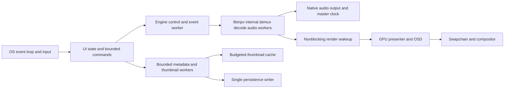

# Foxide engineering design

Status: desktop preview implemented with Slint and a libmpv/OpenGL texture compositor. Baselines exist for hosted software/null-output cohorts. Native-power parity and decoder/display zero-copy remain unverified. Windows has a local desktop build; macOS/Linux require build and real-hardware validation. [Current desktop ADR](adr/0004-slint-desktop.md) supersedes the original UI recommendation below.

## Product constraints and recommendation

Use libmpv for v0.1 playback, with a small safe Rust boundary and an explicit rendering capability probe. Use egui for the OSD, with an initial same-context OpenGL renderer (`egui_glow`), and pursue native D3D11 composition on Windows where a pinned libmpv build supports the newer D3D11 render API. This balances broad format support and initial scope; it does not establish battery parity. See [backend ADR](adr/0001-media-backend.md), [UI ADR](adr/0002-ui-framework.md) and [GPU ADR](adr/0003-gpu-presentation.md).

Start with the engine's own audio output and synchronization. Do not decode with libmpv and send its audio through a second independently clocked `cpal` stream. Keep a backend boundary so a native presentation backend can be introduced if the GPU/power acceptance gates fail. Avoid implementing a custom FFmpeg player before there is evidence the existing engine cannot meet the product requirements.

## Repository boundaries

| Crate | Responsibility | Current implementation |
|---|---|---|
| `player-bench` | Independent competitor launch, sampling, timing provenance, reports and later presentation collectors | Rust CLI + embedded Python sampler and mpv Lua probes |
| `player-core` | Playback commands/policy, future engine facade, capability snapshots and errors | Commands, hardware policy and conservative decode-path classification |
| `player-ui` | Window/OSD/input, UI state and future GPU presenter integration | Keyboard mapping only; no window/renderer |
| `player-cli` | Foxide binary; future argument parsing and engine/UI composition | Explicit external-mpv development launcher |

During v0.1 add a private `mpv` module under core for client FFI and a presenter module under UI for render FFI; split into private `player-mpv-sys` only if ownership/unsafe separation warrants it. Keep benchmark code independent of player implementation so improvements cannot silently change its scoreboard. Python/FFmpeg are development/harness dependencies, not planned runtime dependencies for the shipped player. Native library packaging is separate from the Rust workspace.

## Data and control interfaces

The future `Engine` owns a command sender and immutable capability/state snapshots. Callers never receive a decoder handle, raw mpv pointer or CPU video frame. Operations include open local/URL, pause, tagged seek, speed, select track, add subtitle, chapter navigation and stop. Commands return asynchronous acknowledgments with an operation ID, not a promise of screen presentation. Events include file-loaded, track-list, seek accepted, playback restart, errors, decoder fallback and end-of-file. Attach a content generation ID to every open/seek and reject stale thumbnails/state updates.

`Capabilities` records codec, bit depth, backend version, active decoder, selected GPU/adapter, presentation API, output HDR mode, interop status and any copy-back reason. Separate `requested_hwdec` from `actual_hwdec`, and `hardware_decoder_active` from `cpu_readback_absent`. A configuration string is never proof of a hardware path. Display timestamps are separate events supplied by the presenter/OS collector and reference a video-content generation/PTS when observable.

Use bounded queues. Open/stop/track changes preserve order; a seek mailbox keeps the latest outstanding scrub target to prevent a backlog, with explicit cancellation of superseded operation IDs. Keyboard exact seeks are not coalesced with unrelated playlist actions. UI snapshots can be overwritten with newer state. Persist a resume position only after the file identity and successful playback are known. Resolve local path identities without using paths alone as permanent database keys; retain size/mtime plus an optional background content identifier.

## Thread ownership

| Boundary | Ownership and blocking rule |
|---|---|
| OS/main event loop | Required for platform windows/input, particularly macOS. Performs no demux, network reads, database transactions or synchronous engine property calls. |
| Engine control/event worker | Owns client command/event handling, translates properties and commands, publishes snapshots. Async command calls and bounded waits with cancellation. |
| Demux/read-ahead | Owned by libmpv/FFmpeg internals, not a competing Rust demux loop. Apply bounded cache limits for local/network profiles. |
| Hardware decode | Engine-owned decoder workers; GPU surface pools selected by codec/reorder requirements. Never force single-frame buffering to hit a RAM target at the cost of correctness. |
| Audio/ring buffer | Engine-owned resampling and native output (WASAPI, CoreAudio, platform Linux backend). RT callback consumes its ring buffer without Rust UI/database locks or allocation work. |
| GPU presenter | One owner of current GL context, or serialized access to D3D11 immediate context. Calls permitted render API only; no synchronous client calls or control-thread locks. Signals presentation feedback off-thread. |
| Thumbnail/metadata workers | Initially a small bounded standard thread pool (1–2 background decoders), low priority, cancellable. Separate engine instance and scaled decode; never seek the foreground player to produce thumbnails. |
| Persistence | One SQLite WAL writer off playback threads, batched resume writes about every five seconds and on clean pause/close. Reads/results are asynchronous. redb remains an alternative if measured footprint warrants it. |

`tokio` is optional for later HTTP/library tasks, not part of the A/V clock. libmpv already owns network streaming and audio. A runtime dependency is justified only by work that needs it. If a custom FFmpeg backend becomes necessary, it must own distinct demux/decoder queues, an RT-safe audio ring and master-clock scheduler behind the same facade; that is new engineering work, not code that already exists.

For libmpv callbacks, retain pinned callback userdata until callbacks are unregistered and render work is quiescent. Wakeups only set atomics/send a window event; never call rendering or synchronous client APIs inside them. Preserve context-current requirements for render-context creation, calls and destruction. Stop input/jobs, cancel pending operations, unregister callbacks, destroy the render context while its GPU device/context remains alive, then destroy the client and window. Validate this order with repeated open/close, resize, sleep/wake, device loss and shutdown-under-load tests before release.

## Rendering and power policy

The GPU contract is **no CPU transfer of decoded frames** on a supported hardware path. A decoded YUV surface still generally needs a GPU color-conversion/scaling/tone-map pass into a presentable RGB texture; a GPU-to-GPU copy may be required by a driver. Report these separately from literal scanout/overlay zero-copy. No design can promise all codecs/profiles on every GPU have hardware support.

With the portable GL path, a single context renders libmpv into the video target, then draws egui into the same surface and swaps once. UI state/layout is prepared separately; the presenter consumes the latest draw data without waiting for I/O. Use an explicit state reset between renderers. Redraw for a video frame, interaction or short OSD animation; sleep when paused and controls are hidden. Animate OSD at display cadence (60/120 Hz) only when visible/active. Do not force 120 Hz video rendering for a 24 fps film or permanently animate invisible controls.

On Windows, validate the newer upstream D3D11 render API against a pinned build and header/API version before relying on it. It permits the application-owned device and target texture; a matching D3D11 egui painter is additional integration work, not `egui_glow` or a free `wgpu` switch. On macOS, VideoToolbox/GL interop is an experiment; no public Metal libmpv render API is assumed. A native VideoToolbox/Metal presenter may be required for the final power target. On Linux, verify VAAPI/dma-buf or NVDEC interop for the actual driver and Wayland/X11 session. See the platform-specific gates in the GPU ADR.

Select a battery profile with conservative scaling, no interpolation/debanding by default and bounded read-ahead. Separate a quality profile and show enabled processing explicitly. The default must render correct color/subtitles; do not disable features only in benchmark builds. Thumbnail extraction, folder scanning and resume writes are measured as additional workloads; suspend them during the steady-playback power baseline. Record software/copy-back fallbacks in diagnostics, then keep playback functional for unsupported hardware.

## Memory and disk budgets

Measure working set/RSS, decoder/GPU allocations and peak versus steady state separately. A 1080p NV12 frame is about 3.1 MB and a 4K P010 frame about 24.9 MB before alignment; decoder reference/reorder pools multiply that. These surfaces often live in GPU/shared memory, whose accounting varies. A 4K RGBA16F target alone is about 66.4 MB; multiple intermediates can dominate the budget. Do not infer total player memory from a small Rust heap.

Start CPU-side budgets at 16 MB compressed read-ahead for local files, a 16 MB thumbnail LRU and bounded metadata/state; tune only from measured stalls and telemetry. Avoid decoding all album art or playlists at startup. Compile release features narrowly, strip symbols into separate debug artifacts, and inventory every shared dependency. Treat <80 MB 1080p RAM and <25 MB **complete installation** as stretch targets. A broad FFmpeg/libass/color/network build may exceed the disk goal; record the tradeoff before considering platform-dependent optional codec packs.

## Licensing and release supply chain

Dependency licenses depend on the actual native build. mpv is GPL by default with a possible LGPL build excluding GPL-only pieces; dynamically loading an arbitrary libmpv DLL does not change its license. FFmpeg configuration and optional components can change its applicable license as well. Use audited native dependency builds, record configure/Meson flags and exact sources, provide notices/corresponding source and satisfy relinking/replacement obligations where applicable. The proposed LGPL distribution route needs review of the complete shipped dependency graph. See [mpv's Copyright](https://github.com/mpv-player/mpv/blob/master/Copyright) and [FFmpeg's distribution guidance](https://ffmpeg.org/legal.html).

Codec patent obligations are independent of copyright licenses and vary with deployment and jurisdiction. Using OS-native decoders can change what is distributed but is not a universal patent exemption. Decide distribution jurisdictions/business model and obtain a qualified review before shipping codec packages. No Foxide source license has been selected in this bootstrap; publication and licensing are explicit product decisions for the first release.

## Verification and CI

Regular CI builds/tests the dependency-light workspace on Windows/macOS/Linux, checks formatting/Clippy, and runs standard-library Python tests. No hosted CI score is treated as a battery or GPU result. Dedicated physical self-hosted runners need fixed hardware, a logged-in display session, fixed power/display settings and versioned fixture/tool manifests. Cold tests require reboot orchestration outside the process runner. A release workflow runs baseline smoke/process checks and saves raw artifacts; certification of Foxide against the quantitative goals remains blocked until the embedded player and missing collectors exist.

Future release gates compare matched hardware/suite/profile/cache conditions, detect both absolute target failures and relative regressions, and require complete core metric coverage. Start a discussion threshold at +10% latency, +5% steady RSS/power against the approved same-machine baseline, subject to measurement uncertainty. Never accept a statistically insignificant win or a missing metric as a pass. See [roadmap](roadmap.md) for the required GPU, timing and packaging milestones.
