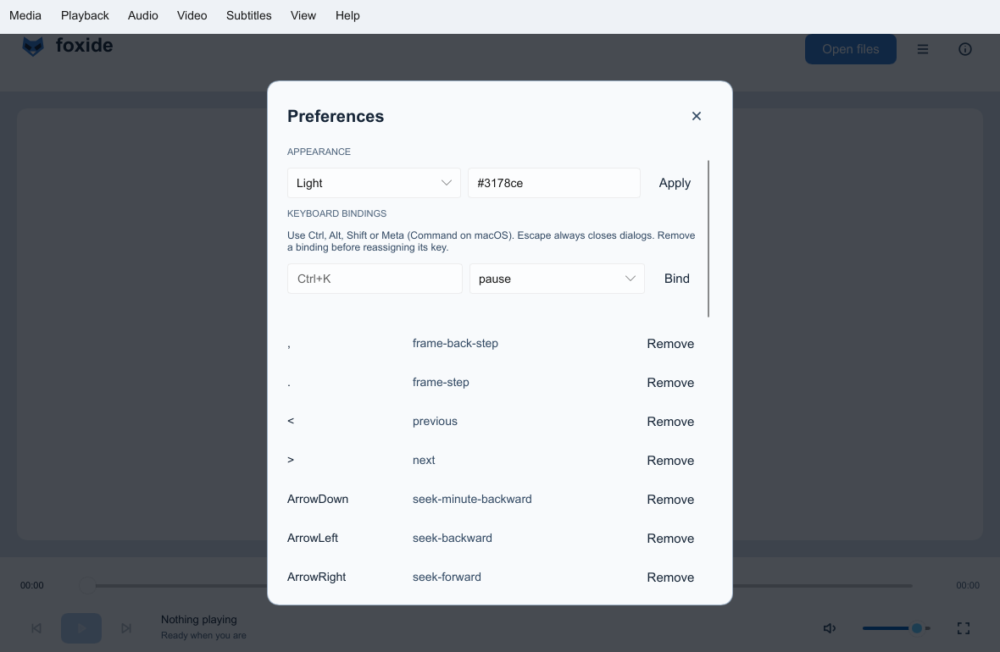
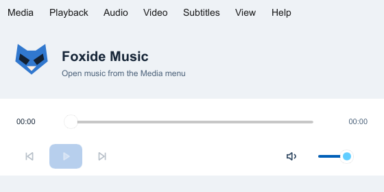

# Feature parity implementation

Foxide starts this work at 49 feature events without gold. The complete [acceptance checklist](remaining.json) preserves every event. Eight events now have reviewed acceptance; 41 remain. The checklist distinguishes accepted, implemented and queued work. Full parity is not claimed.

[Measured verification and limitations](verification.md).

## Desktop customization

Open **View → Preferences** to switch dark/light skins, choose a six-digit RGB accent color, or add/remove keyboard bindings. Changes apply immediately after a successful save. Existing key assignments must be removed before reuse; Escape remains available for closing dialogs and leaving fullscreen. Open **Help → Keyboard shortcuts** for the current bindings. Text editing and open dialogs do not dispatch playback shortcuts.

Open **View → Compact music view** for a dedicated 560×280 logical-pixel music layout with transport, seek and volume controls. The playlist and playback state remain available; leaving the mode restores the previous window size. The mode persists across restarts. It does not claim album-art display, gapless playback or native picture-in-picture.

Preferences are saved to:

| Platform | Default file |
|---|---|
| Windows | %APPDATA%/Foxide/preferences.json |
| macOS | ~/Library/Application Support/Foxide/preferences.json |
| Linux | $XDG_CONFIG_HOME/Foxide/preferences.json, falling back to ~/.config/Foxide/preferences.json |

Use foxide-desktop --config PATH to choose a different file. Missing files use defaults. Invalid files are left untouched on startup and the preferences panel reports the error; an explicit save/reset can replace them. Writes use a synced sibling temporary file followed by replacement; a failed write leaves the active settings unchanged. There is no script or shell-command setting. Reset preferences is an explicit UI action.

The three event claims require the public preferences tests plus the headless desktop acceptance test on Windows, macOS and Linux. CI archives dark, light, preferences and compact previews. Native hardware playback measurements remain separate.

## Rendered previews

Settings storage/validation lives in the independent player-settings crate. The existing player-ui playback-policy library and action benchmarks remain unchanged, so adding configuration code does not enlarge their compilation unit. Customization benchmarks run as a sixth target; all existing cases and thresholds remain intact.

## Implementation order

1. Desktop customization: editable keyboard bindings, light/dark skins with custom accents, compact music view.
2. Network playback tools: video-site URL integration and radio-directory browsing, with bounded network requests and dependency/provider acceptance fixtures.
3. Local playback experience: artwork, thumbnails, gapless transitions, system media controls, gestures/controller navigation and native PiP.
4. Shared media and server clients: WebDAV/SMB/NFS/UPnP browsing, authenticated Jellyfin/Emby/Plex libraries, offline downloads, metadata and watched-state integrations.
5. Advanced engine controls and authoring: color profiles/shaders, projection/stereo, passthrough, extensions, capture, trimming, conversion and tag editing.
6. Receiver and device integrations: Chromecast, AirPlay, live TV/PVR and optical media. Emulator/protocol tests accompany implementation, and physical-device acceptance is recorded separately.

Every item remains in the checklist until its frontend interaction, error/cancellation behavior and acceptance evidence are implemented. Credentials, receiver hardware, optical drives and display-specific acceptance are explicit dependencies, not automatic gold medals.

## Red/green evidence

- Editable shortcut JSON round-trip, persistence, custom appearance and compact persistence each failed before their implementation and now pass.
- The desktop acceptance test failed before the callbacks and properties existed, then passed through the same public callbacks the UI uses.
- A real F2 window-event test caught the missing native key encoding and passed after the mapping fix.
- A Unicode key test caught case expansion corrupting a saved single-character binding and passed after preserving Unicode characters while normalizing ASCII case.
- Tests cover malformed/oversized files, rejected edits, conflicting keys, repeat saves, save failure, defaults and restoration of the normal window size.

Sixteen customization CPU benchmark cases extend the existing suite without changing its existing cases or regression thresholds. They measure configured key lookup, preference decoding/encoding and edits; they do not claim menu-to-pixel latency or battery efficiency.

## Internet radio

Open **Media → Internet radio**, enter a station name, choose **Search**, then **Play** beside a result. Playback uses the existing queue and media engine. Searches run away from the UI thread; Cancel or closing the panel invalidates pending results. A directory error leaves active playback alone. Station selections send a best-effort click notification to Radio Browser.

The client uses the [Radio Browser API](https://docs.radio-browser.info/), discovers current mirrors, remembers the last successful mirror for the session and fetches fresh results for each search. Requests have response/time limits and use a directly launched system curl executable without a shell or working-directory executable search. No provider request runs at startup. Windows requires its system curl; macOS/Linux use /usr/bin/curl or /bin/curl. Missing curl produces a panel error. `--radio-directory HTTPS_ORIGIN` selects a compatible endpoint for testing; HTTP is restricted to literal loopback/localhost origins.

Tests cover query encoding, station filtering, mirror failover/bounds/cache, malformed responses, real HTTP transport against a loopback fixture, helper argument preservation, output limits, timeout and cancellation. The desktop acceptance test drives search, selection, cancellation and provider failure through public callbacks and archives a radio panel preview. Separate live-provider acceptance searched the directory and decoded a returned FLAC stream on all three platforms; see acceptance.json. Provider availability can change.

Two owner-provided Chromecasts and a Samsung TV are available for future receiver tests. TV protocol support remains unverified. No casting session has been started.

## Video-site URLs

Under **View → Preferences → Video sites**, choose an explicitly trusted native yt-dlp executable and restart Foxide. Paste a supported HTTP(S) page URL in **Media → Open URL**. Disable the helper in Preferences and restart to turn extraction off. `--yt-dlp ABSOLUTE_PATH` overrides the saved choice for that launch. Missing/invalid helpers report a preferences error while local playback remains available. A Lua-enabled libmpv build is required; a build without that hook remains usable for local media.

Foxide uses [mpv’s built-in ytdl hook](https://mpv.io/manual/stable/#options-ytdl), which preserves separate audio/video formats and stream headers. It passes the single helper path through the [structured client option API](https://github.com/mpv-player/mpv/blob/v0.40.0/include/mpv/client.h), avoiding comma/path-list parsing. There is no automatic helper discovery from PATH, the working directory or parent folders. The helper is not bundled; choose an installation from the [yt-dlp project](https://github.com/yt-dlp/yt-dlp#installation).

Tests cover optional preferences/backward compatibility, helper validation, persistent enable/disable and restart notices. The native acceptance test compiles a deterministic helper, returns separate loopback video/audio URLs, verifies HTTP header forwarding and checks both actual decoders. Hosted acceptance runs on all three platforms and contributes to the combined desktop/GPU coverage gate. A real Internet Archive page also decoded audio/video through the production engine on all platforms, preserving the original page identity. This establishes the accepted feature; other sites still depend on the helper and provider availability.

## Embedded music artwork

Audio files with an embedded cover display it in the normal canvas and compact music view through the existing shared GPU texture. Album-art tracks are distinguished from motion video: frame stepping stays disabled for music, and loading an audio file without artwork hides the previous image. Selected motion-video tracks are now correctly reported; the prior track filter incorrectly omitted all video tracks.

Synthetic FLAC/Matroska fixtures cover native metadata. Headless desktop tests render the compact cover and verify stale-art removal. The hosted OpenGL test decodes the embedded asymmetric PNG and checks upright red/blue pixels after actual Slint composition, archiving an image proof. CPU readback exists only in this test; playback retains the shared-texture path. The real-audio fixture and hosted compositor acceptance passed; exact jobs and scope are in acceptance.json.

## User GPU shaders

Choose **Video → GPU shaders → Load trusted shaders** to replace the session shader stack, or **Clear shader stack** to restore the normal renderer. Selection order is pipeline order. The information panel reports selection errors; engine compilation warnings appear in playback status without disabling playback. Files are not auto-loaded or persisted across launches.

Only explicitly selected regular UTF-8 mpv hook files are accepted (at most eight, 1 MiB each). File checks and the native picker run away from the UI thread; completion posts one UI event rather than polling. Clearing invalidates a pending selection so its late result cannot re-enable shaders. The structured native array API preserves punctuation and platform path separators. This follows [mpv’s user shader interface](https://mpv.io/manual/stable/#options-glsl-shaders).

Red/green tests cover file validation, native path preservation/reset, UI selection/errors/stale completion and rejected-control recovery. A separate hosted compositor test checks actual inverted pixels, a deliberate compile failure that preserves playback, and restored pixels after clearing. Those pixel checks and the three-platform frontend/native checks passed; the event is accepted.

## Opt-in live-provider checks

The live online-service workflow runs on Windows/macOS/Linux only when explicitly dispatched or when its workflow/request manifest changes. Ordinary tests remain offline. It uses a fixed [yt-dlp release](https://github.com/yt-dlp/yt-dlp/releases/tag/2026.10.26) with pinned platform SHA-256 hashes, extracts the [Big Buck Bunny page](https://archive.org/details/BigBuckBunny_328), and checks both actual decoders plus an advancing playback clock. Separately, Foxide searches Radio Browser and attempts at most three returned HTTPS stations. No login, cookies or credentials are supplied. Output is null; no stream is saved.

Per-platform JSON evidence records decoders and success/failure without local paths or signed stream URLs. These probes verify live service integration and are sensitive to provider availability. They do not measure displayed frames, UI latency, battery use or power. Feature medals change only after the evidence is reviewed. To request another run, update docs/feature-parity/live-acceptance-request.json.

## Accepted native/services checkpoint

Four more events are accepted at 8e1abde4e2785bb62495774ce6abac2c1ece57df: internet-radio directory, video-site URLs with an explicit helper, embedded music artwork and user GPU shaders. Together with desktop customization, **7 of 49 gaps are accepted; 42 remain**. [Exact evidence and limits](acceptance.json) include three-platform public UI/native acceptance, actual live decoders and original-page identity, twelve compositor trials, shader failure/reset pixels and **90.85%** full desktop/GPU line coverage. Null-output probes do not certify displayed-frame latency, physical audio devices, GPU power or battery life.

## Manual ICC display profiles

Use **Video → Color management → Load display ICC profile** to select the RGB display profile for your monitor. Clear the manual profile to restore the engine default. Selection applies to the session; automatic profile discovery and switching between monitors are not implemented by this control.

Profile reads run away from the UI thread, with a 4 MiB limit and checks of the ICC signature, RGB display class, declared length and tag-table bounds. Little CMS in the native engine handles the color transform; bounds validation does not replace its semantic validation. Malformed selections leave playback and the current profile alone. Clearing invalidates pending selections. There is no startup scan or saved profile path.

Tests cover malformed resources, native path application/reset and public desktop callbacks. The GPU acceptance fixture uses a neutral image and a generated linear RGB display profile, with an independent Little CMS reference of RGB 128 → 55, then checks final composited pixels and reset. [ICC specification](https://www.color.org/specifications/ICC.1-2022-05.pdf) and [mpv color-management options](https://mpv.io/manual/stable/#options-icc-profile) define the resource and engine interface. Physical monitor calibration remains separate. Manual selection/reset is accepted after three-platform controls and twelve hosted pixel trials matched the independent reference. Automatic monitor-profile switching remains outside this implemented control.

The accepted manual ICC event brings the current total to **8 of 49 gaps closed; 41 remain**. Its [reviewed evidence](acceptance.json) records RGB **128 → 55 → 128** and **90.59%** full desktop/GPU line coverage (4,024/4,442 lines).
