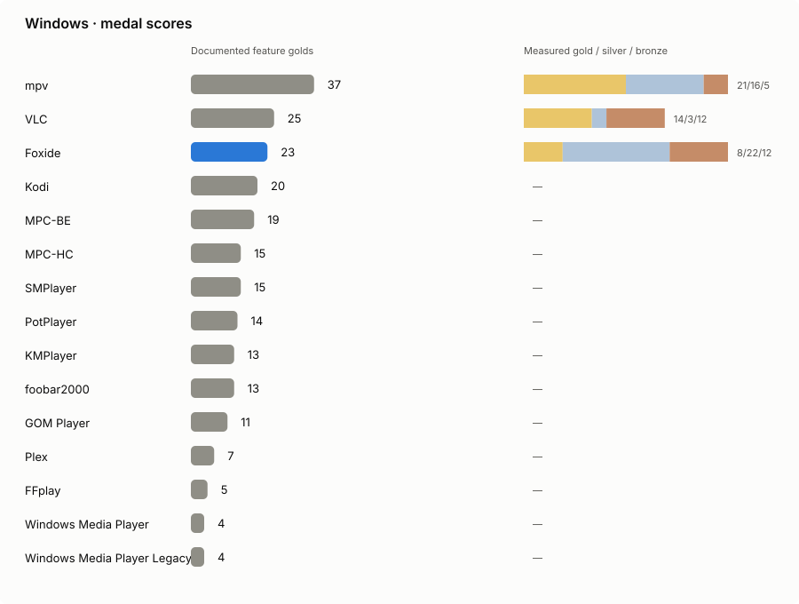
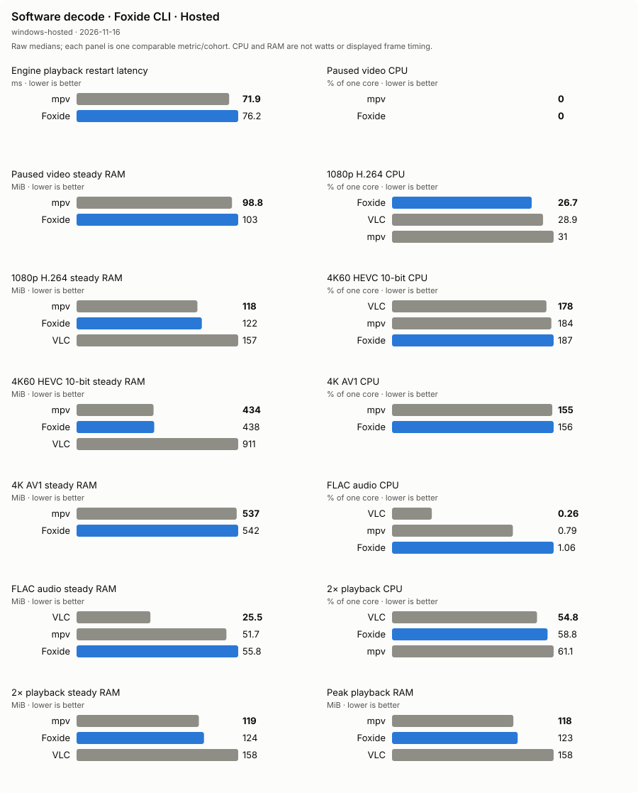
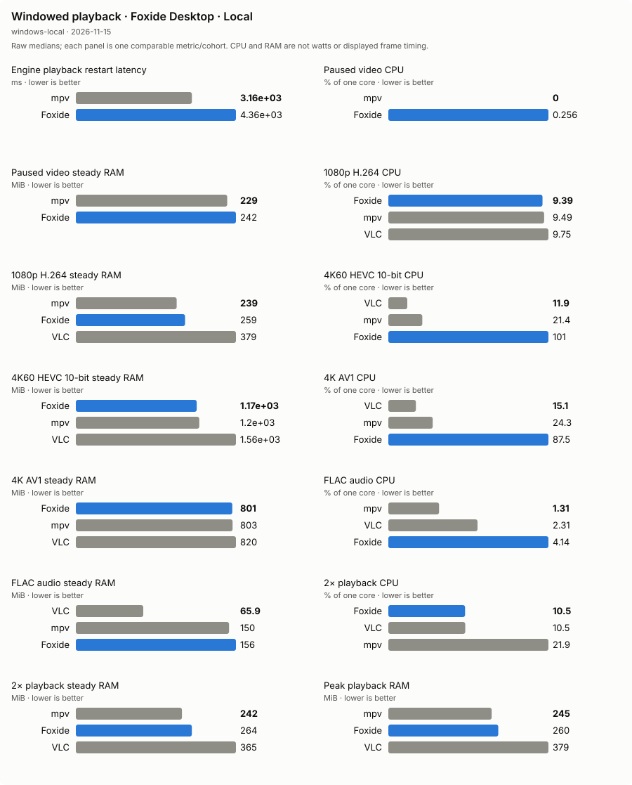
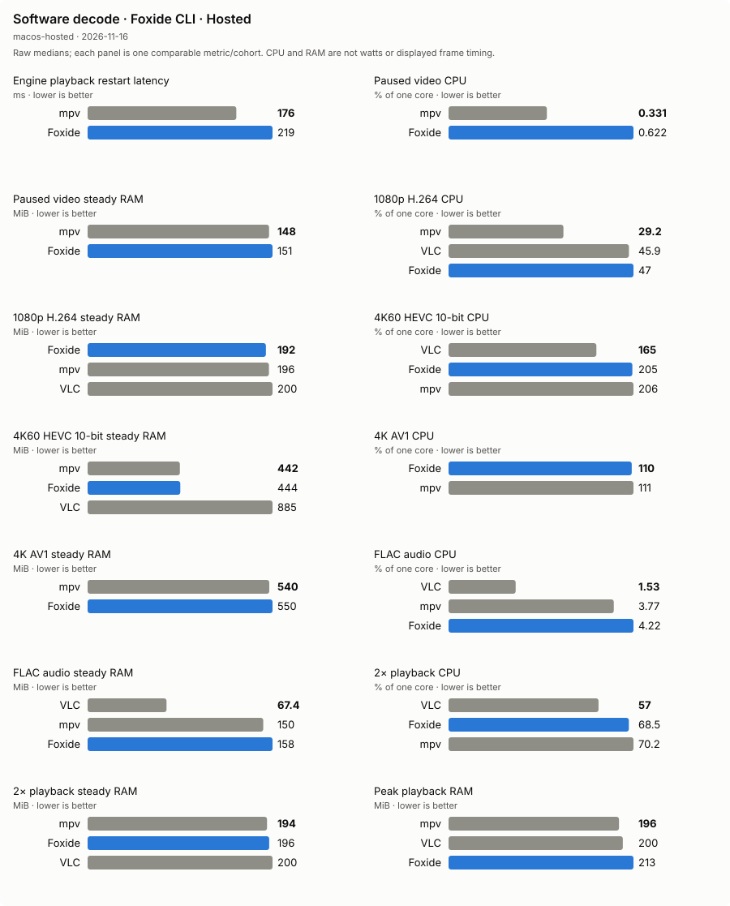
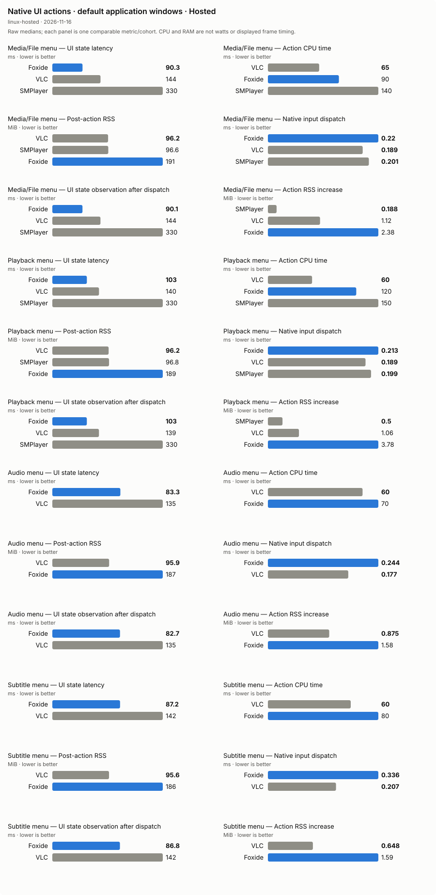
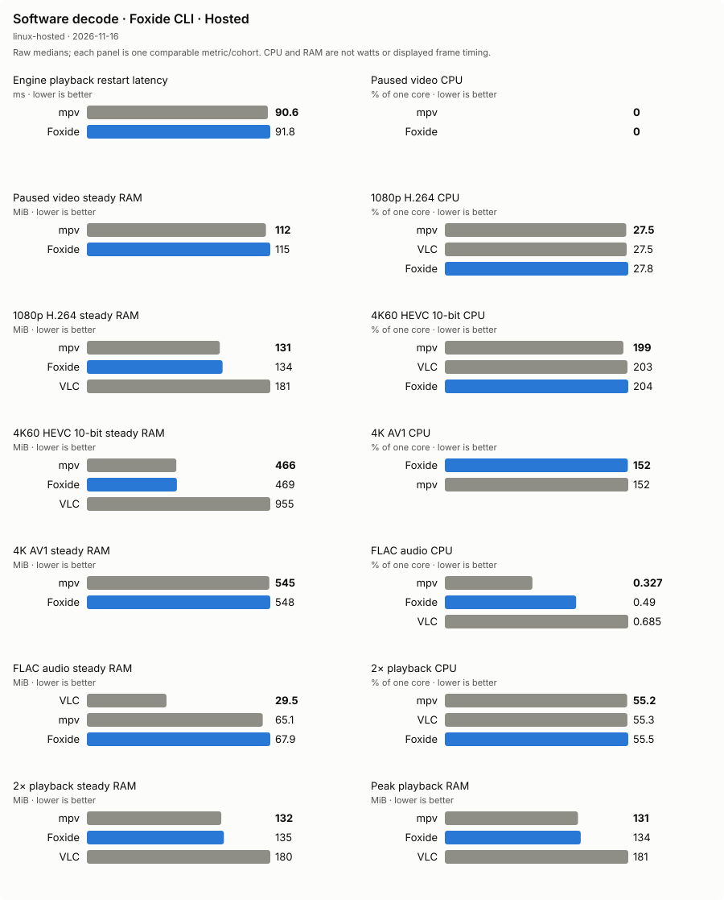

## Benchmark

### Latest results

Every metric is a separate medal event within one platform, host, fixture and settings cohort. Performance requires ≥3 verified repeats and ≥2 comparable entrants. Documented feature support earns shared gold; unknown does not mean unsupported.

Overall feature gold counts each feature once across applicable platforms; performance totals count every eligible field. These totals are not an overall speed ranking.

**Overall**

| Player | 🥇 | 🥈 | 🥉 | Total |
|---|---:|---:|---:|---:|
| mpv | 78 | 22 | 7 | 107 |
| VLC | 58 | 18 | 20 | 96 |
| Foxide | 55 | 46 | 24 | 125 |
| IINA | 33 | 0 | 0 | 33 |
| Infuse | 21 | 0 | 0 | 21 |
| Kodi | 20 | 0 | 0 | 20 |
| SMPlayer | 19 | 2 | 6 | 27 |
| MPC-BE | 19 | 0 | 0 | 19 |
| MPC-HC | 15 | 0 | 0 | 15 |
| PotPlayer | 14 | 0 | 0 | 14 |
| KMPlayer | 13 | 0 | 0 | 13 |
| foobar2000 | 13 | 0 | 0 | 13 |
| GOM Player | 11 | 0 | 0 | 11 |
| Plex | 7 | 0 | 0 | 7 |
| FFplay | 5 | 0 | 0 | 5 |
| QuickTime Player | 5 | 0 | 0 | 5 |
| Windows Media Player | 4 | 0 | 0 | 4 |
| Windows Media Player Legacy | 4 | 0 | 0 | 4 |

**Performance**

| Player | 🥇 | 🥈 | 🥉 | Total |
|---|---:|---:|---:|---:|
| mpv | 41 | 22 | 7 | 70 |
| VLC | 33 | 18 | 20 | 71 |
| Foxide | 24 | 46 | 24 | 94 |
| SMPlayer | 4 | 2 | 6 | 12 |
| FFplay | 0 | 0 | 0 | 0 |
| GOM Player | 0 | 0 | 0 | 0 |
| IINA | 0 | 0 | 0 | 0 |
| Infuse | 0 | 0 | 0 | 0 |
| KMPlayer | 0 | 0 | 0 | 0 |
| Kodi | 0 | 0 | 0 | 0 |
| MPC-BE | 0 | 0 | 0 | 0 |
| MPC-HC | 0 | 0 | 0 | 0 |
| Plex | 0 | 0 | 0 | 0 |
| PotPlayer | 0 | 0 | 0 | 0 |
| QuickTime Player | 0 | 0 | 0 | 0 |
| Windows Media Player | 0 | 0 | 0 | 0 |
| Windows Media Player Legacy | 0 | 0 | 0 | 0 |
| foobar2000 | 0 | 0 | 0 | 0 |

**Features**

| Player | 🥇 | 🥈 | 🥉 | Total |
|---|---:|---:|---:|---:|
| mpv | 37 | 0 | 0 | 37 |
| IINA | 33 | 0 | 0 | 33 |
| Foxide | 31 | 0 | 0 | 31 |
| VLC | 25 | 0 | 0 | 25 |
| Infuse | 21 | 0 | 0 | 21 |
| Kodi | 20 | 0 | 0 | 20 |
| MPC-BE | 19 | 0 | 0 | 19 |
| MPC-HC | 15 | 0 | 0 | 15 |
| SMPlayer | 15 | 0 | 0 | 15 |
| PotPlayer | 14 | 0 | 0 | 14 |
| KMPlayer | 13 | 0 | 0 | 13 |
| foobar2000 | 13 | 0 | 0 | 13 |
| GOM Player | 11 | 0 | 0 | 11 |
| Plex | 7 | 0 | 0 | 7 |
| FFplay | 5 | 0 | 0 | 5 |
| QuickTime Player | 5 | 0 | 0 | 5 |
| Windows Media Player | 4 | 0 | 0 | 4 |
| Windows Media Player Legacy | 4 | 0 | 0 | 4 |

[Raw scores](./medals.json) · [Feature sources](./features.json) · [Performance protocols](./performance-events.json) · [Download optional HTML](./report.html)

Windowed fields use **Foxide Desktop**; software-only fields use the **Foxide CLI** launcher. Engine playback evidence is distinct from physical frame presentation. UI-action metrics, displayed TTFF, power and battery results remain pending unless explicitly measured.

### Windows medals

| Player | 🥇 | 🥈 | 🥉 | Total |
|---|---:|---:|---:|---:|
| mpv | 58 | 16 | 5 | 79 |
| Foxide | 39 | 22 | 12 | 73 |
| VLC | 39 | 3 | 12 | 54 |
| Kodi | 20 | 0 | 0 | 20 |
| MPC-BE | 19 | 0 | 0 | 19 |
| MPC-HC | 15 | 0 | 0 | 15 |
| SMPlayer | 15 | 0 | 0 | 15 |
| PotPlayer | 14 | 0 | 0 | 14 |
| KMPlayer | 13 | 0 | 0 | 13 |
| foobar2000 | 13 | 0 | 0 | 13 |
| GOM Player | 11 | 0 | 0 | 11 |
| Plex | 7 | 0 | 0 | 7 |
| FFplay | 5 | 0 | 0 | 5 |
| Windows Media Player | 4 | 0 | 0 | 4 |
| Windows Media Player Legacy | 4 | 0 | 0 | 4 |

**Windows · Software decode · Foxide CLI · Hosted**

| Player | 🥇 | 🥈 | 🥉 | Total |
|---|---:|---:|---:|---:|
| mpv | 9 | 3 | 2 | 14 |
| VLC | 4 | 1 | 4 | 9 |
| Foxide | 2 | 9 | 3 | 14 |

**Windows · Windowed playback · Foxide Desktop · Local**

| Player | 🥇 | 🥈 | 🥉 | Total |
|---|---:|---:|---:|---:|
| mpv | 7 | 6 | 1 | 14 |
| Foxide | 4 | 6 | 4 | 14 |
| VLC | 3 | 2 | 6 | 11 |

**Windows · Software decode · Foxide CLI · Local**

| Player | 🥇 | 🥈 | 🥉 | Total |
|---|---:|---:|---:|---:|
| VLC | 7 | 0 | 2 | 9 |
| mpv | 5 | 7 | 2 | 14 |
| Foxide | 2 | 7 | 5 | 14 |

Windows feature medals — shared gold

| Feature | Foxide | VLC | mpv | Windows Media Player | Windows Media Player Legacy | MPC-HC | MPC-BE | PotPlayer | SMPlayer | KMPlayer | GOM Player | FFplay | Kodi | Plex | foobar2000 |
|---|---:|---:|---:|---:|---:|---:|---:|---:|---:|---:|---:|---:|---:|---:|---:|
| MP4 and MKV playback | 🥇 | 🥇 | 🥇 | ? | ? | ? | 🥇 | 🥇 | 🥇 | 🥇 | ? | ? | ? | ? | N/A |
| FLAC audio | 🥇 | 🥇 | 🥇 | ? | ? | ? | 🥇 | 🥇 | ? | 🥇 | ? | ? | ? | ? | 🥇 |
| Hardware decoding | 🥇 | 🥇 | 🥇 | ? | ? | ? | 🥇 | 🥇 | ? | 🥇 | ? | ? | 🥇 | ? | N/A |
| Audio track selection | 🥇 | 🥇 | 🥇 | ? | ? | ? | 🥇 | ? | 🥇 | ? | 🥇 | 🥇 | 🥇 | 🥇 | N/A |
| Subtitle track selection | 🥇 | 🥇 | 🥇 | ? | ? | ? | 🥇 | 🥇 | 🥇 | ? | ? | 🥇 | 🥇 | 🥇 | N/A |
| External subtitle files | 🥇 | 🥇 | 🥇 | ? | ? | ? | 🥇 | ? | 🥇 | 🥇 | 🥇 | ? | 🥇 | ? | N/A |
| ASS/SSA subtitle rendering | 🥇 | 🥇 | 🥇 | ? | ? | 🥇 | 🥇 | 🥇 | ? | 🥇 | ? | ? | ? | ? | N/A |
| Variable playback speed | 🥇 | 🥇 | 🥇 | ? | 🥇 | 🥇 | 🥇 | 🥇 | 🥇 | ? | 🥇 | ? | ? | 🥇 | ? |
| Playlists | 🥇 | 🥇 | 🥇 | 🥇 | ? | ? | 🥇 | 🥇 | ? | 🥇 | 🥇 | ? | ? | ? | ? |
| Keyboard controls | 🥇 | 🥇 | 🥇 | 🥇 | ? | 🥇 | ? | ? | ? | ? | 🥇 | 🥇 | ? | 🥇 | 🥇 |
| Frame-accurate seeking | 🥇 | ? | 🥇 | ? | ? | ? | ? | ? | ? | ? | ? | ? | ? | ? | N/A |
| Seekbar thumbnail previews | ? | ? | ? | ? | ? | 🥇 | 🥇 | ? | ? | ? | ? | ? | ? | ? | N/A |
| HDR video playback | 🥇 | ? | 🥇 | ? | ? | 🥇 | 🥇 | 🥇 | ? | ? | ? | ? | ? | ? | N/A |
| HDR to SDR tone mapping | 🥇 | ? | 🥇 | ? | ? | ? | ? | 🥇 | ? | ? | ? | ? | ? | ? | N/A |
| Audio synchronization offset | 🥇 | 🥇 | 🥇 | ? | ? | ? | 🥇 | ? | 🥇 | ? | ? | ? | 🥇 | ? | N/A |
| Subtitle synchronization offset | 🥇 | 🥇 | 🥇 | ? | ? | ? | 🥇 | ? | 🥇 | ? | 🥇 | ? | 🥇 | ? | N/A |
| Video filters and adjustments | 🥇 | 🥇 | 🥇 | ? | ? | 🥇 | 🥇 | 🥇 | 🥇 | 🥇 | 🥇 | 🥇 | ? | ? | N/A |
| Chapter navigation | 🥇 | 🥇 | 🥇 | ? | ? | ? | 🥇 | ? | ? | ? | ? | ? | 🥇 | ? | ? |
| Native picture in picture | ? | ? | ? | ? | ? | ? | ? | ? | ? | ? | ? | ? | ? | ? | N/A |
| Network stream playback | 🥇 | 🥇 | 🥇 | ? | ? | 🥇 | 🥇 | 🥇 | ? | 🥇 | ? | ? | ? | ? | 🥇 |
| Persistent playback resume | 🥇 | ? | 🥇 | ? | ? | 🥇 | ? | ? | 🥇 | ? | ? | ? | ? | ? | ? |
| Automatic folder playback | 🥇 | ? | ? | ? | ? | 🥇 | ? | ? | ? | ? | ? | ? | ? | ? | ? |
| Borderless viewing mode | 🥇 | ? | 🥇 | ? | ? | ? | ? | ? | ? | ? | ? | ? | ? | ? | ? |
| Video screenshots | 🥇 | 🥇 | 🥇 | ? | ? | ? | 🥇 | 🥇 | ? | 🥇 | 🥇 | ? | ? | ? | N/A |
| A–B repeat | 🥇 | 🥇 | 🥇 | ? | ? | 🥇 | 🥇 | ? | ? | ? | 🥇 | ? | ? | ? | ? |
| Audio equalizer / DSP | 🥇 | 🥇 | 🥇 | ? | ? | ? | ? | ? | ? | ? | ? | ? | ? | ? | 🥇 |
| ReplayGain | 🥇 | 🥇 | 🥇 | ? | ? | ? | ? | 🥇 | ? | ? | ? | ? | ? | ? | 🥇 |
| Gapless audio playback | ? | ? | 🥇 | ? | ? | ? | ? | ? | ? | ? | ? | ? | ? | ? | 🥇 |
| DVD / Blu-ray structure playback | ? | 🥇 | 🥇 | ? | ? | ? | 🥇 | ? | ? | ? | 🥇 | ? | ? | ? | N/A |
| Chromecast video output | ? | 🥇 | ? | ? | ? | ? | ? | ? | 🥇 | ? | ? | ? | ? | ? | N/A |
| AirPlay video output | ? | ? | ? | ? | ? | ? | ? | ? | ? | ? | ? | ? | ? | ? | N/A |
| AirPlay audio receiver | ? | ? | ? | ? | ? | ? | ? | ? | ? | ? | ? | ? | 🥇 | ? | ? |
| Search and download subtitles | ? | ? | ? | ? | ? | 🥇 | ? | ? | 🥇 | ? | ? | ? | ? | ? | N/A |
| Video-site URL playback | ? | ? | 🥇 | ? | ? | 🥇 | ? | ? | 🥇 | 🥇 | ? | ? | ? | ? | N/A |
| User extension or scripting system | ? | ? | 🥇 | ? | ? | ? | ? | ? | ? | ? | ? | ? | 🥇 | ? | 🥇 |
| Editable keyboard bindings | ? | ? | 🥇 | ? | ? | 🥇 | ? | ? | ? | ? | ? | ? | ? | ? | 🥇 |
| Customizable UI layout or skins | ? | ? | ? | ? | ? | ? | ? | ? | 🥇 | ? | ? | ? | ? | ? | 🥇 |
| Touch or trackpad playback gestures | ? | ? | ? | ? | ? | ? | ? | ? | 🥇 | ? | ? | ? | ? | ? | ? |
| System media-control integration | ? | ? | ? | ? | ? | ? | ? | ? | ? | ? | ? | ? | ? | ? | ? |
| Compact dedicated music view | ? | ? | ? | 🥇 | ? | ? | ? | ? | ? | ? | ? | ? | ? | ? | ? |
| Dark interface theme | 🥇 | ? | ? | ? | ? | 🥇 | ? | ? | ? | ? | ? | ? | ? | ? | ? |
| Music playback artwork view | ? | ? | ? | 🥇 | ? | ? | ? | ? | ? | ? | ? | ? | ? | ? | ? |
| Automatic movie and TV library metadata | ? | ? | ? | ? | ? | ? | ? | ? | ? | ? | ? | ? | 🥇 | ? | N/A |
| Browse SMB network media | ? | ? | ? | ? | ? | ? | ? | ? | ? | ? | ? | ? | 🥇 | ? | ? |
| Direct cloud-storage playback | ? | ? | ? | ? | ? | ? | ? | ? | ? | ? | ? | ? | ? | ? | N/A |
| Download server media for offline viewing | ? | ? | ? | ? | ? | ? | ? | ? | ? | ? | ? | ? | ? | 🥇 | ? |
| Cross-device playback progress sync | ? | ? | ? | ? | ? | ? | ? | ? | ? | ? | ? | ? | ? | ? | N/A |
| Live TV and guide frontend | ? | ? | ? | ? | ? | ? | ? | ? | ? | ? | ? | ? | 🥇 | ? | N/A |
| Schedule TV recordings from the player | ? | ? | ? | ? | ? | ? | ? | ? | ? | ? | ? | ? | 🥇 | ? | N/A |
| HTTP remote-control interface | ? | ? | ? | ? | ? | ? | ? | ? | ? | ? | ? | ? | 🥇 | ? | ? |
| Documented JSON IPC control | ? | ? | 🥇 | ? | ? | ? | ? | ? | ? | ? | ? | ? | ? | ? | ? |
| HD audio bitstream passthrough | ? | 🥇 | 🥇 | ? | ? | ? | ? | ? | ? | ? | ? | ? | ? | ? | ? |
| 360-degree panoramic video | ? | 🥇 | ? | ? | ? | ? | ? | ? | ? | 🥇 | 🥇 | ? | ? | ? | N/A |
| Stereoscopic 3D video | ? | ? | ? | ? | ? | ? | ? | ? | ? | 🥇 | ? | ? | ? | ? | N/A |
| Capture playing video to a clip | ? | ? | ? | ? | ? | ? | ? | ? | ? | 🥇 | ? | ? | ? | ? | N/A |
| Desktop screen recording | ? | 🥇 | ? | ? | ? | ? | ? | ? | ? | ? | ? | ? | ? | ? | N/A |
| Trim and rearrange video clips | ? | ? | ? | ? | ? | ? | ? | ? | ? | ? | ? | ? | ? | ? | N/A |
| Audio conversion or transcoding | ? | ? | ? | ? | ? | ? | ? | ? | ? | ? | ? | ? | ? | ? | 🥇 |
| Audio CD ripping | ? | ? | ? | ? | 🥇 | ? | ? | ? | ? | ? | ? | ? | ? | ? | 🥇 |
| Audio or data CD burning | ? | ? | ? | ? | 🥇 | ? | ? | ? | ? | ? | ? | ? | ? | ? | ? |
| Edit media tags | ? | ? | ? | ? | ? | ? | ? | ? | ? | ? | ? | ? | ? | ? | 🥇 |
| Built-in internet-radio directory | ? | ? | ? | ? | ? | ? | ? | ? | ? | ? | ? | ? | ? | ? | 🥇 |
| Video rotation and flip controls | 🥇 | ? | 🥇 | ? | ? | 🥇 | ? | ? | ? | ? | ? | ? | ? | ? | N/A |
| ICC display color management | ? | ? | 🥇 | ? | ? | ? | ? | ? | ? | ? | ? | ? | ? | ? | N/A |
| User GPU shader pipeline | ? | ? | 🥇 | ? | ? | ? | ? | ? | ? | ? | ? | ? | ? | ? | N/A |
| Debanding control | 🥇 | ? | 🥇 | ? | ? | ? | ? | ? | ? | ? | ? | ? | ? | ? | N/A |
| Single-frame advance | 🥇 | ? | 🥇 | ? | ? | ? | ? | ? | ? | ? | ? | 🥇 | ? | ? | N/A |
| Playlist search and filtering | 🥇 | ? | ? | ? | ? | ? | ? | 🥇 | ? | ? | ? | ? | ? | ? | ? |
| Two simultaneous subtitle tracks | 🥇 | ? | 🥇 | ? | ? | ? | ? | ? | 🥇 | ? | ? | ? | ? | ? | N/A |
| Browse UPnP / DLNA media servers | ? | ? | ? | ? | ? | ? | ? | ? | ? | ? | ? | ? | 🥇 | ? | ? |
| Share a library as a UPnP server | ? | ? | ? | ? | ? | ? | ? | ? | ? | ? | ? | ? | 🥇 | ? | ? |
| Game controller UI navigation | ? | ? | ? | ? | ? | ? | ? | ? | ? | ? | ? | ? | 🥇 | ? | ? |
| Browse WebDAV media shares | ? | ? | ? | ? | ? | ? | ? | ? | ? | ? | ? | ? | 🥇 | ? | ? |
| Browse NFS media shares | ? | ? | ? | ? | ? | ? | ? | ? | ? | ? | ? | ? | 🥇 | ? | ? |
| Trakt watched-history scrobbling | ? | ? | ? | ? | ? | ? | ? | ? | ? | ? | ? | ? | ? | ? | N/A |
| Native Plex server library integration | ? | ? | ? | ? | ? | ? | ? | ? | ? | ? | ? | ? | ? | 🥇 | N/A |
| Native Emby server library integration | ? | ? | ? | ? | ? | ? | ? | ? | ? | ? | ? | ? | ? | ? | N/A |
| Native Jellyfin server library integration | ? | ? | ? | ? | ? | ? | ? | ? | ? | ? | ? | ? | ? | ? | N/A |
| Skip detected episode intros | ? | ? | ? | ? | ? | ? | ? | ? | ? | ? | ? | ? | ? | 🥇 | N/A |
| Music visualization display | ? | 🥇 | ? | ? | 🥇 | ? | ? | ? | ? | ? | ? | ? | 🥇 | ? | ? |

? = undocumented/unverified. N/A = inapplicable media type.

### macOS medals

| Player | 🥇 | 🥈 | 🥉 | Total |
|---|---:|---:|---:|---:|
| mpv | 44 | 4 | 2 | 50 |
| IINA | 33 | 0 | 0 | 33 |
| Foxide | 32 | 8 | 4 | 44 |
| VLC | 28 | 2 | 3 | 33 |
| Infuse | 21 | 0 | 0 | 21 |
| Kodi | 19 | 0 | 0 | 19 |
| SMPlayer | 13 | 0 | 0 | 13 |
| foobar2000 | 12 | 0 | 0 | 12 |
| Plex | 6 | 0 | 0 | 6 |
| QuickTime Player | 5 | 0 | 0 | 5 |
| FFplay | 4 | 0 | 0 | 4 |

**macOS · Software decode · Foxide CLI · Hosted**

| Player | 🥇 | 🥈 | 🥉 | Total |
|---|---:|---:|---:|---:|
| mpv | 8 | 4 | 2 | 14 |
| VLC | 4 | 2 | 3 | 9 |
| Foxide | 2 | 8 | 4 | 14 |

macOS feature medals — shared gold

1 universal feature events omitted: every eligible player has documented gold. Evidence remains in the raw scores and feature sources.

| Feature | Foxide | VLC | mpv | SMPlayer | FFplay | Kodi | Plex | foobar2000 | Infuse | IINA | QuickTime Player |
|---|---:|---:|---:|---:|---:|---:|---:|---:|---:|---:|---:|
| MP4 and MKV playback | 🥇 | 🥇 | 🥇 | 🥇 | ? | ? | ? | N/A | 🥇 | 🥇 | ? |
| FLAC audio | 🥇 | 🥇 | 🥇 | ? | ? | ? | ? | 🥇 | ? | 🥇 | ? |
| Hardware decoding | 🥇 | 🥇 | 🥇 | ? | ? | 🥇 | ? | N/A | 🥇 | 🥇 | ? |
| Audio track selection | 🥇 | 🥇 | 🥇 | 🥇 | 🥇 | 🥇 | 🥇 | N/A | 🥇 | 🥇 | ? |
| External subtitle files | 🥇 | 🥇 | 🥇 | 🥇 | ? | 🥇 | ? | N/A | 🥇 | 🥇 | ? |
| ASS/SSA subtitle rendering | 🥇 | 🥇 | 🥇 | ? | ? | ? | ? | N/A | 🥇 | 🥇 | ? |
| Variable playback speed | 🥇 | 🥇 | 🥇 | 🥇 | ? | ? | 🥇 | ? | 🥇 | 🥇 | 🥇 |
| Playlists | 🥇 | 🥇 | 🥇 | ? | ? | ? | ? | ? | ? | 🥇 | ? |
| Keyboard controls | 🥇 | 🥇 | 🥇 | ? | 🥇 | ? | 🥇 | 🥇 | ? | 🥇 | ? |
| Frame-accurate seeking | 🥇 | ? | 🥇 | ? | ? | ? | ? | N/A | ? | 🥇 | ? |
| Seekbar thumbnail previews | ? | ? | ? | ? | ? | ? | ? | N/A | ? | 🥇 | ? |
| HDR video playback | 🥇 | ? | 🥇 | ? | ? | ? | ? | N/A | 🥇 | 🥇 | ? |
| HDR to SDR tone mapping | 🥇 | ? | 🥇 | ? | ? | ? | ? | N/A | ? | 🥇 | ? |
| Audio synchronization offset | 🥇 | 🥇 | 🥇 | 🥇 | ? | 🥇 | ? | N/A | ? | 🥇 | ? |
| Subtitle synchronization offset | 🥇 | 🥇 | 🥇 | 🥇 | ? | 🥇 | ? | N/A | ? | 🥇 | ? |
| Video filters and adjustments | 🥇 | 🥇 | 🥇 | 🥇 | 🥇 | ? | ? | N/A | ? | 🥇 | ? |
| Chapter navigation | 🥇 | 🥇 | 🥇 | ? | ? | 🥇 | ? | ? | 🥇 | 🥇 | ? |
| Native picture in picture | ? | ? | ? | ? | ? | ? | ? | N/A | 🥇 | 🥇 | 🥇 |
| Network stream playback | 🥇 | 🥇 | 🥇 | ? | ? | ? | ? | 🥇 | ? | 🥇 | ? |
| Persistent playback resume | 🥇 | ? | 🥇 | 🥇 | ? | ? | ? | ? | ? | 🥇 | ? |
| Automatic folder playback | 🥇 | ? | ? | ? | ? | ? | ? | ? | 🥇 | 🥇 | ? |
| Borderless viewing mode | 🥇 | ? | 🥇 | ? | ? | ? | ? | ? | ? | ? | ? |
| Video screenshots | 🥇 | 🥇 | 🥇 | ? | ? | ? | ? | N/A | ? | 🥇 | ? |
| A–B repeat | 🥇 | 🥇 | 🥇 | ? | ? | ? | ? | ? | ? | 🥇 | ? |
| Audio equalizer / DSP | 🥇 | 🥇 | 🥇 | ? | ? | ? | ? | 🥇 | ? | 🥇 | ? |
| ReplayGain | 🥇 | 🥇 | 🥇 | ? | ? | ? | ? | 🥇 | ? | 🥇 | ? |
| Gapless audio playback | ? | ? | 🥇 | ? | ? | ? | ? | 🥇 | ? | 🥇 | ? |
| DVD / Blu-ray structure playback | ? | 🥇 | 🥇 | ? | ? | ? | ? | N/A | ? | ? | ? |
| Chromecast video output | ? | 🥇 | ? | 🥇 | ? | ? | ? | N/A | ? | ? | ? |
| AirPlay video output | ? | ? | ? | ? | ? | ? | ? | N/A | ? | ? | 🥇 |
| AirPlay audio receiver | ? | ? | ? | ? | ? | 🥇 | ? | ? | ? | ? | ? |
| Search and download subtitles | ? | ? | ? | 🥇 | ? | ? | ? | N/A | ? | 🥇 | ? |
| Video-site URL playback | ? | ? | 🥇 | 🥇 | ? | ? | ? | N/A | ? | ? | ? |
| User extension or scripting system | ? | ? | 🥇 | ? | ? | 🥇 | ? | 🥇 | ? | 🥇 | ? |
| Editable keyboard bindings | ? | ? | 🥇 | ? | ? | ? | ? | 🥇 | ? | ? | ? |
| Customizable UI layout or skins | ? | ? | ? | 🥇 | ? | ? | ? | 🥇 | ? | 🥇 | ? |
| Touch or trackpad playback gestures | ? | ? | ? | ? | ? | ? | ? | ? | ? | 🥇 | ? |
| System media-control integration | ? | ? | ? | ? | ? | ? | ? | ? | ? | 🥇 | ? |
| Compact dedicated music view | ? | ? | ? | ? | ? | ? | ? | ? | ? | 🥇 | ? |
| Dark interface theme | 🥇 | ? | ? | ? | ? | ? | ? | ? | ? | 🥇 | ? |
| Music playback artwork view | ? | ? | ? | ? | ? | ? | ? | ? | ? | ? | ? |
| Automatic movie and TV library metadata | ? | ? | ? | ? | ? | 🥇 | ? | N/A | 🥇 | ? | ? |
| Browse SMB network media | ? | ? | ? | ? | ? | 🥇 | ? | ? | ? | ? | ? |
| Direct cloud-storage playback | ? | ? | ? | ? | ? | ? | ? | N/A | 🥇 | ? | ? |
| Download server media for offline viewing | ? | ? | ? | ? | ? | ? | 🥇 | ? | ? | ? | ? |
| Cross-device playback progress sync | ? | ? | ? | ? | ? | ? | ? | N/A | 🥇 | ? | ? |
| Live TV and guide frontend | ? | ? | ? | ? | ? | 🥇 | ? | N/A | ? | ? | ? |
| Schedule TV recordings from the player | ? | ? | ? | ? | ? | 🥇 | ? | N/A | ? | ? | ? |
| HTTP remote-control interface | ? | ? | ? | ? | ? | 🥇 | ? | ? | ? | ? | ? |
| Documented JSON IPC control | ? | ? | 🥇 | ? | ? | ? | ? | ? | ? | ? | ? |
| HD audio bitstream passthrough | ? | 🥇 | 🥇 | ? | ? | ? | ? | ? | ? | ? | ? |
| 360-degree panoramic video | ? | 🥇 | ? | ? | ? | ? | ? | N/A | ? | ? | ? |
| Stereoscopic 3D video | ? | ? | ? | ? | ? | ? | ? | N/A | ? | ? | ? |
| Capture playing video to a clip | ? | ? | ? | ? | ? | ? | ? | N/A | ? | ? | ? |
| Desktop screen recording | ? | 🥇 | ? | ? | ? | ? | ? | N/A | ? | ? | ? |
| Trim and rearrange video clips | ? | ? | ? | ? | ? | ? | ? | N/A | ? | ? | 🥇 |
| Audio conversion or transcoding | ? | ? | ? | ? | ? | ? | ? | 🥇 | ? | ? | ? |
| Audio CD ripping | ? | ? | ? | ? | ? | ? | ? | ? | ? | ? | ? |
| Audio or data CD burning | ? | ? | ? | ? | ? | ? | ? | ? | ? | ? | ? |
| Edit media tags | ? | ? | ? | ? | ? | ? | ? | 🥇 | ? | ? | ? |
| Built-in internet-radio directory | ? | ? | ? | ? | ? | ? | ? | 🥇 | ? | ? | ? |
| Video rotation and flip controls | 🥇 | ? | 🥇 | ? | ? | ? | ? | N/A | ? | ? | 🥇 |
| ICC display color management | ? | ? | 🥇 | ? | ? | ? | ? | N/A | ? | ? | ? |
| User GPU shader pipeline | ? | ? | 🥇 | ? | ? | ? | ? | N/A | ? | ? | ? |
| Debanding control | 🥇 | ? | 🥇 | ? | ? | ? | ? | N/A | ? | ? | ? |
| Single-frame advance | 🥇 | ? | 🥇 | ? | 🥇 | ? | ? | N/A | ? | ? | ? |
| Playlist search and filtering | 🥇 | ? | ? | ? | ? | ? | ? | ? | ? | ? | ? |
| Two simultaneous subtitle tracks | 🥇 | ? | 🥇 | 🥇 | ? | ? | ? | N/A | ? | ? | ? |
| Browse UPnP / DLNA media servers | ? | ? | ? | ? | ? | 🥇 | ? | ? | 🥇 | ? | ? |
| Share a library as a UPnP server | ? | ? | ? | ? | ? | 🥇 | ? | ? | ? | ? | ? |
| Game controller UI navigation | ? | ? | ? | ? | ? | 🥇 | ? | ? | ? | ? | ? |
| Browse WebDAV media shares | ? | ? | ? | ? | ? | 🥇 | ? | ? | 🥇 | ? | ? |
| Browse NFS media shares | ? | ? | ? | ? | ? | 🥇 | ? | ? | 🥇 | ? | ? |
| Trakt watched-history scrobbling | ? | ? | ? | ? | ? | ? | ? | N/A | 🥇 | ? | ? |
| Native Plex server library integration | ? | ? | ? | ? | ? | ? | 🥇 | N/A | 🥇 | ? | ? |
| Native Emby server library integration | ? | ? | ? | ? | ? | ? | ? | N/A | 🥇 | ? | ? |
| Native Jellyfin server library integration | ? | ? | ? | ? | ? | ? | ? | N/A | 🥇 | ? | ? |
| Skip detected episode intros | ? | ? | ? | ? | ? | ? | 🥇 | N/A | 🥇 | ? | ? |
| Music visualization display | ? | 🥇 | ? | ? | ? | 🥇 | ? | ? | ? | ? | ? |

? = undocumented/unverified. N/A = inapplicable media type.

### Linux medals

| Player | 🥇 | 🥈 | 🥉 | Total |
|---|---:|---:|---:|---:|
| mpv | 47 | 2 | 0 | 49 |
| Foxide | 43 | 16 | 8 | 67 |
| VLC | 38 | 13 | 5 | 56 |
| Kodi | 18 | 0 | 0 | 18 |
| SMPlayer | 16 | 2 | 6 | 24 |
| Plex | 5 | 0 | 0 | 5 |
| FFplay | 3 | 0 | 0 | 3 |

**Linux · Native UI actions · default application windows · Hosted**

| Player | 🥇 | 🥈 | 🥉 | Total |
|---|---:|---:|---:|---:|
| VLC | 14 | 10 | 0 | 24 |
| Foxide | 12 | 8 | 4 | 24 |
| SMPlayer | 4 | 2 | 6 | 12 |

**Linux · Software decode · Foxide CLI · Hosted**

| Player | 🥇 | 🥈 | 🥉 | Total |
|---|---:|---:|---:|---:|
| mpv | 12 | 2 | 0 | 14 |
| Foxide | 2 | 8 | 4 | 14 |
| VLC | 1 | 3 | 5 | 9 |

Linux feature medals — shared gold

2 universal feature events omitted: every eligible player has documented gold. Evidence remains in the raw scores and feature sources.

| Feature | Foxide | VLC | mpv | SMPlayer | FFplay | Kodi | Plex |
|---|---:|---:|---:|---:|---:|---:|---:|
| MP4 and MKV playback | 🥇 | 🥇 | 🥇 | 🥇 | ? | ? | ? |
| FLAC audio | 🥇 | 🥇 | 🥇 | ? | ? | ? | ? |
| Hardware decoding | 🥇 | 🥇 | 🥇 | ? | ? | 🥇 | ? |
| External subtitle files | 🥇 | 🥇 | 🥇 | 🥇 | ? | 🥇 | ? |
| ASS/SSA subtitle rendering | 🥇 | 🥇 | 🥇 | ? | ? | ? | ? |
| Variable playback speed | 🥇 | 🥇 | 🥇 | 🥇 | ? | ? | 🥇 |
| Playlists | 🥇 | 🥇 | 🥇 | ? | ? | ? | ? |
| Keyboard controls | 🥇 | 🥇 | 🥇 | ? | 🥇 | ? | 🥇 |
| Frame-accurate seeking | 🥇 | ? | 🥇 | ? | ? | ? | ? |
| Seekbar thumbnail previews | ? | ? | ? | ? | ? | ? | ? |
| HDR video playback | 🥇 | ? | 🥇 | ? | ? | ? | ? |
| HDR to SDR tone mapping | 🥇 | ? | 🥇 | ? | ? | ? | ? |
| Audio synchronization offset | 🥇 | 🥇 | 🥇 | 🥇 | ? | 🥇 | ? |
| Subtitle synchronization offset | 🥇 | 🥇 | 🥇 | 🥇 | ? | 🥇 | ? |
| Video filters and adjustments | 🥇 | 🥇 | 🥇 | 🥇 | 🥇 | ? | ? |
| Chapter navigation | 🥇 | 🥇 | 🥇 | ? | ? | 🥇 | ? |
| Native picture in picture | ? | ? | ? | ? | ? | ? | ? |
| Network stream playback | 🥇 | 🥇 | 🥇 | ? | ? | ? | ? |
| Persistent playback resume | 🥇 | ? | 🥇 | 🥇 | ? | ? | ? |
| Automatic folder playback | 🥇 | ? | ? | ? | ? | ? | ? |
| Borderless viewing mode | 🥇 | ? | 🥇 | ? | ? | ? | ? |
| Video screenshots | 🥇 | 🥇 | 🥇 | ? | ? | ? | ? |
| A–B repeat | 🥇 | 🥇 | 🥇 | ? | ? | ? | ? |
| Audio equalizer / DSP | 🥇 | 🥇 | 🥇 | ? | ? | ? | ? |
| ReplayGain | 🥇 | 🥇 | 🥇 | ? | ? | ? | ? |
| Gapless audio playback | ? | ? | 🥇 | ? | ? | ? | ? |
| DVD / Blu-ray structure playback | ? | 🥇 | 🥇 | ? | ? | ? | ? |
| Chromecast video output | ? | 🥇 | ? | 🥇 | ? | ? | ? |
| AirPlay video output | ? | ? | ? | ? | ? | ? | ? |
| AirPlay audio receiver | ? | ? | ? | ? | ? | 🥇 | ? |
| Search and download subtitles | ? | ? | ? | 🥇 | ? | ? | ? |
| Video-site URL playback | ? | ? | 🥇 | 🥇 | ? | ? | ? |
| User extension or scripting system | ? | ? | 🥇 | ? | ? | 🥇 | ? |
| Editable keyboard bindings | ? | ? | 🥇 | ? | ? | ? | ? |
| Customizable UI layout or skins | ? | ? | ? | 🥇 | ? | ? | ? |
| Touch or trackpad playback gestures | ? | ? | ? | ? | ? | ? | ? |
| System media-control integration | ? | ? | ? | ? | ? | ? | ? |
| Compact dedicated music view | ? | ? | ? | ? | ? | ? | ? |
| Dark interface theme | 🥇 | ? | ? | ? | ? | ? | ? |
| Music playback artwork view | ? | ? | ? | ? | ? | ? | ? |
| Automatic movie and TV library metadata | ? | ? | ? | ? | ? | 🥇 | ? |
| Browse SMB network media | ? | ? | ? | ? | ? | 🥇 | ? |
| Direct cloud-storage playback | ? | ? | ? | ? | ? | ? | ? |
| Download server media for offline viewing | ? | ? | ? | ? | ? | ? | 🥇 |
| Cross-device playback progress sync | ? | ? | ? | ? | ? | ? | ? |
| Live TV and guide frontend | ? | ? | ? | ? | ? | 🥇 | ? |
| Schedule TV recordings from the player | ? | ? | ? | ? | ? | 🥇 | ? |
| HTTP remote-control interface | ? | ? | ? | ? | ? | 🥇 | ? |
| Documented JSON IPC control | ? | ? | 🥇 | ? | ? | ? | ? |
| HD audio bitstream passthrough | ? | 🥇 | 🥇 | ? | ? | ? | ? |
| 360-degree panoramic video | ? | 🥇 | ? | ? | ? | ? | ? |
| Stereoscopic 3D video | ? | ? | ? | ? | ? | ? | ? |
| Capture playing video to a clip | ? | ? | ? | ? | ? | ? | ? |
| Desktop screen recording | ? | 🥇 | ? | ? | ? | ? | ? |
| Trim and rearrange video clips | ? | ? | ? | ? | ? | ? | ? |
| Audio conversion or transcoding | ? | ? | ? | ? | ? | ? | ? |
| Audio CD ripping | ? | ? | ? | ? | ? | ? | ? |
| Audio or data CD burning | ? | ? | ? | ? | ? | ? | ? |
| Edit media tags | ? | ? | ? | ? | ? | ? | ? |
| Built-in internet-radio directory | ? | ? | ? | ? | ? | ? | ? |
| Video rotation and flip controls | 🥇 | ? | 🥇 | ? | ? | ? | ? |
| ICC display color management | ? | ? | 🥇 | ? | ? | ? | ? |
| User GPU shader pipeline | ? | ? | 🥇 | ? | ? | ? | ? |
| Debanding control | 🥇 | ? | 🥇 | ? | ? | ? | ? |
| Single-frame advance | 🥇 | ? | 🥇 | ? | 🥇 | ? | ? |
| Playlist search and filtering | 🥇 | ? | ? | ? | ? | ? | ? |
| Two simultaneous subtitle tracks | 🥇 | ? | 🥇 | 🥇 | ? | ? | ? |
| Browse UPnP / DLNA media servers | ? | ? | ? | ? | ? | 🥇 | ? |
| Share a library as a UPnP server | ? | ? | ? | ? | ? | 🥇 | ? |
| Game controller UI navigation | ? | ? | ? | ? | ? | 🥇 | ? |
| Browse WebDAV media shares | ? | ? | ? | ? | ? | 🥇 | ? |
| Browse NFS media shares | ? | ? | ? | ? | ? | 🥇 | ? |
| Trakt watched-history scrobbling | ? | ? | ? | ? | ? | ? | ? |
| Native Plex server library integration | ? | ? | ? | ? | ? | ? | 🥇 |
| Native Emby server library integration | ? | ? | ? | ? | ? | ? | ? |
| Native Jellyfin server library integration | ? | ? | ? | ? | ? | ? | ? |
| Skip detected episode intros | ? | ? | ? | ? | ? | ? | 🥇 |
| Music visualization display | ? | 🥇 | ? | ? | ? | 🥇 | ? |

? = undocumented/unverified. N/A = inapplicable media type.

### Charts

#### Windows

**Windows · Software decode · Foxide CLI · Hosted**

**Windows · Windowed playback · Foxide Desktop · Local**

**Windows · Software decode · Foxide CLI · Local**

#### macOS

**macOS · Software decode · Foxide CLI · Hosted**

#### Linux

**Linux · Native UI actions · default application windows · Hosted**

**Linux · Software decode · Foxide CLI · Hosted**

### Measurement details

linux-hostedLinux-7.0.0-1014-aws-x86_64-with-glibc2.39x86_644 logical CPUs2026-11-16T10:10:28.239948+00:00linux-hosted · Linux-7.0.0-1014-aws-x86_64-with-glibc2.39 · x86_64 · 4 logical CPUs · 2026-11-16T10:10:28.239948+00:00.

[Actions run](https://github.com/marksmayo/foxide/actions/runs/43845858649) · Source: `80ef311bc7b13dcbe02003c9d10c1bbaebe0b3b8`. Freshness is per field; older platform results are retained with their original collection dates.

Sampling: 8s after engine readiness, 2s warmup excluded; randomized order (seed 20261115); cache state uncontrolled.

Every measured metric — median values and podiums

| Metric | Foxide | VLC | mpv |
|---|---:|---:|---:|
| Engine playback restart latency | 91.8 ms | — | **90.6** ms |
| Paused video CPU | **0** % of one core | — | **0** % of one core |
| Paused video steady RAM | 115 MiB | — | **112** MiB |
| 1080p H.264 CPU | 27.8 % of one core | 27.5 % of one core | **27.5** % of one core |
| 1080p H.264 steady RAM | 134 MiB | 181 MiB | **131** MiB |
| 4K60 HEVC 10-bit CPU | 204 % of one core | 203 % of one core | **199** % of one core |
| 4K60 HEVC 10-bit steady RAM | 469 MiB | 955 MiB | **466** MiB |
| 4K AV1 CPU | **152** % of one core | — | 152 % of one core |
| 4K AV1 steady RAM | 548 MiB | — | **545** MiB |
| FLAC audio CPU | 0.49 % of one core | 0.685 % of one core | **0.327** % of one core |
| FLAC audio steady RAM | 67.9 MiB | **29.5** MiB | 65.1 MiB |
| 2× playback CPU | 55.5 % of one core | 55.3 % of one core | **55.2** % of one core |
| 2× playback steady RAM | 135 MiB | 180 MiB | **132** MiB |
| Peak playback RAM | 134 MiB | 181 MiB | **131** MiB |

Bold values are gold medians. — means no eligible comparable result. Trial evidence and exact cohort IDs:

| Metric | Cohort | Trials per eligible entrant |
|---|---|---:|
| Engine playback restart latency | `software-null-output/avc1080/2d35314f3fa91805` | 3, 3 |
| Paused video CPU | `software-null-output/paused/323a6608a4239a28` | 3, 3 |
| Paused video steady RAM | `software-null-output/paused/323a6608a4239a28` | 3, 3 |
| 1080p H.264 CPU | `software-null-output/avc1080/2d35314f3fa91805` | 3, 3, 3 |
| 1080p H.264 steady RAM | `software-null-output/avc1080/2d35314f3fa91805` | 3, 3, 3 |
| 4K60 HEVC 10-bit CPU | `software-null-output/hevc4k/5340f1b98f6b23e0` | 3, 3, 3 |
| 4K60 HEVC 10-bit steady RAM | `software-null-output/hevc4k/5340f1b98f6b23e0` | 3, 3, 3 |
| 4K AV1 CPU | `software-null-output/av14k/e0322c2ce0f415da` | 3, 3 |
| 4K AV1 steady RAM | `software-null-output/av14k/e0322c2ce0f415da` | 3, 3 |
| FLAC audio CPU | `software-null-output/flac/4c713fc53815f924` | 3, 3, 3 |
| FLAC audio steady RAM | `software-null-output/flac/4c713fc53815f924` | 3, 3, 3 |
| 2× playback CPU | `software-null-output/speed2x/c45f9405064bf893` | 3, 3, 3 |
| 2× playback steady RAM | `software-null-output/speed2x/c45f9405064bf893` | 3, 3, 3 |
| Peak playback RAM | `software-null-output/avc1080/2d35314f3fa91805` | 3, 3, 3 |

Linux runtime outcomes

| Player | Runtime outcome | Evidence / limitation |
|---|---|---|
| Foxide | Verified playback 18/21; Verified UI actions 40/41 | adapter-required, sampled-playback-unverified, verified, verified-playback |
| VLC | Verified playback 12/21; Verified UI actions 40/41 | adapter-required, playback-readiness-timeout, sampled-playback-unverified, verified, verified-playback |
| mpv | Verified playback 18/21 | sampled-playback-unverified, verified-playback |
| SMPlayer | Unverified / diagnostic (3 cases); Verified UI actions 20/23 | adapter-required, sampled-playback-unverified, verified |
| FFplay | Unverified / diagnostic (3 cases) | sampled-playback-unverified |
| Kodi | Unverified / diagnostic (3 cases) | early-exit |
| Plex | not-detected | No native executable found; packaged-app/account/Store activation may need a dedicated adapter. |

