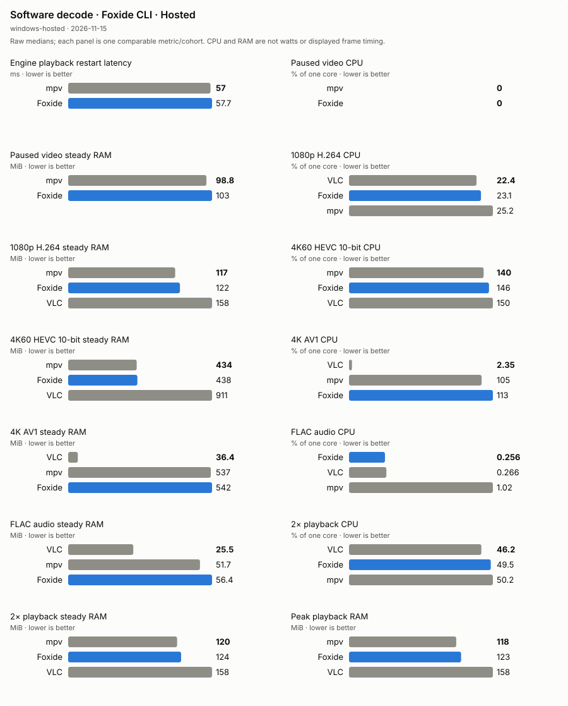
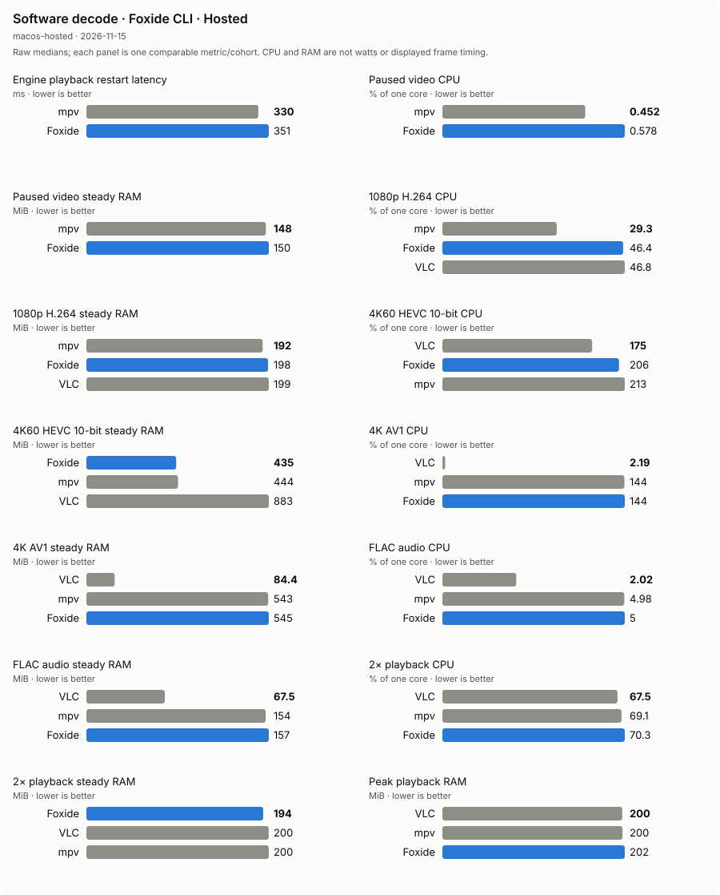
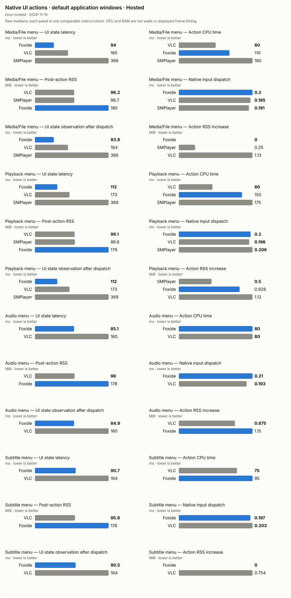
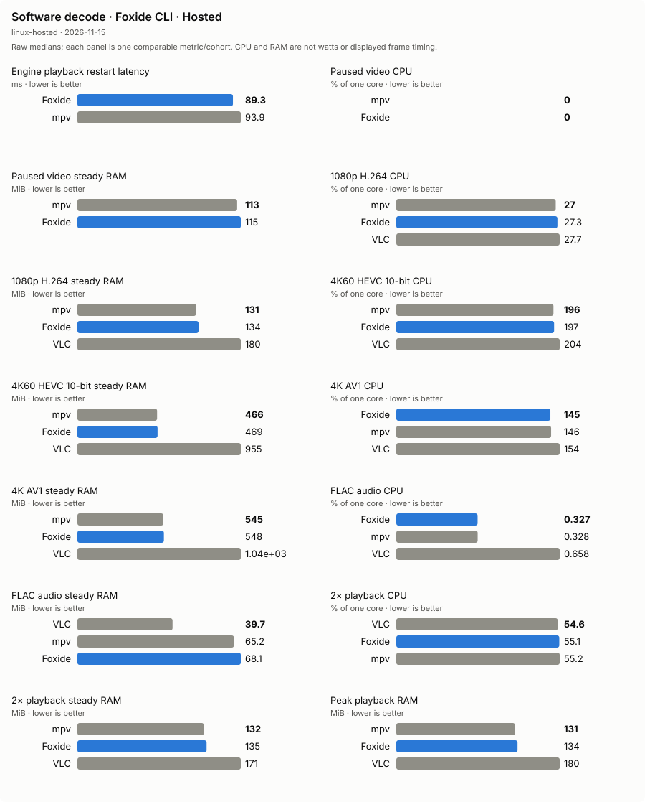

## Benchmark

### Latest results

Every metric is a separate medal event within one platform, host, fixture and settings cohort. Performance requires ≥3 verified repeats and ≥2 comparable entrants. Documented feature support earns shared gold; unknown does not mean unsupported.

Overall feature gold counts each feature once across applicable platforms; performance totals count every eligible field. These totals are not an overall speed ranking.

**Overall**

| Player | 🥇 | 🥈 | 🥉 | Total |
|---|---:|---:|---:|---:|
| mpv | 70 | 27 | 9 | 106 |
| VLC | 61 | 13 | 27 | 101 |
| Foxide | 52 | 44 | 21 | 117 |
| IINA | 34 | 0 | 0 | 34 |
| MPC-BE | 19 | 0 | 0 | 19 |
| SMPlayer | 17 | 3 | 6 | 26 |
| MPC-HC | 15 | 0 | 0 | 15 |
| Infuse | 14 | 0 | 0 | 14 |
| Kodi | 14 | 0 | 0 | 14 |
| PotPlayer | 14 | 0 | 0 | 14 |
| KMPlayer | 13 | 0 | 0 | 13 |
| foobar2000 | 13 | 0 | 0 | 13 |
| GOM Player | 11 | 0 | 0 | 11 |
| QuickTime Player | 6 | 0 | 0 | 6 |
| FFplay | 5 | 0 | 0 | 5 |
| Plex | 5 | 0 | 0 | 5 |
| Windows Media Player | 4 | 0 | 0 | 4 |
| Windows Media Player Legacy | 3 | 0 | 0 | 3 |

**Performance**

| Player | 🥇 | 🥈 | 🥉 | Total |
|---|---:|---:|---:|---:|
| VLC | 37 | 13 | 27 | 77 |
| mpv | 34 | 27 | 9 | 70 |
| Foxide | 29 | 44 | 21 | 94 |
| SMPlayer | 3 | 3 | 6 | 12 |
| FFplay | 0 | 0 | 0 | 0 |
| GOM Player | 0 | 0 | 0 | 0 |
| IINA | 0 | 0 | 0 | 0 |
| Infuse | 0 | 0 | 0 | 0 |
| KMPlayer | 0 | 0 | 0 | 0 |
| Kodi | 0 | 0 | 0 | 0 |
| MPC-BE | 0 | 0 | 0 | 0 |
| MPC-HC | 0 | 0 | 0 | 0 |
| Plex | 0 | 0 | 0 | 0 |
| PotPlayer | 0 | 0 | 0 | 0 |
| QuickTime Player | 0 | 0 | 0 | 0 |
| Windows Media Player | 0 | 0 | 0 | 0 |
| Windows Media Player Legacy | 0 | 0 | 0 | 0 |
| foobar2000 | 0 | 0 | 0 | 0 |

**Features**

| Player | 🥇 | 🥈 | 🥉 | Total |
|---|---:|---:|---:|---:|
| mpv | 36 | 0 | 0 | 36 |
| IINA | 34 | 0 | 0 | 34 |
| VLC | 24 | 0 | 0 | 24 |
| Foxide | 23 | 0 | 0 | 23 |
| MPC-BE | 19 | 0 | 0 | 19 |
| MPC-HC | 15 | 0 | 0 | 15 |
| Infuse | 14 | 0 | 0 | 14 |
| Kodi | 14 | 0 | 0 | 14 |
| PotPlayer | 14 | 0 | 0 | 14 |
| SMPlayer | 14 | 0 | 0 | 14 |
| KMPlayer | 13 | 0 | 0 | 13 |
| foobar2000 | 13 | 0 | 0 | 13 |
| GOM Player | 11 | 0 | 0 | 11 |
| QuickTime Player | 6 | 0 | 0 | 6 |
| FFplay | 5 | 0 | 0 | 5 |
| Plex | 5 | 0 | 0 | 5 |
| Windows Media Player | 4 | 0 | 0 | 4 |
| Windows Media Player Legacy | 3 | 0 | 0 | 3 |

[Raw scores](./medals.json) · [Feature sources](./features.json) · [Performance protocols](./performance-events.json) · [Download optional HTML](./report.html)

Windowed fields use **Foxide Desktop**; software-only fields use the **Foxide CLI** launcher. Engine playback evidence is distinct from physical frame presentation. UI-action metrics, displayed TTFF, power and battery results remain pending unless explicitly measured.

### Windows

| Player | 🥇 | 🥈 | 🥉 | Total |
|---|---:|---:|---:|---:|
| mpv | 56 | 16 | 6 | 78 |
| VLC | 39 | 3 | 13 | 55 |
| Foxide | 31 | 22 | 12 | 65 |
| MPC-BE | 19 | 0 | 0 | 19 |
| MPC-HC | 15 | 0 | 0 | 15 |
| Kodi | 14 | 0 | 0 | 14 |
| PotPlayer | 14 | 0 | 0 | 14 |
| SMPlayer | 14 | 0 | 0 | 14 |
| KMPlayer | 13 | 0 | 0 | 13 |
| foobar2000 | 13 | 0 | 0 | 13 |
| GOM Player | 11 | 0 | 0 | 11 |
| FFplay | 5 | 0 | 0 | 5 |
| Plex | 5 | 0 | 0 | 5 |
| Windows Media Player | 4 | 0 | 0 | 4 |
| Windows Media Player Legacy | 3 | 0 | 0 | 3 |

**Software decode · Foxide CLI · Hosted**

windows-hosted · Windows-2025Server-10.0.26100-SP0 · AMD64 · 4 logical CPUs · 2026-11-15T20:59:21.412831+00:00.

[Actions run](https://github.com/marksmayo/foxide/actions/runs/43760231567) · Source: `9e6be74fd4c1d920bc04f472bbddda259b55c491`. Freshness is per field; older platform results are retained with their original collection dates.

Sampling: 8s after engine readiness, 2s warmup excluded; randomized order (seed 20261115); cache state uncontrolled.

| Player | 🥇 | 🥈 | 🥉 | Total |
|---|---:|---:|---:|---:|
| mpv | 8 | 3 | 3 | 14 |
| VLC | 5 | 1 | 5 | 11 |
| Foxide | 2 | 9 | 3 | 14 |

Every measured metric — median values and podiums

| Metric | Foxide | VLC | mpv |
|---|---:|---:|---:|
| Engine playback restart latency | 57.7 ms | — | **57** ms |
| Paused video CPU | **0** % of one core | — | **0** % of one core |
| Paused video steady RAM | 103 MiB | — | **98.8** MiB |
| 1080p H.264 CPU | 23.1 % of one core | **22.4** % of one core | 25.2 % of one core |
| 1080p H.264 steady RAM | 122 MiB | 158 MiB | **117** MiB |
| 4K60 HEVC 10-bit CPU | 146 % of one core | 150 % of one core | **140** % of one core |
| 4K60 HEVC 10-bit steady RAM | 438 MiB | 911 MiB | **434** MiB |
| 4K AV1 CPU | 113 % of one core | **2.35** % of one core | 105 % of one core |
| 4K AV1 steady RAM | 542 MiB | **36.4** MiB | 537 MiB |
| FLAC audio CPU | **0.256** % of one core | 0.266 % of one core | 1.02 % of one core |
| FLAC audio steady RAM | 56.4 MiB | **25.5** MiB | 51.7 MiB |
| 2× playback CPU | 49.5 % of one core | **46.2** % of one core | 50.2 % of one core |
| 2× playback steady RAM | 124 MiB | 158 MiB | **120** MiB |
| Peak playback RAM | 123 MiB | 158 MiB | **118** MiB |

Bold values are gold medians. — means no eligible comparable result. Trial evidence and exact cohort IDs:

| Metric | Cohort | Trials per eligible entrant |
|---|---|---:|
| Engine playback restart latency | `software-null-output/avc1080/0c6635bfa070b933` | 3, 3 |
| Paused video CPU | `software-null-output/paused/5a88b91890cbbba5` | 3, 3 |
| Paused video steady RAM | `software-null-output/paused/5a88b91890cbbba5` | 3, 3 |
| 1080p H.264 CPU | `software-null-output/avc1080/0c6635bfa070b933` | 3, 3, 3 |
| 1080p H.264 steady RAM | `software-null-output/avc1080/0c6635bfa070b933` | 3, 3, 3 |
| 4K60 HEVC 10-bit CPU | `software-null-output/hevc4k/c8eff49d07534bdc` | 3, 3, 3 |
| 4K60 HEVC 10-bit steady RAM | `software-null-output/hevc4k/c8eff49d07534bdc` | 3, 3, 3 |
| 4K AV1 CPU | `software-null-output/av14k/84bf91a277d0523a` | 3, 3, 3 |
| 4K AV1 steady RAM | `software-null-output/av14k/84bf91a277d0523a` | 3, 3, 3 |
| FLAC audio CPU | `software-null-output/flac/bfb259002311284b` | 3, 3, 3 |
| FLAC audio steady RAM | `software-null-output/flac/bfb259002311284b` | 3, 3, 3 |
| 2× playback CPU | `software-null-output/speed2x/95ded4d2ad5d5ebc` | 3, 3, 3 |
| 2× playback steady RAM | `software-null-output/speed2x/95ded4d2ad5d5ebc` | 3, 3, 3 |
| Peak playback RAM | `software-null-output/avc1080/0c6635bfa070b933` | 3, 3, 3 |

**Windowed playback · Foxide Desktop · Local**

windows-local · Windows-11-10.0.26300-SP0 · 20 logical CPUs · 2026-11-15T04:01:52.019159+00:00.

Source: `372de990b8f2810a32e091b01a553a1ec5d3a76f`. Freshness is per field; older platform results are retained with their original collection dates.

Sampling: 8s after engine readiness, 2s warmup excluded; randomized order (seed 20261115); cache state uncontrolled.

Exploratory native playback at each player’s default window size and audio route; dimensions are not normalized. Hardware fallback and observer overhead differ. This field does not establish displayed FPS or battery efficiency.

| Observed decoder | Foxide | VLC | mpv |
|---|---|---|---|
| 1080p H.264 | d3d11va-copy | Not reported | d3d11va |
| 4K60 HEVC | d3d11va-copy | Not reported | d3d11va |
| 4K60 AV1 | d3d11va-copy | Not reported | d3d11va |

Engine observations, not scanout proof. The [mpv manual](https://mpv.io/manual/stable/#options-hwdec) identifies <code>d3d11va-copy</code> as copying decoded video into system RAM; this is not zero-copy.

| Player | 🥇 | 🥈 | 🥉 | Total |
|---|---:|---:|---:|---:|
| mpv | 7 | 6 | 1 | 14 |
| Foxide | 4 | 6 | 4 | 14 |
| VLC | 3 | 2 | 6 | 11 |

Every measured metric — median values and podiums

| Metric | Foxide | VLC | mpv |
|---|---:|---:|---:|
| Engine playback restart latency | 4.36e+03 ms | — | **3.16e+03** ms |
| Paused video CPU | 0.256 % of one core | — | **0** % of one core |
| Paused video steady RAM | 242 MiB | — | **229** MiB |
| 1080p H.264 CPU | **9.39** % of one core | 9.75 % of one core | 9.49 % of one core |
| 1080p H.264 steady RAM | 259 MiB | 379 MiB | **239** MiB |
| 4K60 HEVC 10-bit CPU | 101 % of one core | **11.9** % of one core | 21.4 % of one core |
| 4K60 HEVC 10-bit steady RAM | **1.17e+03** MiB | 1.56e+03 MiB | 1.2e+03 MiB |
| 4K AV1 CPU | 87.5 % of one core | **15.1** % of one core | 24.3 % of one core |
| 4K AV1 steady RAM | **801** MiB | 820 MiB | 803 MiB |
| FLAC audio CPU | 4.14 % of one core | 2.31 % of one core | **1.31** % of one core |
| FLAC audio steady RAM | 156 MiB | **65.9** MiB | 150 MiB |
| 2× playback CPU | **10.5** % of one core | 10.5 % of one core | 21.9 % of one core |
| 2× playback steady RAM | 264 MiB | 365 MiB | **242** MiB |
| Peak playback RAM | 260 MiB | 379 MiB | **245** MiB |

Bold values are gold medians. — means no eligible comparable result. Trial evidence and exact cohort IDs:

| Metric | Cohort | Trials per eligible entrant |
|---|---|---:|
| Engine playback restart latency | `native-default-window/avc1080/e5a3127a89486db7` | 3, 3 |
| Paused video CPU | `native-default-window/paused/4fe317a2a7ce449c` | 3, 3 |
| Paused video steady RAM | `native-default-window/paused/4fe317a2a7ce449c` | 3, 3 |
| 1080p H.264 CPU | `native-default-window/avc1080/e5a3127a89486db7` | 3, 3, 3 |
| 1080p H.264 steady RAM | `native-default-window/avc1080/e5a3127a89486db7` | 3, 3, 3 |
| 4K60 HEVC 10-bit CPU | `native-default-window/hevc4k/2e513aff25627cca` | 3, 3, 3 |
| 4K60 HEVC 10-bit steady RAM | `native-default-window/hevc4k/2e513aff25627cca` | 3, 3, 3 |
| 4K AV1 CPU | `native-default-window/av14k/50e9d1024fa3f2f7` | 3, 3, 3 |
| 4K AV1 steady RAM | `native-default-window/av14k/50e9d1024fa3f2f7` | 3, 3, 3 |
| FLAC audio CPU | `native-default-window/flac/3a05bf63a227e2b5` | 3, 3, 3 |
| FLAC audio steady RAM | `native-default-window/flac/3a05bf63a227e2b5` | 3, 3, 3 |
| 2× playback CPU | `native-default-window/speed2x/4c72021d4bdad5b6` | 3, 3, 3 |
| 2× playback steady RAM | `native-default-window/speed2x/4c72021d4bdad5b6` | 3, 3, 3 |
| Peak playback RAM | `native-default-window/avc1080/e5a3127a89486db7` | 3, 3, 3 |

**Software decode · Foxide CLI · Local**

windows-local · Windows-11-10.0.26300-SP0 · 20 logical CPUs · 2026-11-15T04:29:30.454755+00:00.

Source: `188f2e6b49b5d638b7f641b47d13ae0ee6906740`. Freshness is per field; older platform results are retained with their original collection dates.

Sampling: 8s after engine readiness, 2s warmup excluded; randomized order (seed 20261115); cache state uncontrolled.

| Player | 🥇 | 🥈 | 🥉 | Total |
|---|---:|---:|---:|---:|
| VLC | 7 | 0 | 2 | 9 |
| mpv | 5 | 7 | 2 | 14 |
| Foxide | 2 | 7 | 5 | 14 |

Every measured metric — median values and podiums

| Metric | Foxide | VLC | mpv |
|---|---:|---:|---:|
| Engine playback restart latency | **2.35e+03** ms | — | 2.42e+03 ms |
| Paused video CPU | 0.325 % of one core | — | **0.27** % of one core |
| Paused video steady RAM | 175 MiB | — | **170** MiB |
| 1080p H.264 CPU | 70.9 % of one core | **62.5** % of one core | 64.5 % of one core |
| 1080p H.264 steady RAM | 200 MiB | **166** MiB | 196 MiB |
| 4K60 HEVC 10-bit CPU | 216 % of one core | — | **207** % of one core |
| 4K60 HEVC 10-bit steady RAM | **835** MiB | — | 848 MiB |
| 4K AV1 CPU | 72.3 % of one core | **51** % of one core | 74.9 % of one core |
| 4K AV1 steady RAM | 643 MiB | 698 MiB | **640** MiB |
| FLAC audio CPU | 1.18 % of one core | 2.68 % of one core | **1.15** % of one core |
| FLAC audio steady RAM | 58.7 MiB | **26.2** MiB | 53.7 MiB |
| 2× playback CPU | 127 % of one core | **47** % of one core | 138 % of one core |
| 2× playback steady RAM | 205 MiB | **174** MiB | 201 MiB |
| Peak playback RAM | 201 MiB | **176** MiB | 198 MiB |

Bold values are gold medians. — means no eligible comparable result. Trial evidence and exact cohort IDs:

| Metric | Cohort | Trials per eligible entrant |
|---|---|---:|
| Engine playback restart latency | `software-null-output/avc1080/627de1d25dff605b` | 3, 3 |
| Paused video CPU | `software-null-output/paused/daf715b1bd930d72` | 3, 3 |
| Paused video steady RAM | `software-null-output/paused/daf715b1bd930d72` | 3, 3 |
| 1080p H.264 CPU | `software-null-output/avc1080/627de1d25dff605b` | 3, 3, 3 |
| 1080p H.264 steady RAM | `software-null-output/avc1080/627de1d25dff605b` | 3, 3, 3 |
| 4K60 HEVC 10-bit CPU | `software-null-output/hevc4k/bef5bd64c814bebc` | 3, 3 |
| 4K60 HEVC 10-bit steady RAM | `software-null-output/hevc4k/bef5bd64c814bebc` | 3, 3 |
| 4K AV1 CPU | `software-null-output/av14k/4c0374fd24a77a8b` | 3, 3, 3 |
| 4K AV1 steady RAM | `software-null-output/av14k/4c0374fd24a77a8b` | 3, 3, 3 |
| FLAC audio CPU | `software-null-output/flac/243ea89a8ffb1188` | 3, 3, 3 |
| FLAC audio steady RAM | `software-null-output/flac/243ea89a8ffb1188` | 3, 3, 3 |
| 2× playback CPU | `software-null-output/speed2x/f035ebb00f869495` | 3, 3, 3 |
| 2× playback steady RAM | `software-null-output/speed2x/f035ebb00f869495` | 3, 3, 3 |
| Peak playback RAM | `software-null-output/avc1080/627de1d25dff605b` | 3, 3, 3 |

Runtime outcomes and feature events

| Player | Runtime outcome | Evidence / limitation |
|---|---|---|
| Foxide | Verified playback 54/57 | sampled-playback-unverified, verified-playback |
| VLC | Verified playback 44/57 | playback-readiness-timeout, sampled-playback-unverified, verified-playback |
| mpv | Verified playback 54/57 | sampled-playback-unverified, verified-playback |
| Windows Media Player | install-blocked | Local Store package was not registered; WinGet list/install both returned 0x8A150001. Store desktop control is unavailable. Interactive Store installation is pending. |
| Windows Media Player Legacy | Unverified / diagnostic (6 cases) | early-exit, sampled-playback-unverified |
| MPC-HC | Unverified / diagnostic (6 cases) | sampled-playback-unverified |
| MPC-BE | Unverified / diagnostic (6 cases) | sampled-playback-unverified |
| PotPlayer | Unverified / diagnostic (6 cases) | sampled-playback-unverified |
| SMPlayer | Unverified / diagnostic (6 cases) | sampled-playback-unverified |
| KMPlayer | Unverified / diagnostic (3 cases) | early-exit, sampled-playback-unverified |
| GOM Player | Unverified / diagnostic (3 cases) | sampled-playback-unverified |
| FFplay | Unverified / diagnostic (6 cases) | sampled-playback-unverified |
| Kodi | Unverified / diagnostic (6 cases) | sampled-playback-unverified |
| Plex | Unverified / diagnostic (6 cases) | early-exit, sampled-playback-unverified |
| foobar2000 | Unverified / diagnostic (6 cases) | sampled-playback-unverified |

| Feature | Foxide | VLC | mpv | Windows Media Player | Windows Media Player Legacy | MPC-HC | MPC-BE | PotPlayer | SMPlayer | KMPlayer | GOM Player | FFplay | Kodi | Plex | foobar2000 |
|---|---:|---:|---:|---:|---:|---:|---:|---:|---:|---:|---:|---:|---:|---:|---:|
| MP4 and MKV playback | 🥇 | 🥇 | 🥇 | ? | ? | ? | 🥇 | 🥇 | 🥇 | 🥇 | ? | ? | ? | ? | N/A |
| FLAC audio | 🥇 | 🥇 | 🥇 | ? | ? | ? | 🥇 | 🥇 | ? | 🥇 | ? | ? | ? | ? | 🥇 |
| Hardware decoding | 🥇 | 🥇 | 🥇 | ? | ? | ? | 🥇 | 🥇 | ? | 🥇 | ? | ? | 🥇 | ? | N/A |
| Audio track selection | 🥇 | 🥇 | 🥇 | ? | ? | ? | 🥇 | ? | 🥇 | ? | 🥇 | 🥇 | 🥇 | 🥇 | N/A |
| Subtitle track selection | 🥇 | 🥇 | 🥇 | ? | ? | ? | 🥇 | 🥇 | 🥇 | ? | ? | 🥇 | 🥇 | 🥇 | N/A |
| External subtitle files | 🥇 | 🥇 | 🥇 | ? | ? | ? | 🥇 | ? | 🥇 | 🥇 | 🥇 | ? | 🥇 | ? | N/A |
| ASS/SSA subtitle rendering | 🥇 | 🥇 | 🥇 | ? | ? | 🥇 | 🥇 | 🥇 | ? | 🥇 | ? | ? | ? | ? | N/A |
| Variable playback speed | 🥇 | 🥇 | 🥇 | ? | 🥇 | 🥇 | 🥇 | 🥇 | 🥇 | ? | 🥇 | ? | ? | 🥇 | ? |
| Playlists | 🥇 | 🥇 | 🥇 | 🥇 | ? | ? | 🥇 | 🥇 | ? | 🥇 | 🥇 | ? | ? | ? | ? |
| Keyboard controls | 🥇 | 🥇 | 🥇 | 🥇 | ? | 🥇 | ? | ? | ? | ? | 🥇 | 🥇 | ? | 🥇 | 🥇 |
| Frame-accurate seeking | 🥇 | ? | 🥇 | ? | ? | ? | ? | ? | ? | ? | ? | ? | ? | ? | N/A |
| Seekbar thumbnail previews | ? | ? | ? | ? | ? | 🥇 | 🥇 | ? | ? | ? | ? | ? | ? | ? | N/A |
| HDR video playback | 🥇 | ? | 🥇 | ? | ? | 🥇 | 🥇 | 🥇 | ? | ? | ? | ? | ? | ? | N/A |
| HDR to SDR tone mapping | 🥇 | ? | 🥇 | ? | ? | ? | ? | 🥇 | ? | ? | ? | ? | ? | ? | N/A |
| Audio synchronization offset | 🥇 | 🥇 | 🥇 | ? | ? | ? | 🥇 | ? | 🥇 | ? | ? | ? | 🥇 | ? | N/A |
| Subtitle synchronization offset | 🥇 | 🥇 | 🥇 | ? | ? | ? | 🥇 | ? | 🥇 | ? | 🥇 | ? | 🥇 | ? | N/A |
| Video filters and adjustments | 🥇 | 🥇 | 🥇 | ? | ? | 🥇 | 🥇 | 🥇 | 🥇 | 🥇 | 🥇 | 🥇 | ? | ? | N/A |
| Chapter navigation | 🥇 | 🥇 | 🥇 | ? | ? | ? | 🥇 | ? | ? | ? | ? | ? | 🥇 | ? | ? |
| Native picture in picture | ? | ? | ? | ? | ? | ? | ? | ? | ? | ? | ? | ? | ? | ? | N/A |
| Network stream playback | 🥇 | 🥇 | 🥇 | ? | ? | 🥇 | 🥇 | 🥇 | ? | 🥇 | ? | ? | ? | ? | 🥇 |
| Persistent playback resume | 🥇 | ? | 🥇 | ? | ? | 🥇 | ? | ? | 🥇 | ? | ? | ? | ? | ? | ? |
| Automatic folder playback | 🥇 | ? | ? | ? | ? | 🥇 | ? | ? | ? | ? | ? | ? | ? | ? | ? |
| Borderless viewing mode | 🥇 | ? | 🥇 | ? | ? | ? | ? | ? | ? | ? | ? | ? | ? | ? | ? |
| Video screenshots | 🥇 | 🥇 | 🥇 | ? | ? | ? | 🥇 | 🥇 | ? | 🥇 | 🥇 | ? | ? | ? | N/A |
| A–B repeat | 🥇 | 🥇 | 🥇 | ? | ? | 🥇 | 🥇 | ? | ? | ? | 🥇 | ? | ? | ? | ? |
| Audio equalizer / DSP | ? | 🥇 | 🥇 | ? | ? | ? | ? | ? | ? | ? | ? | ? | ? | ? | 🥇 |
| ReplayGain | ? | 🥇 | 🥇 | ? | ? | ? | ? | 🥇 | ? | ? | ? | ? | ? | ? | 🥇 |
| Gapless audio playback | ? | ? | 🥇 | ? | ? | ? | ? | ? | ? | ? | ? | ? | ? | ? | 🥇 |
| DVD / Blu-ray structure playback | ? | 🥇 | 🥇 | ? | ? | ? | 🥇 | ? | ? | ? | 🥇 | ? | ? | ? | N/A |
| Chromecast video output | ? | 🥇 | ? | ? | ? | ? | ? | ? | 🥇 | ? | ? | ? | ? | ? | N/A |
| AirPlay video output | ? | ? | ? | ? | ? | ? | ? | ? | ? | ? | ? | ? | ? | ? | N/A |
| AirPlay audio receiver | ? | ? | ? | ? | ? | ? | ? | ? | ? | ? | ? | ? | 🥇 | ? | ? |
| Search and download subtitles | ? | ? | ? | ? | ? | 🥇 | ? | ? | 🥇 | ? | ? | ? | ? | ? | N/A |
| Video-site URL playback | ? | ? | 🥇 | ? | ? | 🥇 | ? | ? | 🥇 | 🥇 | ? | ? | ? | ? | N/A |
| User extension or scripting system | ? | ? | 🥇 | ? | ? | ? | ? | ? | ? | ? | ? | ? | 🥇 | ? | 🥇 |
| Editable keyboard bindings | ? | ? | 🥇 | ? | ? | 🥇 | ? | ? | ? | ? | ? | ? | ? | ? | 🥇 |
| Customizable UI layout or skins | ? | ? | ? | ? | ? | ? | ? | ? | 🥇 | ? | ? | ? | ? | ? | 🥇 |
| Touch or trackpad playback gestures | ? | ? | ? | ? | ? | ? | ? | ? | 🥇 | ? | ? | ? | ? | ? | ? |
| System media-control integration | ? | ? | ? | ? | ? | ? | ? | ? | ? | ? | ? | ? | ? | ? | ? |
| Compact dedicated music view | ? | ? | ? | 🥇 | ? | ? | ? | ? | ? | ? | ? | ? | ? | ? | ? |
| Dark interface theme | ? | ? | ? | ? | ? | 🥇 | ? | ? | ? | ? | ? | ? | ? | ? | ? |
| Music playback artwork view | ? | ? | ? | 🥇 | ? | ? | ? | ? | ? | ? | ? | ? | ? | ? | ? |
| Automatic movie and TV library metadata | ? | ? | ? | ? | ? | ? | ? | ? | ? | ? | ? | ? | 🥇 | ? | N/A |
| Browse SMB network media | ? | ? | ? | ? | ? | ? | ? | ? | ? | ? | ? | ? | 🥇 | ? | ? |
| Direct cloud-storage playback | ? | ? | ? | ? | ? | ? | ? | ? | ? | ? | ? | ? | ? | ? | N/A |
| Download server media for offline viewing | ? | ? | ? | ? | ? | ? | ? | ? | ? | ? | ? | ? | ? | 🥇 | ? |
| Cross-device playback progress sync | ? | ? | ? | ? | ? | ? | ? | ? | ? | ? | ? | ? | ? | ? | N/A |
| Live TV and guide frontend | ? | ? | ? | ? | ? | ? | ? | ? | ? | ? | ? | ? | 🥇 | ? | N/A |
| Schedule TV recordings from the player | ? | ? | ? | ? | ? | ? | ? | ? | ? | ? | ? | ? | 🥇 | ? | N/A |
| HTTP remote-control interface | ? | ? | ? | ? | ? | ? | ? | ? | ? | ? | ? | ? | 🥇 | ? | ? |
| Documented JSON IPC control | ? | ? | 🥇 | ? | ? | ? | ? | ? | ? | ? | ? | ? | ? | ? | ? |
| HD audio bitstream passthrough | ? | 🥇 | 🥇 | ? | ? | ? | ? | ? | ? | ? | ? | ? | ? | ? | ? |
| 360-degree panoramic video | ? | 🥇 | ? | ? | ? | ? | ? | ? | ? | 🥇 | 🥇 | ? | ? | ? | N/A |
| Stereoscopic 3D video | ? | ? | ? | ? | ? | ? | ? | ? | ? | 🥇 | ? | ? | ? | ? | N/A |
| Capture playing video to a clip | ? | ? | ? | ? | ? | ? | ? | ? | ? | 🥇 | ? | ? | ? | ? | N/A |
| Desktop screen recording | ? | 🥇 | ? | ? | ? | ? | ? | ? | ? | ? | ? | ? | ? | ? | N/A |
| Trim and rearrange video clips | ? | ? | ? | ? | ? | ? | ? | ? | ? | ? | ? | ? | ? | ? | N/A |
| Audio conversion or transcoding | ? | ? | ? | ? | ? | ? | ? | ? | ? | ? | ? | ? | ? | ? | 🥇 |
| Audio CD ripping | ? | ? | ? | ? | 🥇 | ? | ? | ? | ? | ? | ? | ? | ? | ? | 🥇 |
| Audio or data CD burning | ? | ? | ? | ? | 🥇 | ? | ? | ? | ? | ? | ? | ? | ? | ? | ? |
| Edit media tags | ? | ? | ? | ? | ? | ? | ? | ? | ? | ? | ? | ? | ? | ? | 🥇 |
| Built-in internet-radio directory | ? | ? | ? | ? | ? | ? | ? | ? | ? | ? | ? | ? | ? | ? | 🥇 |
| Video rotation and flip controls | ? | ? | 🥇 | ? | ? | 🥇 | ? | ? | ? | ? | ? | ? | ? | ? | N/A |
| ICC display color management | ? | ? | 🥇 | ? | ? | ? | ? | ? | ? | ? | ? | ? | ? | ? | N/A |
| User GPU shader pipeline | ? | ? | 🥇 | ? | ? | ? | ? | ? | ? | ? | ? | ? | ? | ? | N/A |
| Debanding control | ? | ? | 🥇 | ? | ? | ? | ? | ? | ? | ? | ? | ? | ? | ? | N/A |
| Single-frame advance | ? | ? | 🥇 | ? | ? | ? | ? | ? | ? | ? | ? | 🥇 | ? | ? | N/A |
| Playlist search and filtering | ? | ? | ? | ? | ? | ? | ? | 🥇 | ? | ? | ? | ? | ? | ? | ? |

? = undocumented/unverified. N/A = inapplicable media type.

### macOS

| Player | 🥇 | 🥈 | 🥉 | Total |
|---|---:|---:|---:|---:|
| mpv | 41 | 7 | 2 | 50 |
| IINA | 34 | 0 | 0 | 34 |
| VLC | 31 | 1 | 3 | 35 |
| Foxide | 25 | 6 | 6 | 37 |
| Infuse | 14 | 0 | 0 | 14 |
| Kodi | 14 | 0 | 0 | 14 |
| SMPlayer | 13 | 0 | 0 | 13 |
| foobar2000 | 12 | 0 | 0 | 12 |
| QuickTime Player | 6 | 0 | 0 | 6 |
| FFplay | 5 | 0 | 0 | 5 |
| Plex | 5 | 0 | 0 | 5 |

**Software decode · Foxide CLI · Hosted**

macos-hosted · macOS-15.8.2-arm64-arm-64bit · arm64 · 3 logical CPUs · 2026-11-15T20:57:45.464420+00:00.

[Actions run](https://github.com/marksmayo/foxide/actions/runs/43760231567) · Source: `9e6be74fd4c1d920bc04f472bbddda259b55c491`. Freshness is per field; older platform results are retained with their original collection dates.

Sampling: 8s after engine readiness, 2s warmup excluded; randomized order (seed 20261115); cache state uncontrolled.

| Player | 🥇 | 🥈 | 🥉 | Total |
|---|---:|---:|---:|---:|
| VLC | 7 | 1 | 3 | 11 |
| mpv | 5 | 7 | 2 | 14 |
| Foxide | 2 | 6 | 6 | 14 |

Every measured metric — median values and podiums

| Metric | Foxide | VLC | mpv |
|---|---:|---:|---:|
| Engine playback restart latency | 351 ms | — | **330** ms |
| Paused video CPU | 0.578 % of one core | — | **0.452** % of one core |
| Paused video steady RAM | 150 MiB | — | **148** MiB |
| 1080p H.264 CPU | 46.4 % of one core | 46.8 % of one core | **29.3** % of one core |
| 1080p H.264 steady RAM | 198 MiB | 199 MiB | **192** MiB |
| 4K60 HEVC 10-bit CPU | 206 % of one core | **175** % of one core | 213 % of one core |
| 4K60 HEVC 10-bit steady RAM | **435** MiB | 883 MiB | 444 MiB |
| 4K AV1 CPU | 144 % of one core | **2.19** % of one core | 144 % of one core |
| 4K AV1 steady RAM | 545 MiB | **84.4** MiB | 543 MiB |
| FLAC audio CPU | 5 % of one core | **2.02** % of one core | 4.98 % of one core |
| FLAC audio steady RAM | 157 MiB | **67.5** MiB | 154 MiB |
| 2× playback CPU | 70.3 % of one core | **67.5** % of one core | 69.1 % of one core |
| 2× playback steady RAM | **194** MiB | 200 MiB | 200 MiB |
| Peak playback RAM | 202 MiB | **200** MiB | 200 MiB |

Bold values are gold medians. — means no eligible comparable result. Trial evidence and exact cohort IDs:

| Metric | Cohort | Trials per eligible entrant |
|---|---|---:|
| Engine playback restart latency | `software-null-output/avc1080/d006882e1456cb0b` | 3, 3 |
| Paused video CPU | `software-null-output/paused/625734912c3bbced` | 3, 3 |
| Paused video steady RAM | `software-null-output/paused/625734912c3bbced` | 3, 3 |
| 1080p H.264 CPU | `software-null-output/avc1080/d006882e1456cb0b` | 3, 3, 3 |
| 1080p H.264 steady RAM | `software-null-output/avc1080/d006882e1456cb0b` | 3, 3, 3 |
| 4K60 HEVC 10-bit CPU | `software-null-output/hevc4k/4b5888404fe5d2b1` | 3, 3, 3 |
| 4K60 HEVC 10-bit steady RAM | `software-null-output/hevc4k/4b5888404fe5d2b1` | 3, 3, 3 |
| 4K AV1 CPU | `software-null-output/av14k/7d103be39463ddfd` | 3, 3, 3 |
| 4K AV1 steady RAM | `software-null-output/av14k/7d103be39463ddfd` | 3, 3, 3 |
| FLAC audio CPU | `software-null-output/flac/07c735f223b63676` | 3, 3, 3 |
| FLAC audio steady RAM | `software-null-output/flac/07c735f223b63676` | 3, 3, 3 |
| 2× playback CPU | `software-null-output/speed2x/c0bb999bae960f57` | 3, 3, 3 |
| 2× playback steady RAM | `software-null-output/speed2x/c0bb999bae960f57` | 3, 3, 3 |
| Peak playback RAM | `software-null-output/avc1080/d006882e1456cb0b` | 3, 3, 3 |

Runtime outcomes and feature events

| Player | Runtime outcome | Evidence / limitation |
|---|---|---|
| Foxide | Verified playback 18/21 | sampled-playback-unverified, verified-playback |
| VLC | Verified playback 15/21 | playback-readiness-timeout, sampled-playback-unverified, verified-playback |
| mpv | Verified playback 18/21 | sampled-playback-unverified, verified-playback |
| SMPlayer | not-detected | No native executable found; packaged-app/account/Store activation may need a dedicated adapter. |
| FFplay | Unverified / diagnostic (3 cases) | sampled-playback-unverified |
| Kodi | Unverified / diagnostic (3 cases) | early-exit |
| Plex | Unverified / diagnostic (3 cases) | sampled-playback-unverified |
| foobar2000 | Unverified / diagnostic (3 cases) | sampled-playback-unverified |
| Infuse | not-detected | No native executable found; packaged-app/account/Store activation may need a dedicated adapter. |
| IINA | Unverified / diagnostic (3 cases) | sampled-playback-unverified |
| QuickTime Player | Unverified / diagnostic (3 cases) | sampled-playback-unverified |

| Feature | Foxide | VLC | mpv | SMPlayer | FFplay | Kodi | Plex | foobar2000 | Infuse | IINA | QuickTime Player |
|---|---:|---:|---:|---:|---:|---:|---:|---:|---:|---:|---:|
| MP4 and MKV playback | 🥇 | 🥇 | 🥇 | 🥇 | ? | ? | ? | N/A | 🥇 | 🥇 | ? |
| FLAC audio | 🥇 | 🥇 | 🥇 | ? | ? | ? | ? | 🥇 | ? | 🥇 | ? |
| Hardware decoding | 🥇 | 🥇 | 🥇 | ? | ? | 🥇 | ? | N/A | 🥇 | 🥇 | ? |
| Audio track selection | 🥇 | 🥇 | 🥇 | 🥇 | 🥇 | 🥇 | 🥇 | N/A | 🥇 | 🥇 | ? |
| Subtitle track selection | 🥇 | 🥇 | 🥇 | 🥇 | 🥇 | 🥇 | 🥇 | N/A | 🥇 | 🥇 | 🥇 |
| External subtitle files | 🥇 | 🥇 | 🥇 | 🥇 | ? | 🥇 | ? | N/A | 🥇 | 🥇 | ? |
| ASS/SSA subtitle rendering | 🥇 | 🥇 | 🥇 | ? | ? | ? | ? | N/A | 🥇 | 🥇 | ? |
| Variable playback speed | 🥇 | 🥇 | 🥇 | 🥇 | ? | ? | 🥇 | ? | 🥇 | 🥇 | 🥇 |
| Playlists | 🥇 | 🥇 | 🥇 | ? | ? | ? | ? | ? | ? | 🥇 | ? |
| Keyboard controls | 🥇 | 🥇 | 🥇 | ? | 🥇 | ? | 🥇 | 🥇 | ? | 🥇 | ? |
| Frame-accurate seeking | 🥇 | ? | 🥇 | ? | ? | ? | ? | N/A | ? | 🥇 | ? |
| Seekbar thumbnail previews | ? | ? | ? | ? | ? | ? | ? | N/A | ? | 🥇 | ? |
| HDR video playback | 🥇 | ? | 🥇 | ? | ? | ? | ? | N/A | 🥇 | 🥇 | ? |
| HDR to SDR tone mapping | 🥇 | ? | 🥇 | ? | ? | ? | ? | N/A | ? | 🥇 | ? |
| Audio synchronization offset | 🥇 | 🥇 | 🥇 | 🥇 | ? | 🥇 | ? | N/A | ? | 🥇 | ? |
| Subtitle synchronization offset | 🥇 | 🥇 | 🥇 | 🥇 | ? | 🥇 | ? | N/A | ? | 🥇 | ? |
| Video filters and adjustments | 🥇 | 🥇 | 🥇 | 🥇 | 🥇 | ? | ? | N/A | ? | 🥇 | ? |
| Chapter navigation | 🥇 | 🥇 | 🥇 | ? | ? | 🥇 | ? | ? | 🥇 | 🥇 | ? |
| Native picture in picture | ? | ? | ? | ? | ? | ? | ? | N/A | 🥇 | 🥇 | 🥇 |
| Network stream playback | 🥇 | 🥇 | 🥇 | ? | ? | ? | ? | 🥇 | ? | 🥇 | ? |
| Persistent playback resume | 🥇 | ? | 🥇 | 🥇 | ? | ? | ? | ? | ? | 🥇 | ? |
| Automatic folder playback | 🥇 | ? | ? | ? | ? | ? | ? | ? | 🥇 | 🥇 | ? |
| Borderless viewing mode | 🥇 | ? | 🥇 | ? | ? | ? | ? | ? | ? | ? | ? |
| Video screenshots | 🥇 | 🥇 | 🥇 | ? | ? | ? | ? | N/A | ? | 🥇 | ? |
| A–B repeat | 🥇 | 🥇 | 🥇 | ? | ? | ? | ? | ? | ? | 🥇 | ? |
| Audio equalizer / DSP | ? | 🥇 | 🥇 | ? | ? | ? | ? | 🥇 | ? | 🥇 | ? |
| ReplayGain | ? | 🥇 | 🥇 | ? | ? | ? | ? | 🥇 | ? | 🥇 | ? |
| Gapless audio playback | ? | ? | 🥇 | ? | ? | ? | ? | 🥇 | ? | 🥇 | ? |
| DVD / Blu-ray structure playback | ? | 🥇 | 🥇 | ? | ? | ? | ? | N/A | ? | ? | ? |
| Chromecast video output | ? | 🥇 | ? | 🥇 | ? | ? | ? | N/A | ? | ? | ? |
| AirPlay video output | ? | ? | ? | ? | ? | ? | ? | N/A | ? | ? | 🥇 |
| AirPlay audio receiver | ? | ? | ? | ? | ? | 🥇 | ? | ? | ? | ? | ? |
| Search and download subtitles | ? | ? | ? | 🥇 | ? | ? | ? | N/A | ? | 🥇 | ? |
| Video-site URL playback | ? | ? | 🥇 | 🥇 | ? | ? | ? | N/A | ? | ? | ? |
| User extension or scripting system | ? | ? | 🥇 | ? | ? | 🥇 | ? | 🥇 | ? | 🥇 | ? |
| Editable keyboard bindings | ? | ? | 🥇 | ? | ? | ? | ? | 🥇 | ? | ? | ? |
| Customizable UI layout or skins | ? | ? | ? | 🥇 | ? | ? | ? | 🥇 | ? | 🥇 | ? |
| Touch or trackpad playback gestures | ? | ? | ? | ? | ? | ? | ? | ? | ? | 🥇 | ? |
| System media-control integration | ? | ? | ? | ? | ? | ? | ? | ? | ? | 🥇 | ? |
| Compact dedicated music view | ? | ? | ? | ? | ? | ? | ? | ? | ? | 🥇 | ? |
| Dark interface theme | ? | ? | ? | ? | ? | ? | ? | ? | ? | 🥇 | ? |
| Music playback artwork view | ? | ? | ? | ? | ? | ? | ? | ? | ? | ? | ? |
| Automatic movie and TV library metadata | ? | ? | ? | ? | ? | 🥇 | ? | N/A | 🥇 | ? | ? |
| Browse SMB network media | ? | ? | ? | ? | ? | 🥇 | ? | ? | ? | ? | ? |
| Direct cloud-storage playback | ? | ? | ? | ? | ? | ? | ? | N/A | 🥇 | ? | ? |
| Download server media for offline viewing | ? | ? | ? | ? | ? | ? | 🥇 | ? | ? | ? | ? |
| Cross-device playback progress sync | ? | ? | ? | ? | ? | ? | ? | N/A | 🥇 | ? | ? |
| Live TV and guide frontend | ? | ? | ? | ? | ? | 🥇 | ? | N/A | ? | ? | ? |
| Schedule TV recordings from the player | ? | ? | ? | ? | ? | 🥇 | ? | N/A | ? | ? | ? |
| HTTP remote-control interface | ? | ? | ? | ? | ? | 🥇 | ? | ? | ? | ? | ? |
| Documented JSON IPC control | ? | ? | 🥇 | ? | ? | ? | ? | ? | ? | ? | ? |
| HD audio bitstream passthrough | ? | 🥇 | 🥇 | ? | ? | ? | ? | ? | ? | ? | ? |
| 360-degree panoramic video | ? | 🥇 | ? | ? | ? | ? | ? | N/A | ? | ? | ? |
| Stereoscopic 3D video | ? | ? | ? | ? | ? | ? | ? | N/A | ? | ? | ? |
| Capture playing video to a clip | ? | ? | ? | ? | ? | ? | ? | N/A | ? | ? | ? |
| Desktop screen recording | ? | 🥇 | ? | ? | ? | ? | ? | N/A | ? | ? | ? |
| Trim and rearrange video clips | ? | ? | ? | ? | ? | ? | ? | N/A | ? | ? | 🥇 |
| Audio conversion or transcoding | ? | ? | ? | ? | ? | ? | ? | 🥇 | ? | ? | ? |
| Audio CD ripping | ? | ? | ? | ? | ? | ? | ? | ? | ? | ? | ? |
| Audio or data CD burning | ? | ? | ? | ? | ? | ? | ? | ? | ? | ? | ? |
| Edit media tags | ? | ? | ? | ? | ? | ? | ? | 🥇 | ? | ? | ? |
| Built-in internet-radio directory | ? | ? | ? | ? | ? | ? | ? | 🥇 | ? | ? | ? |
| Video rotation and flip controls | ? | ? | 🥇 | ? | ? | ? | ? | N/A | ? | ? | 🥇 |
| ICC display color management | ? | ? | 🥇 | ? | ? | ? | ? | N/A | ? | ? | ? |
| User GPU shader pipeline | ? | ? | 🥇 | ? | ? | ? | ? | N/A | ? | ? | ? |
| Debanding control | ? | ? | 🥇 | ? | ? | ? | ? | N/A | ? | ? | ? |
| Single-frame advance | ? | ? | 🥇 | ? | 🥇 | ? | ? | N/A | ? | ? | ? |
| Playlist search and filtering | ? | ? | ? | ? | ? | ? | ? | ? | ? | ? | ? |

? = undocumented/unverified. N/A = inapplicable media type.

### Linux

| Player | 🥇 | 🥈 | 🥉 | Total |
|---|---:|---:|---:|---:|
| mpv | 45 | 4 | 1 | 50 |
| Foxide | 42 | 16 | 3 | 61 |
| VLC | 39 | 9 | 11 | 59 |
| SMPlayer | 16 | 3 | 6 | 25 |
| Kodi | 14 | 0 | 0 | 14 |
| FFplay | 5 | 0 | 0 | 5 |
| Plex | 5 | 0 | 0 | 5 |

**Native UI actions · default application windows · Hosted**

linux-hosted · 2026-11-15T20:58:23.591989+00:00.

[Actions run](https://github.com/marksmayo/foxide/actions/runs/43760231567) · Source: `9e6be74fd4c1d920bc04f472bbddda259b55c491`. Freshness is per field; older platform results are retained with their original collection dates.

| Player | 🥇 | 🥈 | 🥉 | Total |
|---|---:|---:|---:|---:|
| Foxide | 15 | 7 | 2 | 24 |
| VLC | 13 | 9 | 2 | 24 |
| SMPlayer | 3 | 3 | 6 | 12 |

Every measured metric — median values and podiums

| Metric | Foxide | VLC | SMPlayer |
|---|---:|---:|---:|
| Media/File menu — UI state latency | **94** ms | 165 ms | 366 ms |
| Media/File menu — Action CPU time | 110 ms | **80** ms | 160 ms |
| Media/File menu — Post-action RSS | 180 MiB | **96.2** MiB | 96.7 MiB |
| Media/File menu — Native input dispatch | **0.2** ms | **0.195** ms | **0.191** ms |
| Media/File menu — UI state observation after dispatch | **93.9** ms | 164 ms | 366 ms |
| Media/File menu — Action RSS increase | **0** MiB | 1.13 MiB | 0.25 MiB |
| Playback menu — UI state latency | **112** ms | 173 ms | 369 ms |
| Playback menu — Action CPU time | 150 ms | **80** ms | 175 ms |
| Playback menu — Post-action RSS | 179 MiB | **96.1** MiB | 96.8 MiB |
| Playback menu — Native input dispatch | **0.2** ms | **0.196** ms | **0.206** ms |
| Playback menu — UI state observation after dispatch | **112** ms | 173 ms | 369 ms |
| Playback menu — Action RSS increase | 0.928 MiB | 1.12 MiB | **0.5** MiB |
| Audio menu — UI state latency | **85.1** ms | 160 ms | — |
| Audio menu — Action CPU time | **80** ms | **80** ms | — |
| Audio menu — Post-action RSS | 178 MiB | **96** MiB | — |
| Audio menu — Native input dispatch | **0.21** ms | **0.193** ms | — |
| Audio menu — UI state observation after dispatch | **84.9** ms | 160 ms | — |
| Audio menu — Action RSS increase | 1.15 MiB | **0.875** MiB | — |
| Subtitle menu — UI state latency | **90.7** ms | 164 ms | — |
| Subtitle menu — Action CPU time | 95 ms | **75** ms | — |
| Subtitle menu — Post-action RSS | 176 MiB | **95.9** MiB | — |
| Subtitle menu — Native input dispatch | **0.197** ms | **0.203** ms | — |
| Subtitle menu — UI state observation after dispatch | **90.5** ms | 164 ms | — |
| Subtitle menu — Action RSS increase | **0** MiB | 0.754 MiB | — |

Bold values are gold medians. — means no eligible comparable result. Trial evidence and exact cohort IDs:

| Metric | Cohort | Trials per eligible entrant |
|---|---|---:|
| Media/File menu — UI state latency | `native-ui/menu_media/b90b95b9a0670c23` | 10, 10, 10 |
| Media/File menu — Action CPU time | `native-ui/menu_media/b90b95b9a0670c23` | 10, 10, 10 |
| Media/File menu — Post-action RSS | `native-ui/menu_media/b90b95b9a0670c23` | 10, 10, 10 |
| Media/File menu — Native input dispatch | `native-ui/menu_media/b90b95b9a0670c23` | 10, 10, 10 |
| Media/File menu — UI state observation after dispatch | `native-ui/menu_media/b90b95b9a0670c23` | 10, 10, 10 |
| Media/File menu — Action RSS increase | `native-ui/menu_media/b90b95b9a0670c23` | 10, 10, 10 |
| Playback menu — UI state latency | `native-ui/menu_playback/7c51e014db9d2527` | 10, 10, 10 |
| Playback menu — Action CPU time | `native-ui/menu_playback/7c51e014db9d2527` | 10, 10, 10 |
| Playback menu — Post-action RSS | `native-ui/menu_playback/7c51e014db9d2527` | 10, 10, 10 |
| Playback menu — Native input dispatch | `native-ui/menu_playback/7c51e014db9d2527` | 10, 10, 10 |
| Playback menu — UI state observation after dispatch | `native-ui/menu_playback/7c51e014db9d2527` | 10, 10, 10 |
| Playback menu — Action RSS increase | `native-ui/menu_playback/7c51e014db9d2527` | 10, 10, 10 |
| Audio menu — UI state latency | `native-ui/menu_audio/02ba759f8d41ba50` | 10, 10 |
| Audio menu — Action CPU time | `native-ui/menu_audio/02ba759f8d41ba50` | 10, 10 |
| Audio menu — Post-action RSS | `native-ui/menu_audio/02ba759f8d41ba50` | 10, 10 |
| Audio menu — Native input dispatch | `native-ui/menu_audio/02ba759f8d41ba50` | 10, 10 |
| Audio menu — UI state observation after dispatch | `native-ui/menu_audio/02ba759f8d41ba50` | 10, 10 |
| Audio menu — Action RSS increase | `native-ui/menu_audio/02ba759f8d41ba50` | 10, 10 |
| Subtitle menu — UI state latency | `native-ui/menu_subtitles/d664755f87d1e4fd` | 10, 10 |
| Subtitle menu — Action CPU time | `native-ui/menu_subtitles/d664755f87d1e4fd` | 10, 10 |
| Subtitle menu — Post-action RSS | `native-ui/menu_subtitles/d664755f87d1e4fd` | 10, 10 |
| Subtitle menu — Native input dispatch | `native-ui/menu_subtitles/d664755f87d1e4fd` | 10, 10 |
| Subtitle menu — UI state observation after dispatch | `native-ui/menu_subtitles/d664755f87d1e4fd` | 10, 10 |
| Subtitle menu — Action RSS increase | `native-ui/menu_subtitles/d664755f87d1e4fd` | 10, 10 |

**Software decode · Foxide CLI · Hosted**

linux-hosted · Linux-7.0.0-1014-aws-x86_64-with-glibc2.39 · x86_64 · 4 logical CPUs · 2026-11-15T20:56:11.339535+00:00.

[Actions run](https://github.com/marksmayo/foxide/actions/runs/43760231567) · Source: `9e6be74fd4c1d920bc04f472bbddda259b55c491`. Freshness is per field; older platform results are retained with their original collection dates.

Sampling: 8s after engine readiness, 2s warmup excluded; randomized order (seed 20261115); cache state uncontrolled.

| Player | 🥇 | 🥈 | 🥉 | Total |
|---|---:|---:|---:|---:|
| mpv | 9 | 4 | 1 | 14 |
| Foxide | 4 | 9 | 1 | 14 |
| VLC | 2 | 0 | 9 | 11 |

Every measured metric — median values and podiums

| Metric | Foxide | VLC | mpv |
|---|---:|---:|---:|
| Engine playback restart latency | **89.3** ms | — | 93.9 ms |
| Paused video CPU | **0** % of one core | — | **0** % of one core |
| Paused video steady RAM | 115 MiB | — | **113** MiB |
| 1080p H.264 CPU | 27.3 % of one core | 27.7 % of one core | **27** % of one core |
| 1080p H.264 steady RAM | 134 MiB | 180 MiB | **131** MiB |
| 4K60 HEVC 10-bit CPU | 197 % of one core | 204 % of one core | **196** % of one core |
| 4K60 HEVC 10-bit steady RAM | 469 MiB | 955 MiB | **466** MiB |
| 4K AV1 CPU | **145** % of one core | 154 % of one core | 146 % of one core |
| 4K AV1 steady RAM | 548 MiB | 1.04e+03 MiB | **545** MiB |
| FLAC audio CPU | **0.327** % of one core | 0.658 % of one core | 0.328 % of one core |
| FLAC audio steady RAM | 68.1 MiB | **39.7** MiB | 65.2 MiB |
| 2× playback CPU | 55.1 % of one core | **54.6** % of one core | 55.2 % of one core |
| 2× playback steady RAM | 135 MiB | 171 MiB | **132** MiB |
| Peak playback RAM | 134 MiB | 180 MiB | **131** MiB |

Bold values are gold medians. — means no eligible comparable result. Trial evidence and exact cohort IDs:

| Metric | Cohort | Trials per eligible entrant |
|---|---|---:|
| Engine playback restart latency | `software-null-output/avc1080/1cb10445e3eced0c` | 3, 3 |
| Paused video CPU | `software-null-output/paused/97ffec6dbe14b97e` | 3, 3 |
| Paused video steady RAM | `software-null-output/paused/97ffec6dbe14b97e` | 3, 3 |
| 1080p H.264 CPU | `software-null-output/avc1080/1cb10445e3eced0c` | 3, 3, 3 |
| 1080p H.264 steady RAM | `software-null-output/avc1080/1cb10445e3eced0c` | 3, 3, 3 |
| 4K60 HEVC 10-bit CPU | `software-null-output/hevc4k/093be878c04d193b` | 3, 3, 3 |
| 4K60 HEVC 10-bit steady RAM | `software-null-output/hevc4k/093be878c04d193b` | 3, 3, 3 |
| 4K AV1 CPU | `software-null-output/av14k/5517565b6015658a` | 3, 3, 3 |
| 4K AV1 steady RAM | `software-null-output/av14k/5517565b6015658a` | 3, 3, 3 |
| FLAC audio CPU | `software-null-output/flac/545225004d70ce33` | 3, 3, 3 |
| FLAC audio steady RAM | `software-null-output/flac/545225004d70ce33` | 3, 3, 3 |
| 2× playback CPU | `software-null-output/speed2x/5fdd798c2c1915ed` | 3, 3, 3 |
| 2× playback steady RAM | `software-null-output/speed2x/5fdd798c2c1915ed` | 3, 3, 3 |
| Peak playback RAM | `software-null-output/avc1080/1cb10445e3eced0c` | 3, 3, 3 |

Runtime outcomes and feature events

| Player | Runtime outcome | Evidence / limitation |
|---|---|---|
| Foxide | Verified playback 18/21; Verified UI actions 40/41 | adapter-required, sampled-playback-unverified, verified, verified-playback |
| VLC | Verified playback 15/21; Verified UI actions 40/41 | adapter-required, playback-readiness-timeout, sampled-playback-unverified, verified, verified-playback |
| mpv | Verified playback 18/21 | sampled-playback-unverified, verified-playback |
| SMPlayer | Unverified / diagnostic (3 cases); Verified UI actions 20/23 | adapter-required, sampled-playback-unverified, verified |
| FFplay | Unverified / diagnostic (3 cases) | sampled-playback-unverified |
| Kodi | Unverified / diagnostic (3 cases) | early-exit |
| Plex | not-detected | No native executable found; packaged-app/account/Store activation may need a dedicated adapter. |

| Feature | Foxide | VLC | mpv | SMPlayer | FFplay | Kodi | Plex |
|---|---:|---:|---:|---:|---:|---:|---:|
| MP4 and MKV playback | 🥇 | 🥇 | 🥇 | 🥇 | ? | ? | ? |
| FLAC audio | 🥇 | 🥇 | 🥇 | ? | ? | ? | ? |
| Hardware decoding | 🥇 | 🥇 | 🥇 | ? | ? | 🥇 | ? |
| Audio track selection | 🥇 | 🥇 | 🥇 | 🥇 | 🥇 | 🥇 | 🥇 |
| Subtitle track selection | 🥇 | 🥇 | 🥇 | 🥇 | 🥇 | 🥇 | 🥇 |
| External subtitle files | 🥇 | 🥇 | 🥇 | 🥇 | ? | 🥇 | ? |
| ASS/SSA subtitle rendering | 🥇 | 🥇 | 🥇 | ? | ? | ? | ? |
| Variable playback speed | 🥇 | 🥇 | 🥇 | 🥇 | ? | ? | 🥇 |
| Playlists | 🥇 | 🥇 | 🥇 | ? | ? | ? | ? |
| Keyboard controls | 🥇 | 🥇 | 🥇 | ? | 🥇 | ? | 🥇 |
| Frame-accurate seeking | 🥇 | ? | 🥇 | ? | ? | ? | ? |
| Seekbar thumbnail previews | ? | ? | ? | ? | ? | ? | ? |
| HDR video playback | 🥇 | ? | 🥇 | ? | ? | ? | ? |
| HDR to SDR tone mapping | 🥇 | ? | 🥇 | ? | ? | ? | ? |
| Audio synchronization offset | 🥇 | 🥇 | 🥇 | 🥇 | ? | 🥇 | ? |
| Subtitle synchronization offset | 🥇 | 🥇 | 🥇 | 🥇 | ? | 🥇 | ? |
| Video filters and adjustments | 🥇 | 🥇 | 🥇 | 🥇 | 🥇 | ? | ? |
| Chapter navigation | 🥇 | 🥇 | 🥇 | ? | ? | 🥇 | ? |
| Native picture in picture | ? | ? | ? | ? | ? | ? | ? |
| Network stream playback | 🥇 | 🥇 | 🥇 | ? | ? | ? | ? |
| Persistent playback resume | 🥇 | ? | 🥇 | 🥇 | ? | ? | ? |
| Automatic folder playback | 🥇 | ? | ? | ? | ? | ? | ? |
| Borderless viewing mode | 🥇 | ? | 🥇 | ? | ? | ? | ? |
| Video screenshots | 🥇 | 🥇 | 🥇 | ? | ? | ? | ? |
| A–B repeat | 🥇 | 🥇 | 🥇 | ? | ? | ? | ? |
| Audio equalizer / DSP | ? | 🥇 | 🥇 | ? | ? | ? | ? |
| ReplayGain | ? | 🥇 | 🥇 | ? | ? | ? | ? |
| Gapless audio playback | ? | ? | 🥇 | ? | ? | ? | ? |
| DVD / Blu-ray structure playback | ? | 🥇 | 🥇 | ? | ? | ? | ? |
| Chromecast video output | ? | 🥇 | ? | 🥇 | ? | ? | ? |
| AirPlay video output | ? | ? | ? | ? | ? | ? | ? |
| AirPlay audio receiver | ? | ? | ? | ? | ? | 🥇 | ? |
| Search and download subtitles | ? | ? | ? | 🥇 | ? | ? | ? |
| Video-site URL playback | ? | ? | 🥇 | 🥇 | ? | ? | ? |
| User extension or scripting system | ? | ? | 🥇 | ? | ? | 🥇 | ? |
| Editable keyboard bindings | ? | ? | 🥇 | ? | ? | ? | ? |
| Customizable UI layout or skins | ? | ? | ? | 🥇 | ? | ? | ? |
| Touch or trackpad playback gestures | ? | ? | ? | ? | ? | ? | ? |
| System media-control integration | ? | ? | ? | ? | ? | ? | ? |
| Compact dedicated music view | ? | ? | ? | ? | ? | ? | ? |
| Dark interface theme | ? | ? | ? | ? | ? | ? | ? |
| Music playback artwork view | ? | ? | ? | ? | ? | ? | ? |
| Automatic movie and TV library metadata | ? | ? | ? | ? | ? | 🥇 | ? |
| Browse SMB network media | ? | ? | ? | ? | ? | 🥇 | ? |
| Direct cloud-storage playback | ? | ? | ? | ? | ? | ? | ? |
| Download server media for offline viewing | ? | ? | ? | ? | ? | ? | 🥇 |
| Cross-device playback progress sync | ? | ? | ? | ? | ? | ? | ? |
| Live TV and guide frontend | ? | ? | ? | ? | ? | 🥇 | ? |
| Schedule TV recordings from the player | ? | ? | ? | ? | ? | 🥇 | ? |
| HTTP remote-control interface | ? | ? | ? | ? | ? | 🥇 | ? |
| Documented JSON IPC control | ? | ? | 🥇 | ? | ? | ? | ? |
| HD audio bitstream passthrough | ? | 🥇 | 🥇 | ? | ? | ? | ? |
| 360-degree panoramic video | ? | 🥇 | ? | ? | ? | ? | ? |
| Stereoscopic 3D video | ? | ? | ? | ? | ? | ? | ? |
| Capture playing video to a clip | ? | ? | ? | ? | ? | ? | ? |
| Desktop screen recording | ? | 🥇 | ? | ? | ? | ? | ? |
| Trim and rearrange video clips | ? | ? | ? | ? | ? | ? | ? |
| Audio conversion or transcoding | ? | ? | ? | ? | ? | ? | ? |
| Audio CD ripping | ? | ? | ? | ? | ? | ? | ? |
| Audio or data CD burning | ? | ? | ? | ? | ? | ? | ? |
| Edit media tags | ? | ? | ? | ? | ? | ? | ? |
| Built-in internet-radio directory | ? | ? | ? | ? | ? | ? | ? |
| Video rotation and flip controls | ? | ? | 🥇 | ? | ? | ? | ? |
| ICC display color management | ? | ? | 🥇 | ? | ? | ? | ? |
| User GPU shader pipeline | ? | ? | 🥇 | ? | ? | ? | ? |
| Debanding control | ? | ? | 🥇 | ? | ? | ? | ? |
| Single-frame advance | ? | ? | 🥇 | ? | 🥇 | ? | ? |
| Playlist search and filtering | ? | ? | ? | ? | ? | ? | ? |

? = undocumented/unverified. N/A = inapplicable media type.

