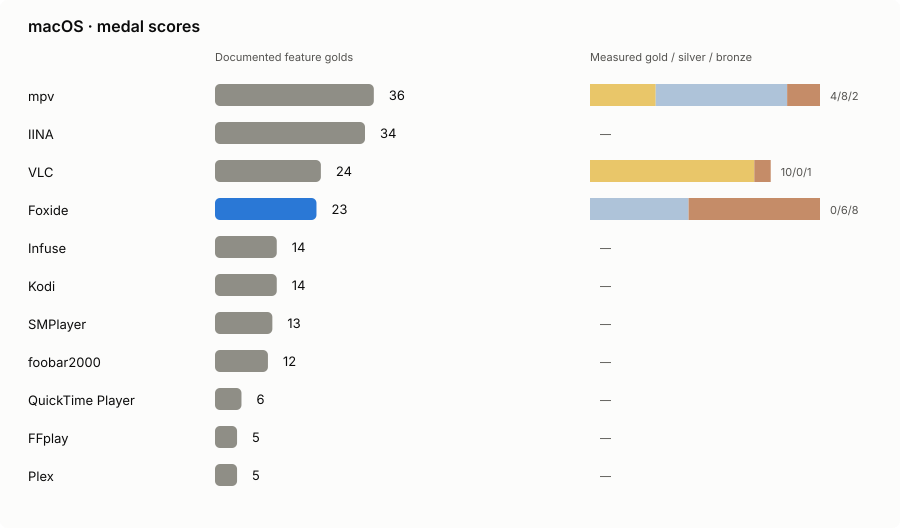
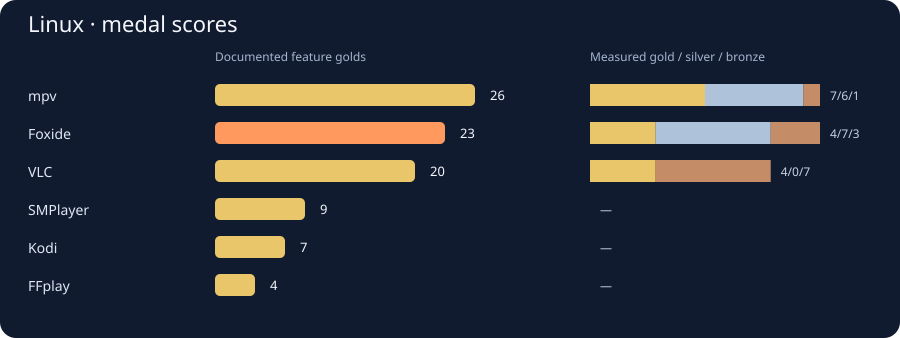

## Player medal scoreboards

Feature support earns **shared gold** for every documented supporter. Unknown is unverified, not unsupported. Counts reflect the documentation reviewed and do not establish an overall best player. Performance medals require at least three verified, comparable repeats on the same platform, host, fixture, scenario, and settings.

[Interactive HTML report](./report.html) · [Raw scores](./medals.json) · [Feature sources](./features.json) · [45 performance protocols](./performance-events.json)

### Windows

| Player | Feature 🥇 | Performance 🥇 | 🥈 | 🥉 | Runtime outcome |
|---|---:|---:|---:|---:|---|
| Foxide | 23 | 1 | 11 | 2 | Verified playback 18/21 |
| VLC | 20 | 4 | 0 | 7 | Verified playback 15/21 |
| mpv | 26 | 10 | 2 | 2 | Verified playback 18/21 |
| Windows Media Player | 2 | 0 | 0 | 0 | installed-adapter-needed |
| Windows Media Player Legacy | 1 | 0 | 0 | 0 | Unverified / diagnostic (3 cases) |
| MPC-HC | 10 | 0 | 0 | 0 | Unverified / diagnostic (3 cases) |
| MPC-BE | 19 | 0 | 0 | 0 | Unverified / diagnostic (3 cases) |
| PotPlayer | 13 | 0 | 0 | 0 | Unverified / diagnostic (3 cases) |
| SMPlayer | 9 | 0 | 0 | 0 | Unverified / diagnostic (3 cases) |
| KMPlayer | 9 | 0 | 0 | 0 | not-detected |
| GOM Player | 10 | 0 | 0 | 0 | installed-adapter-needed |
| FFplay | 4 | 0 | 0 | 0 | Unverified / diagnostic (3 cases) |
| Kodi | 7 | 0 | 0 | 0 | Unverified / diagnostic (3 cases) |
| Plex | 4 | 0 | 0 | 0 | Unverified / diagnostic (3 cases) |
| foobar2000 | 6 | 0 | 0 | 0 | Unverified / diagnostic (3 cases) |

Measured competitive event cohorts: **14**. Zero performance medals may mean measurements are pending. VM decode results never establish displayed TTFF, GPU efficiency, or battery performance.

### macOS

| Player | Feature 🥇 | Performance 🥇 | 🥈 | 🥉 | Runtime outcome |
|---|---:|---:|---:|---:|---|
| Foxide | 23 | 2 | 6 | 6 | Verified playback 18/21 |
| VLC | 20 | 9 | 1 | 1 | Verified playback 15/21 |
| mpv | 26 | 3 | 7 | 4 | Verified playback 18/21 |
| SMPlayer | 9 | 0 | 0 | 0 | not-detected |
| FFplay | 4 | 0 | 0 | 0 | Unverified / diagnostic (3 cases) |
| Kodi | 7 | 0 | 0 | 0 | Unverified / diagnostic (3 cases) |
| Plex | 4 | 0 | 0 | 0 | Unverified / diagnostic (3 cases) |
| foobar2000 | 6 | 0 | 0 | 0 | Unverified / diagnostic (3 cases) |
| Infuse | 12 | 0 | 0 | 0 | not-detected |
| IINA | 27 | 0 | 0 | 0 | Unverified / diagnostic (3 cases) |
| QuickTime Player | 4 | 0 | 0 | 0 | Unverified / diagnostic (3 cases) |

Measured competitive event cohorts: **14**. Zero performance medals may mean measurements are pending. VM decode results never establish displayed TTFF, GPU efficiency, or battery performance.

### Linux

| Player | Feature 🥇 | Performance 🥇 | 🥈 | 🥉 | Runtime outcome |
|---|---:|---:|---:|---:|---|
| Foxide | 23 | 2 | 11 | 1 | Verified playback 18/21 |
| VLC | 20 | 1 | 0 | 10 | Verified playback 15/21 |
| mpv | 26 | 12 | 2 | 0 | Verified playback 18/21 |
| SMPlayer | 9 | 0 | 0 | 0 | Unverified / diagnostic (3 cases) |
| FFplay | 4 | 0 | 0 | 0 | Unverified / diagnostic (3 cases) |
| Kodi | 7 | 0 | 0 | 0 | Unverified / diagnostic (3 cases) |

Measured competitive event cohorts: **14**. Zero performance medals may mean measurements are pending. VM decode results never establish displayed TTFF, GPU efficiency, or battery performance.

